```{r}
#| echo: false
#| message: false
#| warning: false

library("ggtext")
library("palmerpenguins")
library("patchwork")
library("tidyverse")

penguins_df <- penguins |>
  na.omit()

adelie_color = "#fb7504"
chinstrap_color = "#c65ccc"
gentoo_color = "#067476"
```

# Session 11: MNIST

## Learning objectives:

:::: {.columns}

::: {.column width="45%"}
- Traverse the MNIST case study
- Introduce Keras
:::

::: {.column width="10%"}

:::

::: {.column width="45%"}
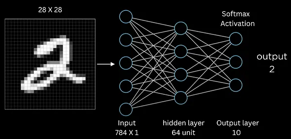

* image source: [Koushik Ahmed Kushal](https://medium.com/@koushikkushal95/mnist-hand-written-digit-classification-using-neural-network-from-scratch-54da85712a06)

:::

::::

# A Brief History

::::: {.panel-tabset}

## Dartmouth

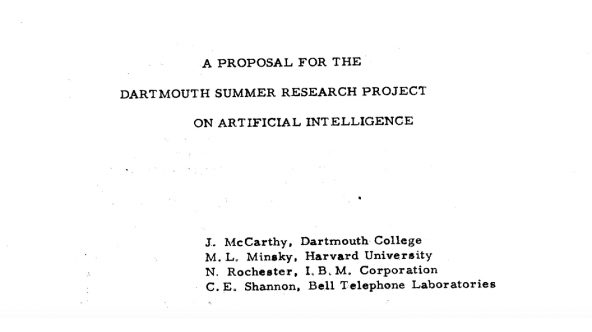

* image source: [Dartmouth](https://home.dartmouth.edu/about/artificial-intelligence-ai-coined-dartmouth)

## ELIZA


* image source: [masswerk](https://www.masswerk.at/elizabot/)

## AI Winter

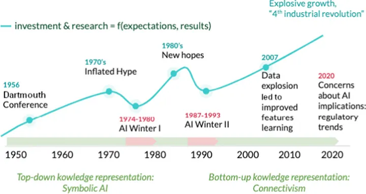

* image source: [Clive Thompson](https://clivethompson.medium.com/the-risk-of-a-new-ai-winter-332ffb4767f0)

## MNIST


* image recognition software by [Yann LeCun](https://en.wikipedia.org/wiki/Yann_LeCun)
* image source: [Koushik Ahmed Kushal](https://medium.com/@koushikkushal95/mnist-hand-written-digit-classification-using-neural-network-from-scratch-54da85712a06)

## Nobel

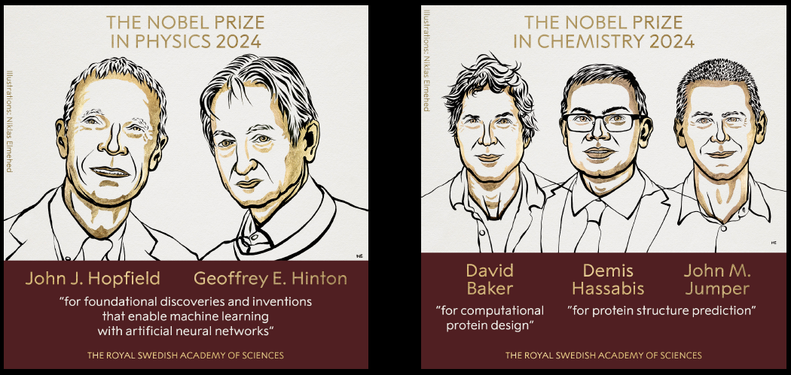

* image source: Royal Swedish Academy of Sciences

:::::

# Logistic Beginnings

::::: {.panel-tabset}

## Not Separable

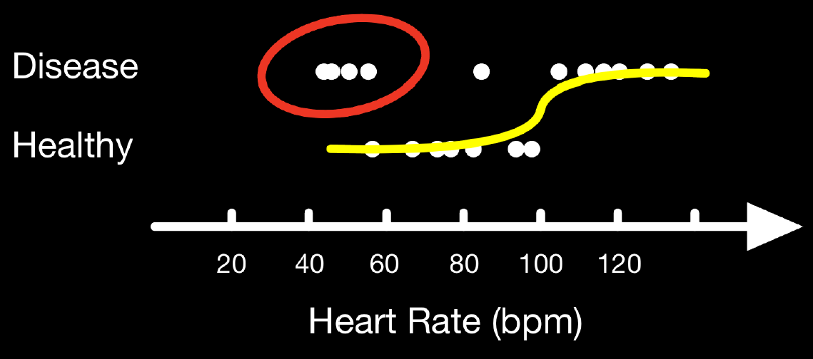

$$\sigma(x) = \frac{1}{1 + e^{-x}}$$

* image source: DataX post-doc Mufan Li

## Pieces

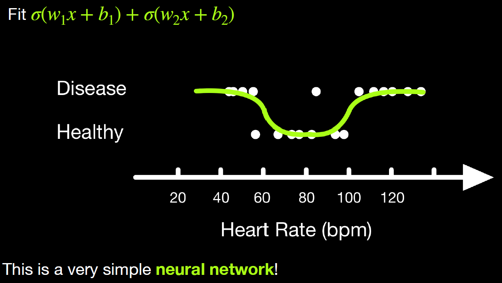
$$\sigma_{1}(w_{1}x + b_{1}) + \sigma_{2}(w_{2}x + b_{2})$$

* image source: DataX post-doc Mufan Li

## Activation

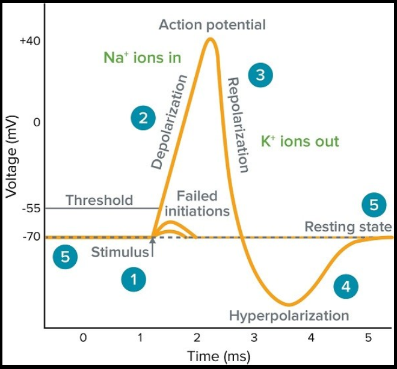

* image source: [Molecular Devices](https://www.moleculardevices.com/applications/patch-clamp-electrophysiology/what-action-potential)

## Neuron

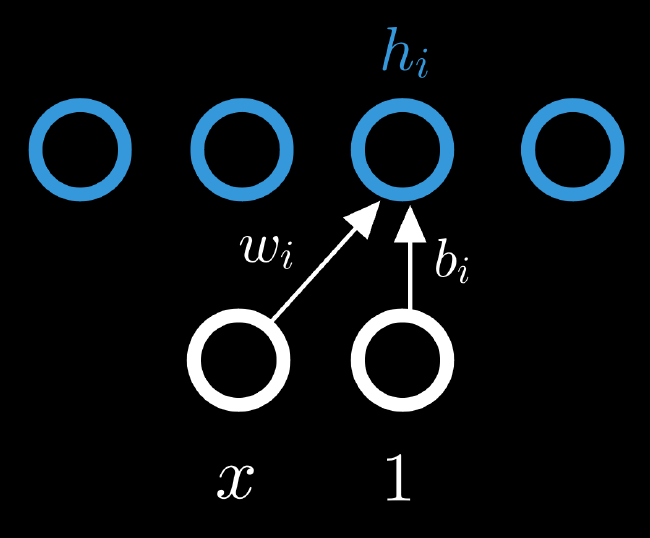

$$h_{i} = \sigma(w_{i}x + b_{i})$$

* image source: DataX post-doc Mufan Li

## Perceptron

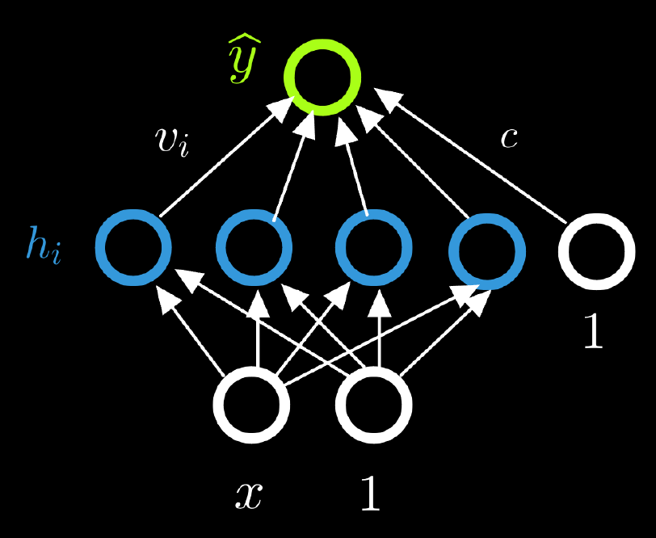

$$\hat{y} = \sigma\left(\sum_{i=1}^{n} v_{i}h_{i} + c\right)$$

* image source: DataX post-doc Mufan Li

## MLP

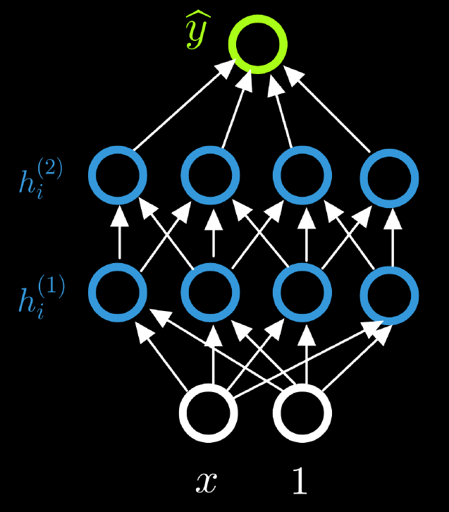

$$h_{i}^{(2)} = \sigma\left(\sum_{j=1}^{n} W_{ij}^{(1)}h_{j}^{(1)}\right)$$

* image source: DataX post-doc Mufan Li

:::::

::: {.callout-warning}
## DCP1
:::


# MNIST

## Pixels

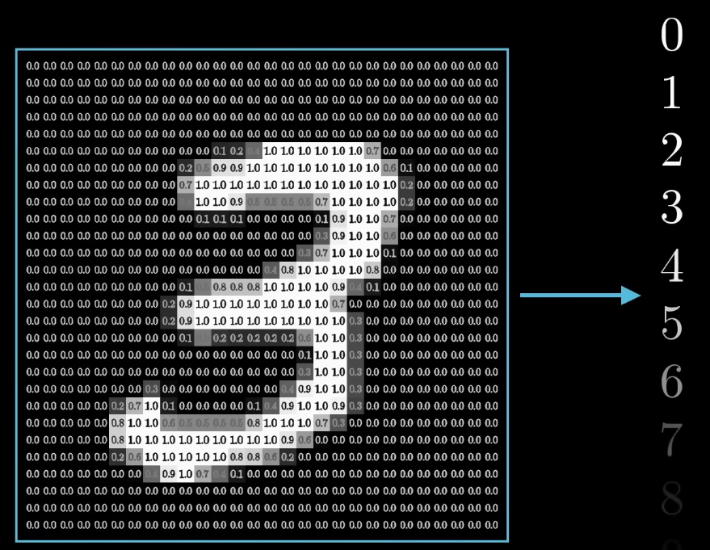

* 70,000 images
* each image in the MNIST dataset (Modified National Institute of Standards and Technology) is 28-by-28 pixels
* 0.0: no color
* 1.0: brightest color
* image source: [3Blue1Brown](https://www.youtube.com/watch?v=aircAruvnKk)

## Input Layer

:::: {.columns}

::: {.column width="45%"}
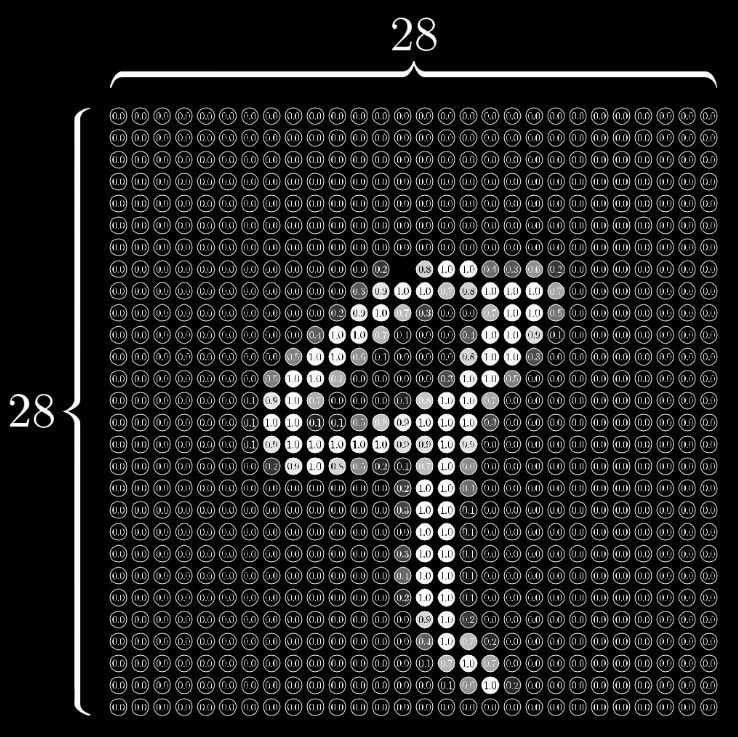


:::

::: {.column width="10%"}
	
:::

::: {.column width="45%"}
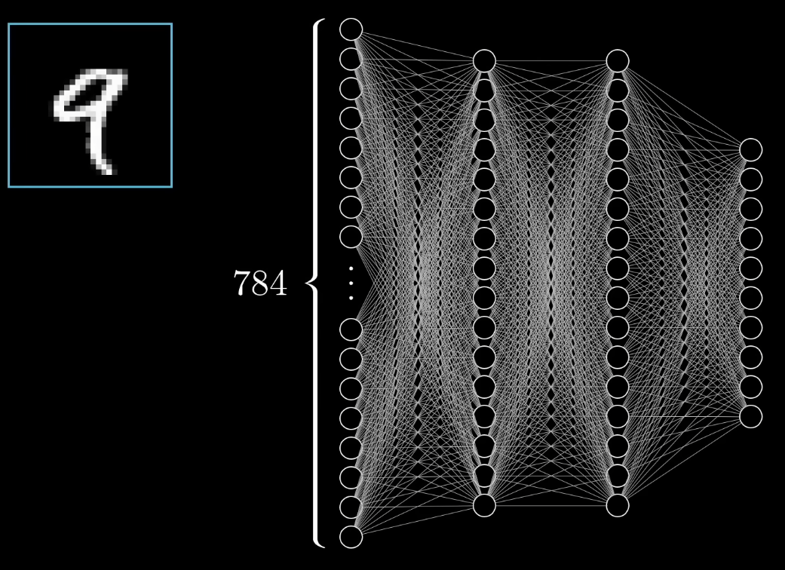

* each image is *flattened* into a 781-by-1 input layer
* image source: [3Blue1Brown](https://www.youtube.com/watch?v=aircAruvnKk)
:::

::::

## Hidden Layers

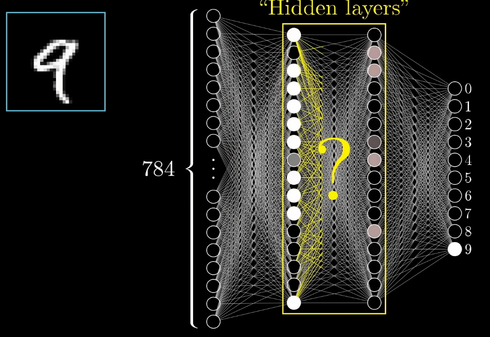

::: {.callout-tip}
## Deep Learning

Having one or more *hidden layers* create a **deep neural network**.  These constructions hope to capture *abstract* concepts (such as loops in the numbers)
:::

* image source: [3Blue1Brown](https://www.youtube.com/watch?v=aircAruvnKk)

## Output Layer

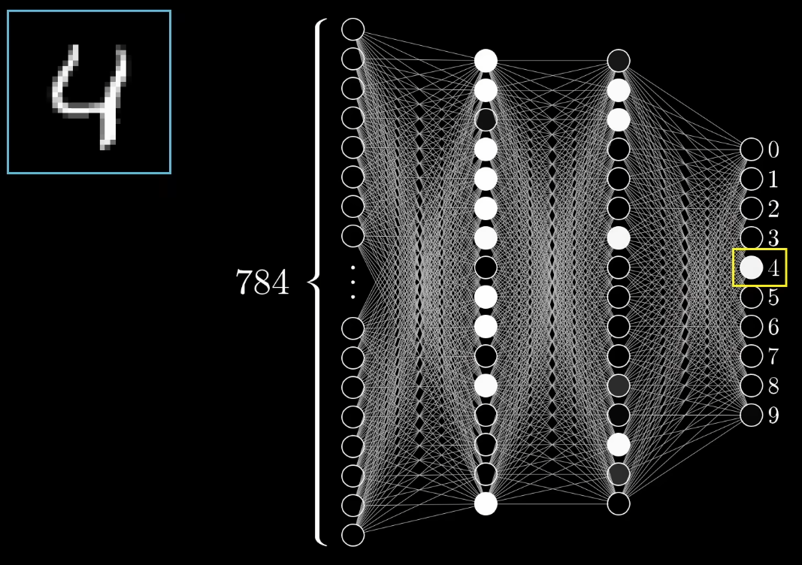

* image source: [3Blue1Brown](https://www.youtube.com/watch?v=aircAruvnKk)

## Backpropagation

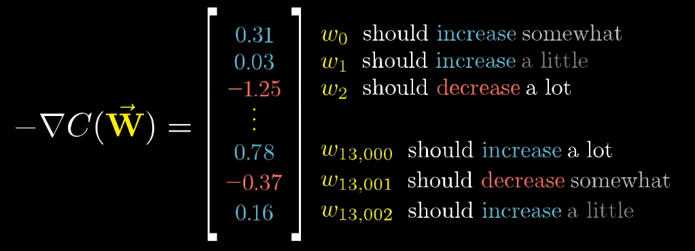

* image source: [3Blue1Brown](https://www.youtube.com/watch?v=IHZwWFHWa-w)

## Legacy

:::: {.columns}

::: {.column width="45%"}
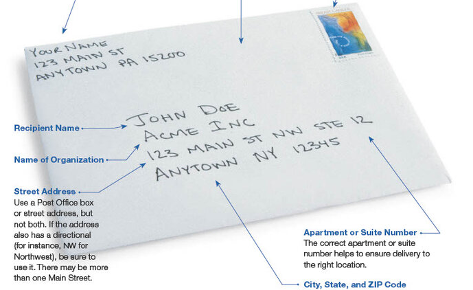

* image source: [UNL](https://printing.unl.edu/mail-distribution/mail-processing/)
:::

::: {.column width="10%"}
	
:::

::: {.column width="45%"}
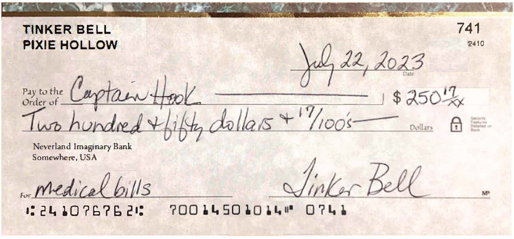

* image source: [US PIRG](https://pirg.org/edfund/resources/how-to-fill-out-a-check-from-your-bank-account/)
:::

::::

::: {.callout-note}
## LeNet

Yann LeCun and colleagues created *LeNet* to greatly accelerate the optical character recognition (**OCR**) that catalyzed postal services, banking, etc.

In particular, their efforts showed that neural networks weights and biases could be trained through gradient descent (i.e. has a mathematical framework)
:::

::: {.callout-warning}
## DCP2
:::

# Ethics Enclave: 4th Amendment

:::: {.columns}

::: {.column width="60%"}
* "How many of you know that a record of every place you have traveled with that phone is available to police without a warrant?" (page 1)

   - Professor Andrew Guthrie Ferguson
   
* "Justice Antonin Scalia once stated, 'When it comes to the **Fourth Amendment**, the home is first among equals'.  He meant that homes are a place of refuge for family and personal freedom" (page 16)

* "Information shared with others doesn't receive the same Fourth Amendment protection as information you keep to yourself.  In constitutional law, this is known as the **third-party doctrine**." (page 18)

* [emphases mine]
:::

::: {.column width="10%"}
	
:::

::: {.column width="30%"}
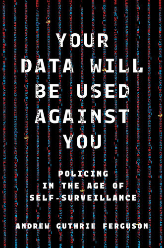
:::

::::


# SGD

::::: {.panel-tabset}

## Gradient Descent

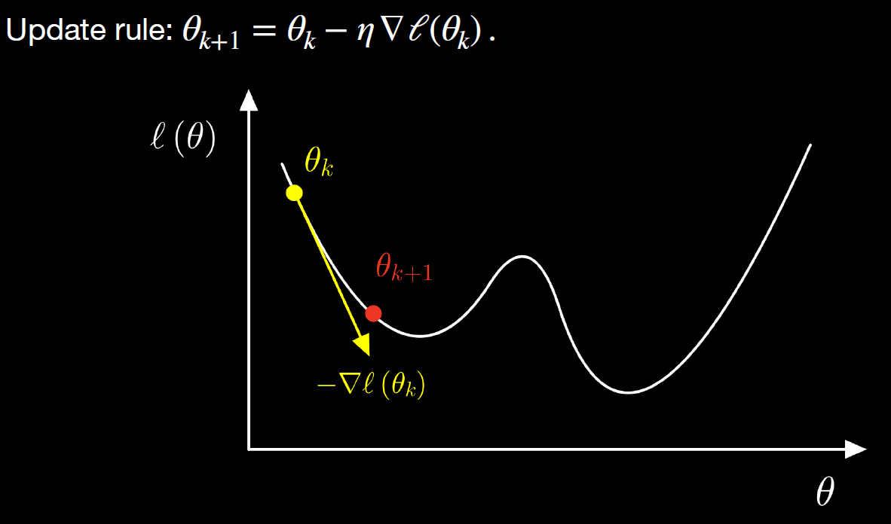

$$\theta_{k+1} = \theta_{k} - \eta \nabla \ell(\theta_{k})$$

* parameters $\theta$
* learning rate $\eta$
* image source: DataX post-doc Mufan Li

## Local Minima

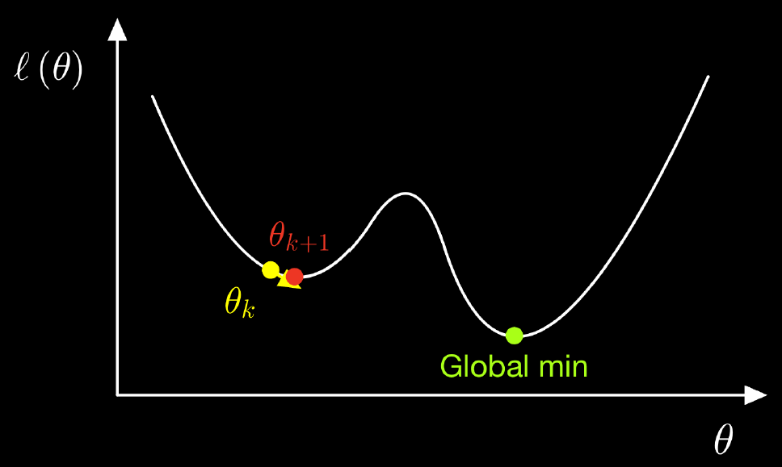

* convergence might not yield an optimal solution
* image source: DataX post-doc Mufan Li

## Divergence

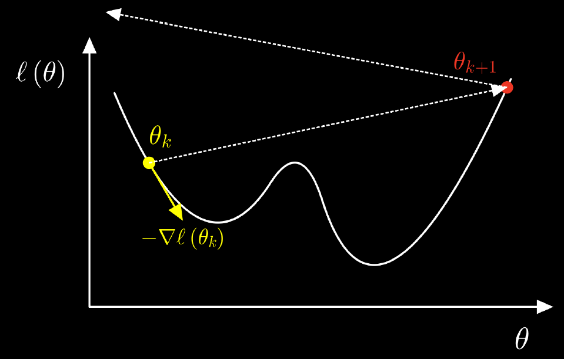

* a large learning rate might not converge toward a solution
* image source: DataX post-doc Mufan Li

## SGD

:::: {.columns}

::: {.column width="45%"}
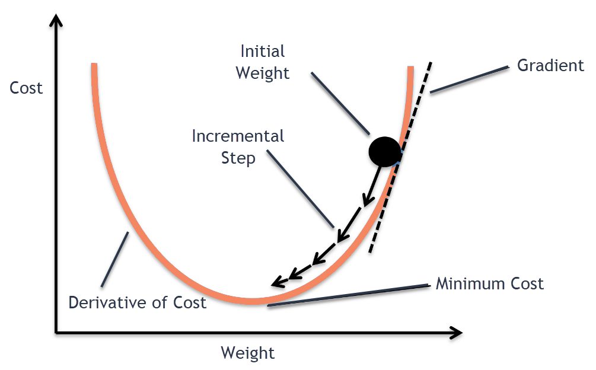	

* image source: [Harshit Dawar](https://medium.com/analytics-vidhya/stochastic-gradient-descent-1ab661fabf89)
:::

::: {.column width="10%"}
	
:::

::: {.column width="45%"}
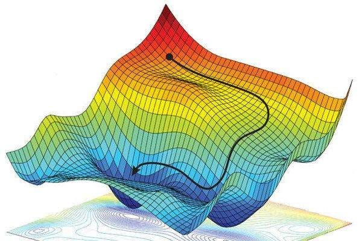

* image source: [Mohit Mishra](https://mohitmishra786687.medium.com/stochastic-gradient-descent-a-basic-explanation-cbddc63f08e0)
:::

::::

::: {.callout-note}
## SGD

**Stochastic gradient descent** takes inputs in *batches* (rather than all at once) and employs some randomness ("stochastic") to possibly converge faster and more reliably.
:::

:::::

# Python Frameworks

## Tensors

We will use tensors in Pytorch Lightning

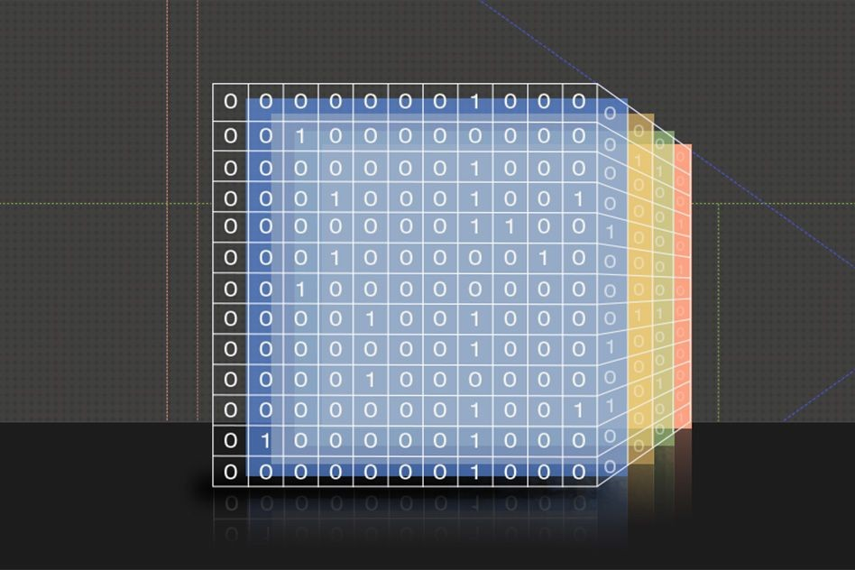

* image source: [MIT](https://news.mit.edu/2017/faster-big-data-analysis-tensor-algebra-1031)

### What are tensors?

At first, **tensors** (for machine learning) are multidimensional arrays.

* a value is a 0D tensor
* an array is a 1D tensor
* a matrix is a 2D tensor

### Why do we use tensors?

* accelerated computations via graphical processing units (GPUs)
* automatic differentiation
* helps with parallelizable processes

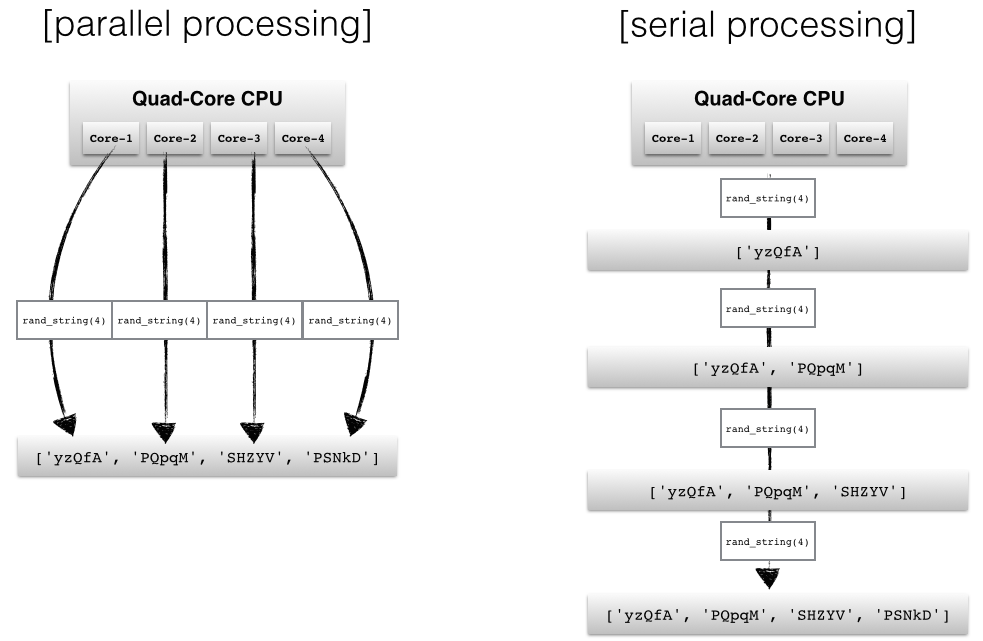

* image source: [Faisal Shahbaz](https://medium.datadriveninvestor.com/python-multiprocessing-pool-vs-process-comparative-analysis-6c03c5b54eec)

## Object-Oriented Programming

Framework choice:

* Keras
* PyTorch
* Scikit Learn
* TensorFlow

Why Pytorch?

* recency bias (Derek studied these concepts with PyTorch)
* **object-oriented programming**

Why Object-Oriented Programming?

Later concepts are probably better understood as *modular* steps in a workflow, which lend themselves to object-oriented programming (OOP)

::::: {.panel-tabset}

## Example 1

For the penguins examples, we needed a fully-connected network whose input layer size was 2 and whose output layer size was 3

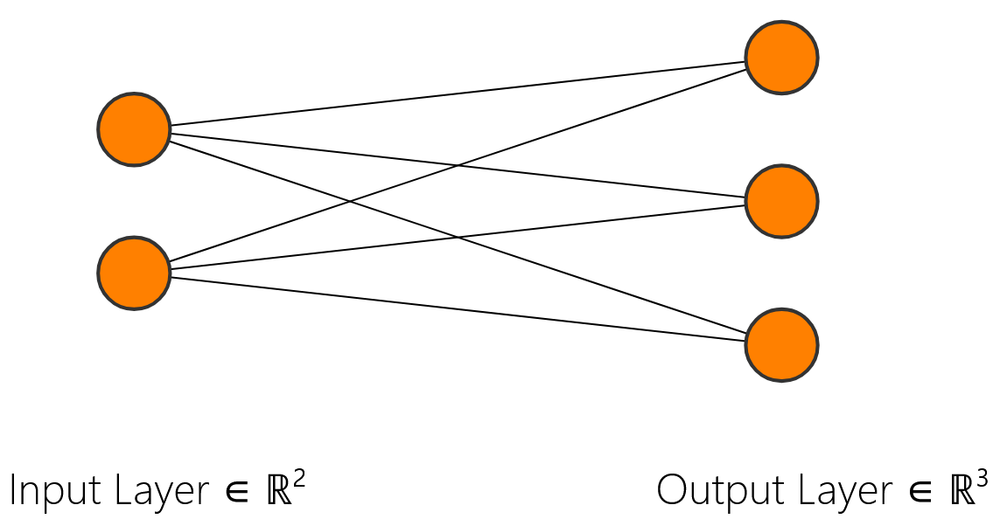

* Python code: `model = FCN(2,3)`

## Example 2

For the math example, we need a fully-connected network whose input layer size is 4 and whose output layer size is 2

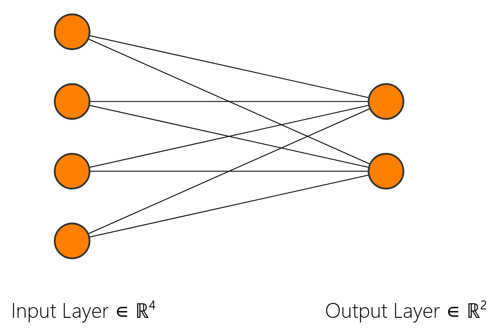

* Python code: `model = FCN(4,2)`

## Class Definition

```{python}
#| eval: false

class FCN(pl.LightningModule):
  # Fully-Connected Network
  # assumes no hidden layer (i.e. going directly into activation functions)

    def __init__(self, input_layer_size, output_layer_size):
        super().__init__()
        self.input_layer_size = input_layer_size 
        self.output_layer_size = output_layer_size 
        self.fc1 = nn.Linear(input_layer_size, output_layer_size)
        self.test_step_outputs = []

    def forward(self, x):
        x = F.relu(self.fc1(x))
        return x

    def training_step(self, batch, batch_idx):
        x, y = batch
        output = self(x)
        loss = F.cross_entropy(output, y)
        return {'loss':loss}

    def test_step(self, batch, batch_idx):
        x, y = batch
        output = self(x)
        loss = F.cross_entropy(output, y)
        self.test_step_outputs.append(loss)
        return {'loss':loss}

    def on_test_epoch_end(self):
        epoch_average = torch.stack(self.test_step_outputs).mean()
        self.log("test_epoch_average", epoch_average)
        self.test_step_outputs.clear()

    def configure_optimizers(self):
        optimizer = torch.optim.SGD(self.parameters(), lr=lr)
        return optimizer
```

:::::

::: {.callout-warning}
## DCP3
:::


# Universal Approximation

::::: {.panel-tabset}

## ReLU

:::: {.columns}

::: {.column width="30%"}
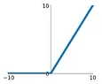
:::

::: {.column width="10%"}
	
:::

::: {.column width="60%"}

$$f(x) = \begin{cases}x, & x \geq 0 \\ 0, & x < 0\end{cases}$$

* domain: $(-\infty, \infty)$
* range: $(0,\infty)$

derivative:

$$f'(x) = \begin{cases}1, & x > 0 \\ 0, & x < 0\end{cases}$$

:::

::::

## Piecewise

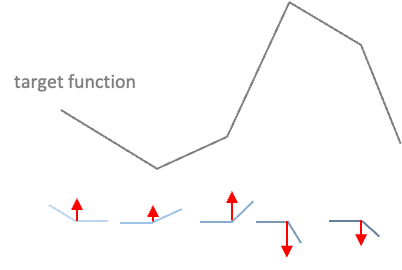

* image source: [Thi-Lam-Thuy Le](https://towardsdatascience.com/how-relu-enables-neural-networks-to-approximate-continuous-nonlinear-functions-f171b7859727/)

## Example

:::: {.columns}

::: {.column width="40%"}
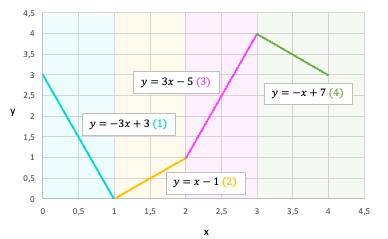	
:::

::: {.column width="10%"}
	
:::

::: {.column width="50%"}
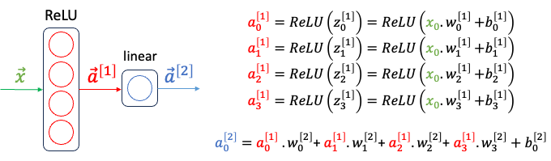	
:::

::::

* image source: [Thi-Lam-Thuy Le](https://towardsdatascience.com/how-relu-enables-neural-networks-to-approximate-continuous-nonlinear-functions-f171b7859727/)

## Overfitting

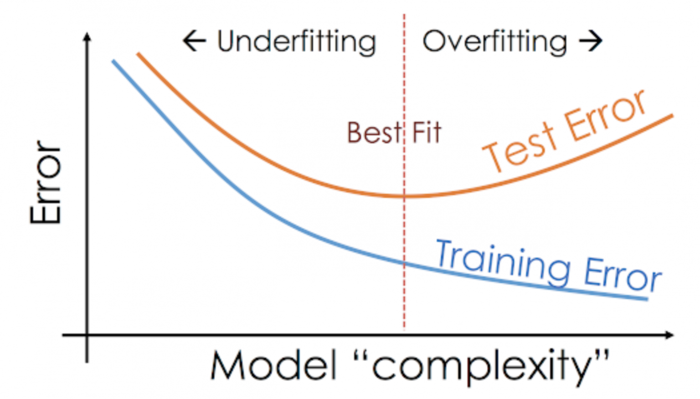

* image source: [Sharoon Saxena](https://www.analyticsvidhya.com/blog/2020/02/underfitting-overfitting-best-fitting-machine-learning/)

## Beyond

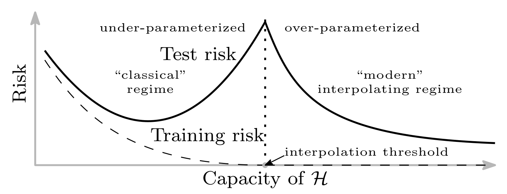

* image source: [Belkin et al](https://arxiv.org/pdf/1812.11118)

:::::

# Quo Vadimus?

:::: {.columns}

::: {.column width="40%"}
Midsemester Project

* due Oct 9:

  * Precept 5
  * Slides as Outline
  
* due Oct 16:

  * Report
  * Poster
  * Video

:::

::: {.column width="10%"}
	
:::

::: {.column width="50%"}


* image source: [Ryan Healy](https://bsky.app/profile/365apps.io)
:::

::::


# Footnotes

::: {.callout-note collapse="true"}

## (optional) Additional Resources and References

* [Pytorch history](https://alexmoltzau.medium.com/pytorch-governance-and-history-2e5889b79dc1) by Alex Moltzau

:::

::: {.callout-note collapse="true"}
## Session Info

```{r}
sessionInfo()
```
:::


:::: {.columns}

::: {.column width="45%"}
	
:::

::: {.column width="10%"}
	
:::

::: {.column width="45%"}

:::

::::

::::: {.panel-tabset}


:::::