# Session 12: Hyperparameters

## Learning objectives:

:::: {.columns}

::: {.column width="45%"}
- Outline semester goals
- Revisit hyperparameters
- Introduce neural network convergence aids
:::

::: {.column width="10%"}

:::

::: {.column width="45%"}
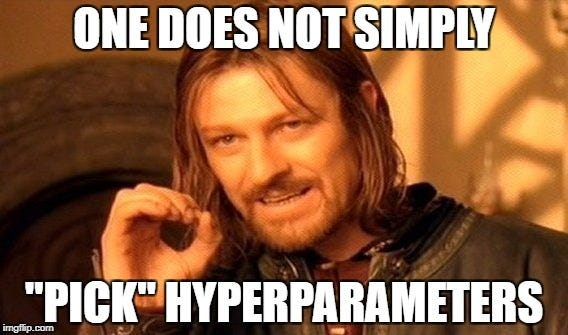

* image source: [Daniel Shapiro](https://towardsdatascience.com/artificial-intelligence-hyperparameters-48fa29daa516/)

:::

::::

# Semester Projects

::::: {.panel-tabset}

## Overview

For SML 301, students will complete a substantial machine learning project

- exploration of an image data set
- fine tuning a pre-trained model
- neural network hyperparameter tuning
- machine learning modeling
- video presentation
- research poster/slides

You (and your group) may select one of the [Roboflow computer vision datasets](https://public.roboflow.com/) (that was not used during class or precepts)

* or you may propose your own project (please do so before Fall Break)

## CNN

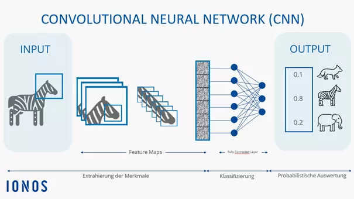

* image source: [IONOS](https://www.ionos.com/digitalguide/websites/web-development/convolutional-neural-networks/)

## Fine Tuning

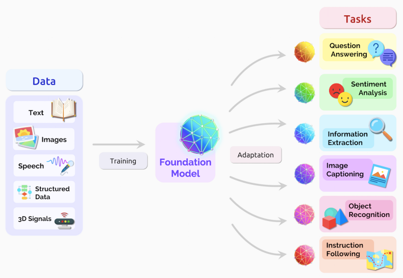

* image source: [Labeller](https://www.labellerr.com/blog/beginners-guide-using-foundation-models-in-ml-projects/)

## RoboFlow

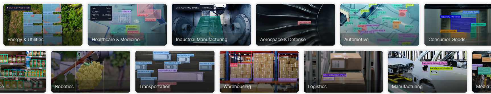

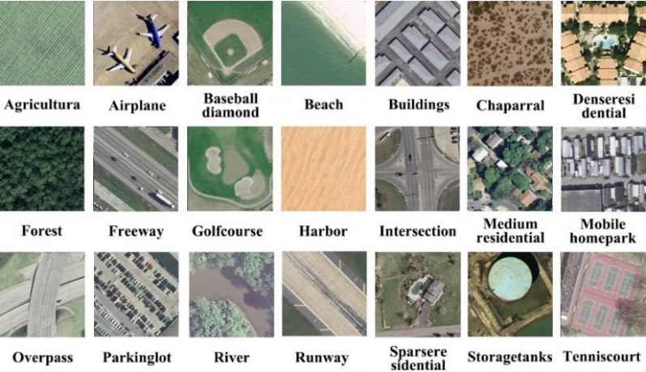

:::::

# Hyperparameters

::: {.callout-note}
Models are *fit* to the training data by finding the best parameter values (e.g. coefficients) through optimization.

The shape of the models are affected by **hyperparameters**
:::

::: {.callout-tip}
Machine learning algorithms train models on data to compute *parameter* values.

You, the machine learning analyst, make choices about the *hyperparameters*.
:::

::::: {.panel-tabset}

## Polynomials

:::: {.columns}

::: {.column width="50%"}
$d = 2: \hat{y} = \beta_{0} + \beta_{1}X_{1} + \beta_{2}X_{1}^{2}$

$d = 3: \hat{y} = \beta_{0} + \beta_{1}X_{1} + \beta_{2}X_{1}^{2} + \beta_{3}X_{1}^{3}$	
:::

::: {.column width="10%"}
	
:::

::: {.column width="40%"}
For polynomial regression, the degree $d$ is a hyperparameter.

* parameters: $\beta_{0}, \beta_{1}, \beta_{2}, ...$
* hyperparameter: $d$
:::

::::

## Decision Trees

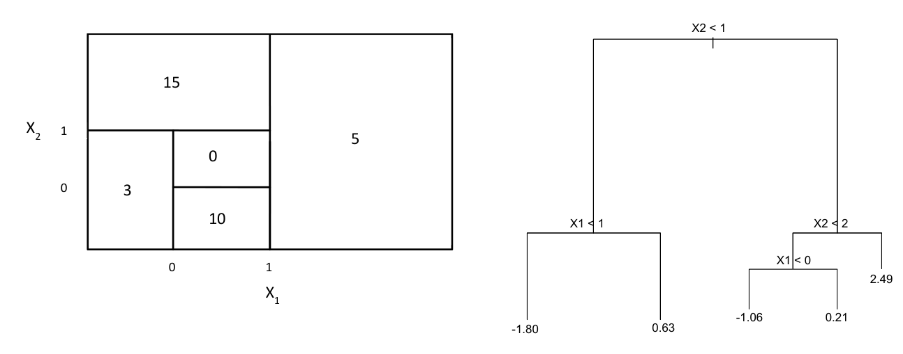

:::: {.columns}

::: {.column width="45%"}
* trained parameters: decision space partition

:::

::: {.column width="10%"}
	
:::

::: {.column width="45%"}
* hyperparameters: tree depth, number of trees, input variables, etc.

:::

::::

* image source: [ISLP](https://www.statlearning.com/)

## SVM

:::: {.columns}

::: {.column width="45%"}
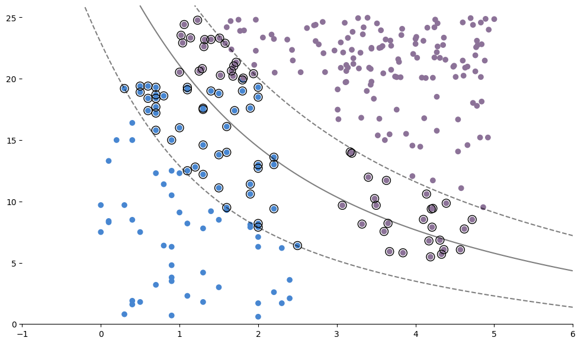

* parameters: 
  
  * decision boundary
  * slack distances

:::

::: {.column width="10%"}
	
:::

::: {.column width="45%"}
* hyperparameters:

  * cost (misclassification allowance)
  * kernel
  
    * linear
    * polynomial
    * radial basis functions

* image source: [Carolina Bento](https://medium.com/towards-data-science/support-vector-machines-explained-with-python-examples-cb65e8172c85)

:::

::::

:::::

::: {.callout-warning}
# DCP 1
:::

# Neural Network Training

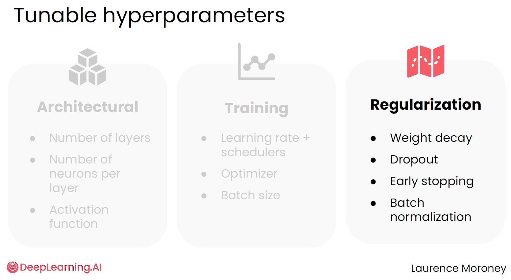

* image source: [DeepLearning.ai](https://www.deeplearning.ai/specializations/pytorch-for-deep-learning-professional-certificate)


## Architectural

* **Deep learning**: having more than one hidden layer

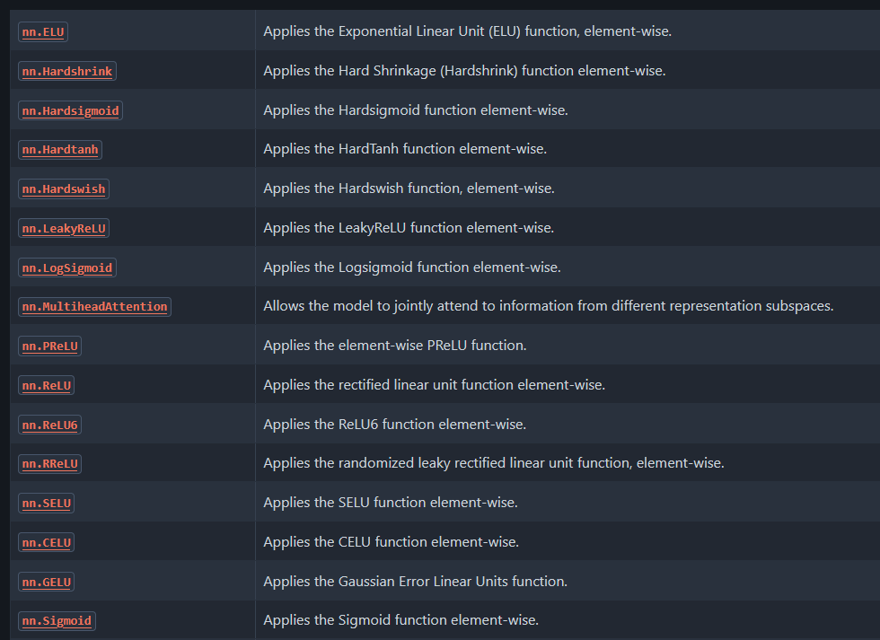

* image source: [PyTorch](https://docs.pytorch.org/docs/2.14/nn.html#non-linear-activations-weighted-sum-nonlinearity)

::: {.callout-tip collapse="true"}
## How many neurons in a layer?

While we don't know the answer in advance, inspired by the MNIST work, practioners tend to use powers of two:

* 2 neurons
* 4 neurons
* 8 neurons
* 16 neurons
* 32 neurons
* 64 neurons 
* ...

to paraphrase [Deep Learning Illustrated](https://www.deeplearningillustrated.com/)
:::


## Training

### Batches

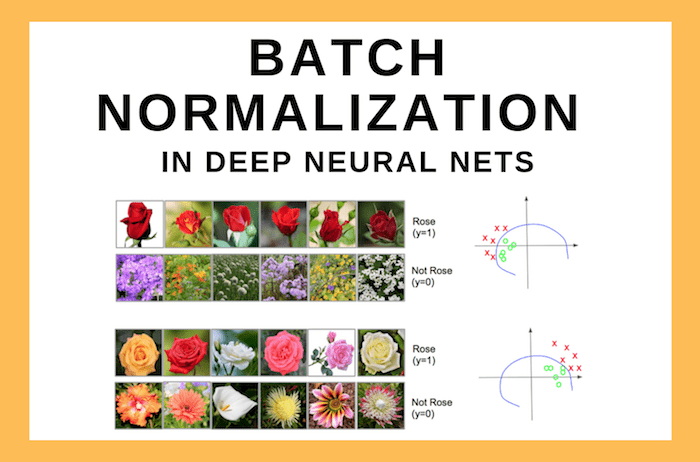

* image source: [Sunita Nayak](https://learnopencv.com/batch-normalization-in-deep-networks/)

### Learning Rate

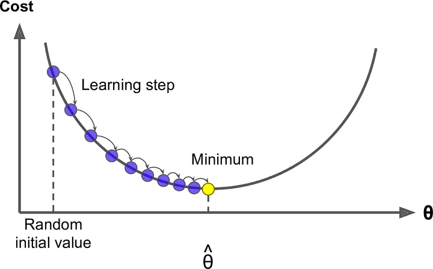

* image source: [Sahin Ahmed](https://medium.com/@sahin.samia/how-to-choose-the-right-learning-rate-in-deep-learning-with-pytorch-690de782b405)

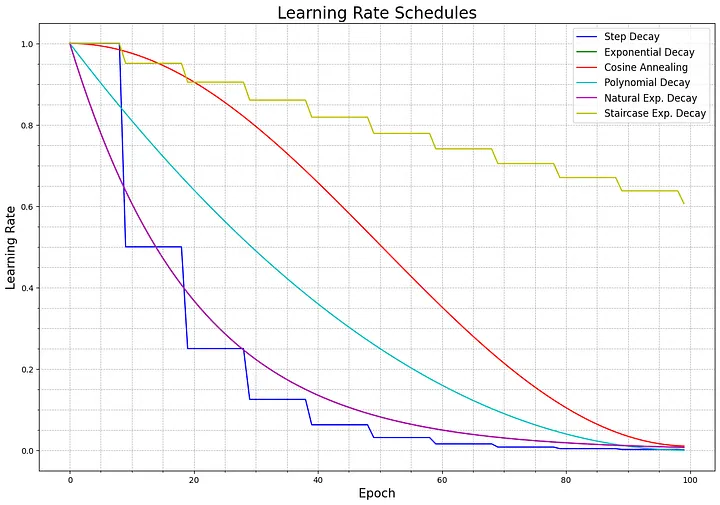

* image source: [Theo Martin](https://medium.com/@theom/a-very-short-visual-introduction-to-learning-rate-schedulers-with-code-189eddffdb00)

### Adam

One popular optimizer is [Adam](https://docs.pytorch.org/docs/2.14/generated/torch.optim.Adam.html) (adaptive moment estimation)

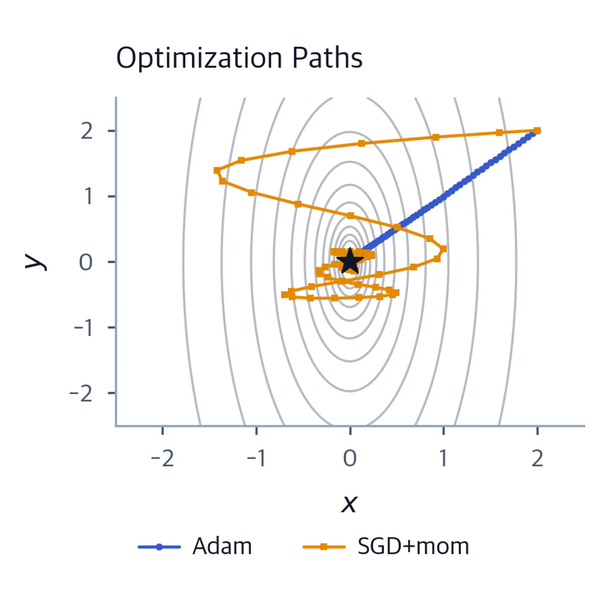

* image source: [Michael Brenndoerfer](https://mbrenndoerfer.com/writing/adam-optimizer-deep-learning)


## Regularization

While "big data" and "large language" projects can move beyond overfitting, medium-sized projects are still susceptible.

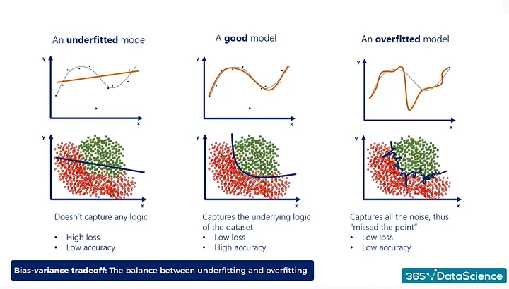

* image source: [Pierre-Emmanuel Saint-Mezard](https://medium.com/@pierre.lgsm/regularization-techniques-in-deep-learning-bdf06862a5ff)


### Weight Decay

* ridge regression

$$\text{Loss} = \text{Error}(y, \hat{y}) + \lambda \sum_{i=1}^{N} w_{i}^{2}$$

* LASSO regression

$$\text{Loss} = \text{Error}(y, \hat{y}) + \lambda \sum_{i=1}^{N} |w_{i}|$$

### Early Stopping

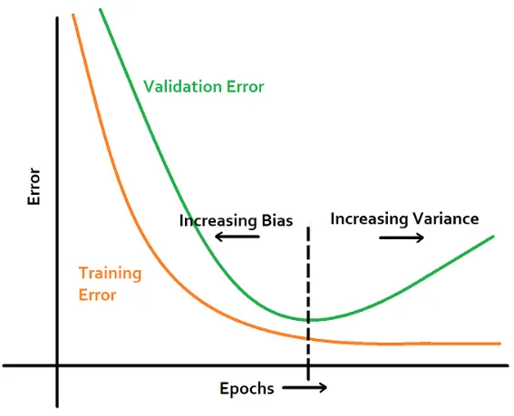

* image source: [Pierre-Emmanuel Saint-Mezard](https://medium.com/@pierre.lgsm/regularization-techniques-in-deep-learning-bdf06862a5ff)

### Dropout

Instead of fully connected networks, one could randomly disable neurons to try to prevent overly memorizing training data.

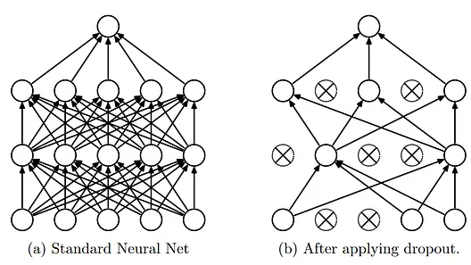

* image source: [Pierre-Emmanuel Saint-Mezard](https://medium.com/@pierre.lgsm/regularization-techniques-in-deep-learning-bdf06862a5ff)


# Tensorflow Playground

:::: {.columns}

::: {.column width="60%"}

## TensorFlow Playground

* link: [https://playground.tensorflow.org](https://playground.tensorflow.org)
* explore the various menus and buttons
* feel free to run a simulation

:::

::: {.column width="10%"}
	
:::

::: {.column width="30%"}
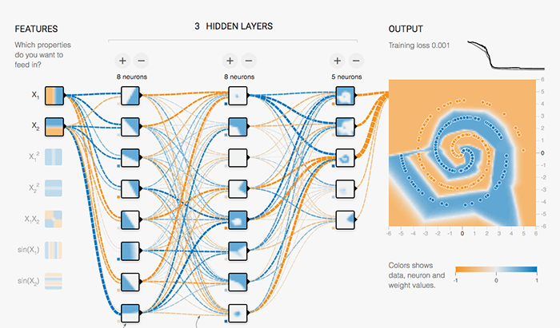
:::

::::

::: {.callout-warning}
# DCP 2
:::

# Marimo

## Setup

### Windows

For those of us who use Windows, we might want to ensure that the `Python` program is accessible to command-line and other interfaces.  During installation, ensure that "Add Python to environment variables" is set.

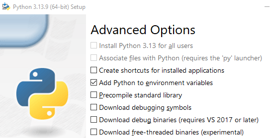

::: {.callout-warning collapse="true"}
### Python Environments

Actually, the above is naive advice on my part.  Python programmers know that keeping separate *environments* is wiser since Python programming is rife with the possibility of having incompatible packages.  As we will soon see, advice for small programs is to use **virtual environments**
:::


### Virtual Environments

Especially when trying out new software, Python programmers recommend using **virtual environments** that are quarantined from the rest of a computer so that installing packages there do not disturb other projects.

* open a command-line interface (CLI)
* navigate to the folder where you want to build a virtual environment
* install a virtual environment with

```
python -m venv vir_env
```

(where `vir_env` is a label that you can customize)

* activate and enter the virtual environment with

:::: {.columns}

::: {.column width="45%"}
#### Mac

```
source vir_env/bin/activate
```
:::

::: {.column width="10%"}
	
:::

::: {.column width="45%"}
#### Windows

```
vir_env\Scripts\activate.bat
```
:::

::::


## Installation

We can now install `marimo` (say, within a virtual environment) with

```
pip install marimo
```

## Tutorials

We can peruse the features of `marimo` through their tutorials

* `marimo tutorial intro`
* `marimo tutorial dataflow`
* `marimo tutorial ui`
* `marimo tutorial markdown`
* `marimo tutorial plots`
* `marimo tutorial sql`
* `marimo tutorial layout`
* `marimo tutorial fileformat`
* `marimo tutorial markdown-format`
* `marimo tutorial for-jupyter-users`

## Coup de Grace

One of the best applications of `marimo` (for our SML 301 course) is [this demonstration](https://github.com/marimo-team/marimo?tab=readme-ov-file#learn-more) of an embedding of the MNIST data set:

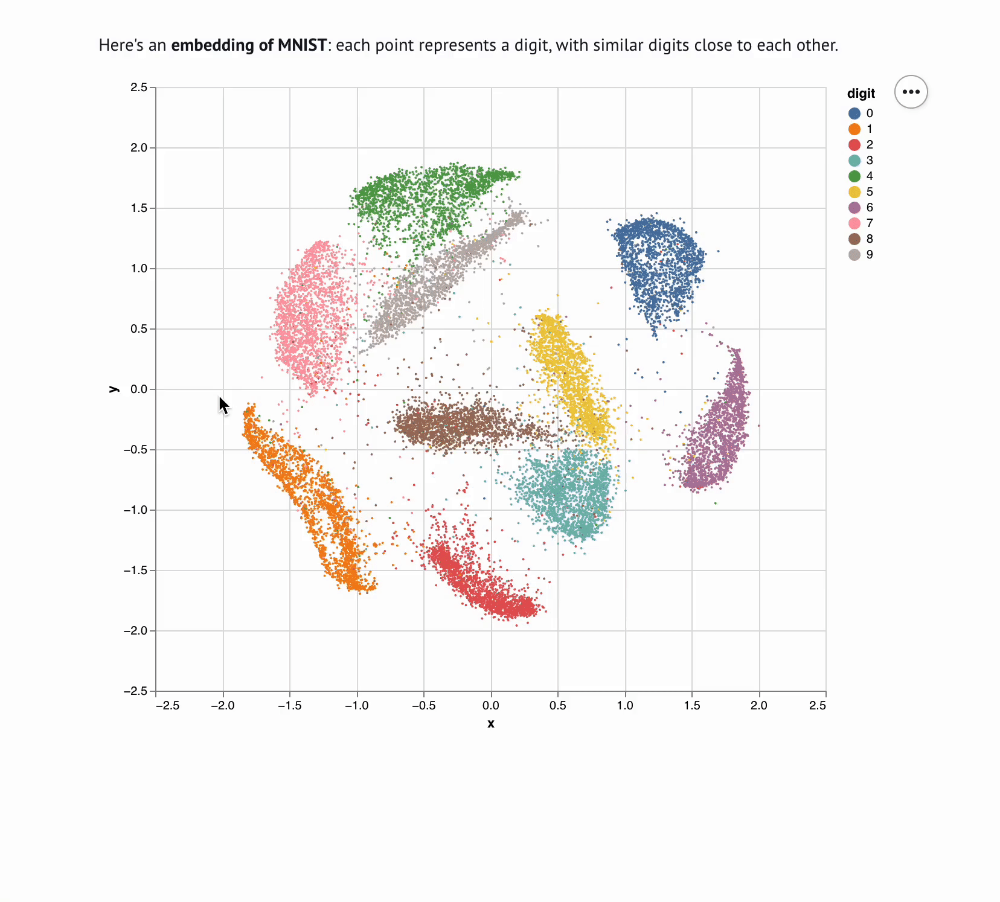

::: {.callout-warning}
## DCP3
:::

# Ethics Enclave: Cat Neurons

::::: {.panel-tabset}

## Origins

:::: {.columns}

::: {.column width="45%"}
> ... history of deep neural networks acknowledge the seminal work done by neurophysiologists David Hubel and Torsten Wiesel ... joint winners of the 1981 Nobel Prize in Physiology or Medicine.  The Nobel was for their work on the cat's visual system ...

--- *Why Machines Learn* by Anil Ananthaswamy, page 346
:::

::: {.column width="10%"}
	
:::

::: {.column width="45%"}
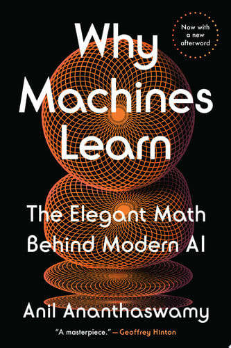
:::

::::

## RGCs

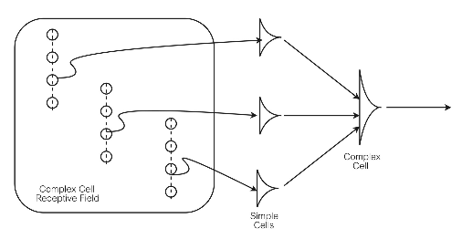

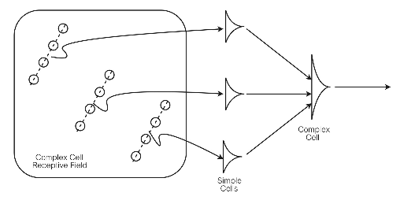

## Cats?


* image source: [Shrek 2](https://www.dreamworks.com/movies/shrek-2)

## Fallout

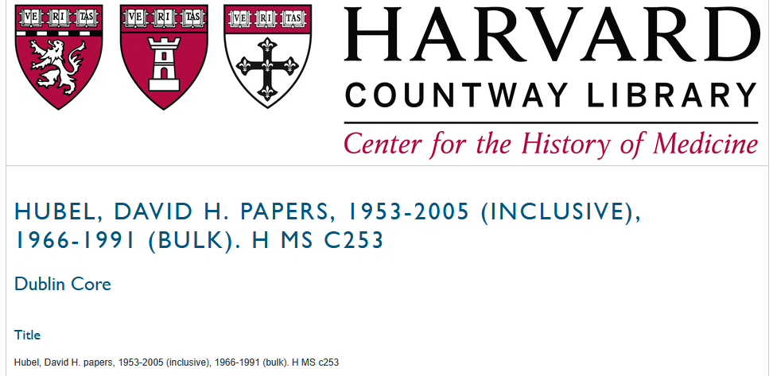

:::::


# Quo Vadimus?

:::: {.columns}

::: {.column width="50%"}
Midsemester Project

* due Oct 16:

  * Report
  * Poster
  * Video

:::

::: {.column width="10%"}
	
:::

::: {.column width="40%"}
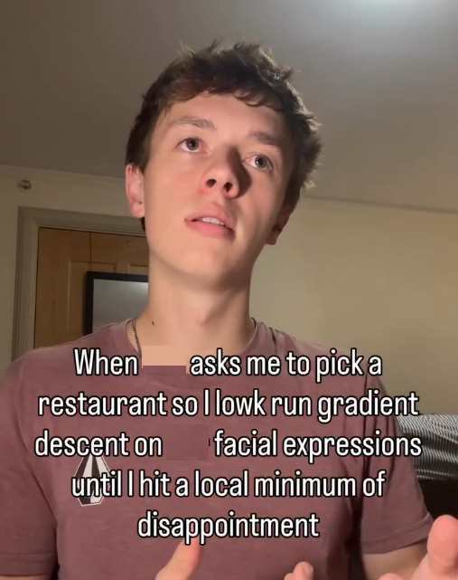

* image source: [getmindvault](https://www.instagram.com/p/DeYlbVrTaZF/)
:::

::::


# Footnotes

::: {.callout-note collapse="true"}

## (optional) Additional Resources and References


:::

::: {.callout-note collapse="true"}
## Session Info

```{r}
sessionInfo()
```
:::


:::: {.columns}

::: {.column width="45%"}
	
:::

::: {.column width="10%"}
	
:::

::: {.column width="45%"}

:::

::::

::::: {.panel-tabset}


:::::