```{r}
#| echo: false
#| message: false
#| warning: false

library("palmerpenguins")
library("patchwork")
library("tidyverse")

penguins_df <- penguins |>
  na.omit()

adelie_color = "#fb7504"
chinstrap_color = "#c65ccc"
gentoo_color = "#067476"
```

# Session 13: Recurrence

## Learning objectives:

:::: {.columns}

::: {.column width="45%"}
- RNN
- LSTM
- GRU
:::

::: {.column width="10%"}

:::

::: {.column width="45%"}

:::

::::

# Cross Entropy

Recall, a step size in back propagation is

$$\text{step size} = \text{derivative} \cdot \text{learning rate}$$

::: {.callout-note}
## Cross Entropy Loss

When classifying among $C$ classes, for an array of predictions (after computing a softmax) $\vec{s}$ and its associated vector of true observations $\vec{y}$, the **cross entropy loss** is calculated as

$$L(\vec{s}, \vec{y}) = -\sum_{i=1}^{C} y_{i}\log s_{i}$$
:::

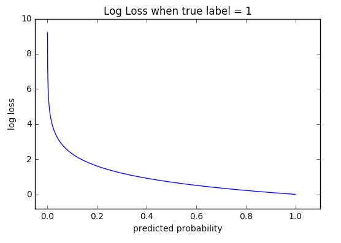

* logarithm of softmax
* larger derivative values for larger misclassification values
* larger step sizes for larger misclassification values
* image source: [Machine Learning Glossary](https://ml-cheatsheet.readthedocs.io/en/latest/index.html)

::: {.callout-tip}
## Cross Entropy Inference

As a logarithm (a monotonic transformation) of softmax and similar to the sum-of-squared residuals (SSR), we are likewise seeking lower values of errors.

* smaller cross entropy $\rightarrow$ better network
:::


# Hidden Layer

To try to capture abstract notions with a neural network, we can employ a **hidden layer** between the input and output layers.

::: {.callout-note collapse="true"}
## Python code

```{python}
#| eval: false
class NN1H(pl.LightningModule):
  # Neural Network object
  # assumes one hidden layer (and default learning rate: 0.01)
  # inheirited class from LightningModule (for faster computations)

    def __init__(self, input_layer_size, hidden_layer_size,
                 output_layer_size, learning_rate = None):
        super().__init__()
        self.input_layer_size = input_layer_size #input layer size (number of explanatory variables)
        self.hidden_layer_size = hidden_layer_size
        self.learning_rate = learning_rate if learning_rate is not None else 0.01
        self.output_layer_size = output_layer_size #output layer size: 3 (number of penguin species)
        self.fc1 = nn.Linear(input_layer_size, hidden_layer_size)
        self.fc2 = nn.Linear(hidden_layer_size, output_layer_size)
        self.test_step_outputs = []

    def forward(self, x):
        x = F.relu(self.fc1(x))
        x = self.fc2(x)
        return x

    def training_step(self, batch, batch_idx): # what happen in each train step
        x, y = batch
        output = self(x)
        loss = F.cross_entropy(output, y)
        # self.log('train_loss', loss, on_epoch=True) # use this for logging (e.g. using TensorBoard)
        return {'loss':loss}

    def test_step(self, batch, batch_idx): # what happen in each test step
        x, y = batch
        output = self(x)
        loss = F.cross_entropy(output, y)
        self.test_step_outputs.append(loss)
        return {'loss':loss}

    def on_test_epoch_end(self):
        epoch_average = torch.stack(self.test_step_outputs).mean()
        self.log("test_epoch_average", epoch_average)
        self.test_step_outputs.clear()  # free memory

    def configure_optimizers(self):
        optimizer = torch.optim.SGD(self.parameters(), lr = lr)
        return optimizer
```
:::

Once again, let us deploy the `palmerpenguins`:

* $x_{1}$: bill length (mm)
* $x_{2}$: bill depth (mm)
* $x_{3}$: flipper length (mm)
* $x_{4}$: body mass (g)

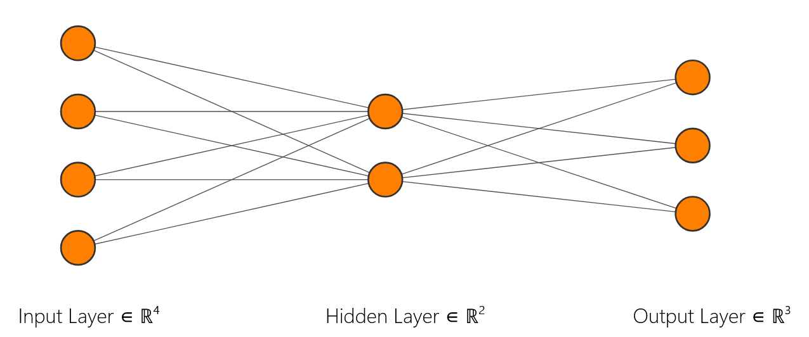

$$\text{min-max normalization} \rightarrow Wx + b \rightarrow \text{ReLU} \rightarrow Wx + b \rightarrow \text{cross entropy}$$

After 100 epochs, our weights and bias values are

$$\begin{array}{c}
\text{min-max normalization} \\ 
\downarrow \\
\left[\begin{array}{rrrr}
  0.04 & -1.19 & 0.96 & 0.91 \\
  -1.59 & 0.65 & 0.02 & 0.16 \\
\end{array}\right]
\left[\begin{array}{c}
  x_{1} \\ x_{2} \\ x_{3} \\ x_{4} \\
\end{array}\right]
+
\left[\begin{array}{r}
  0.55 \\ 0.62 \\
\end{array}\right] \\
\downarrow \\
\text{ReLU} \\
\downarrow \\
\left[\begin{array}{rr}
  -1.00 & 1.17 \\
  -1.07 & -1.21 \\
  1.08 & -0.74 \\
\end{array}\right]
\left[\begin{array}{c}
  x_{1} \\ x_{2} \\ 
\end{array}\right]
+
\left[\begin{array}{r}
  -0.29 \\ 1.28 \\ -1.38 \\
\end{array}\right] \\
\downarrow \\
\text{cross entropy}
\end{array}$$


## Hidden Layer Size

::: {.callout-note collapse="true"}
## How do we decide on a hidden layer size?

Industry professionals and writers suggest powers of two:

$$d_{\text{model}} = 2, 4, 8, 16, ...$$

and choose a model with a low cross-entropy result (i.e. when increasing the hidden layer size barely reduces the cross-entropy amount).

* MNIST paper: $d_{\text{model}} = 16$
* Attention paper: $d_{\text{model}} = 1024$

:::

::::: {.panel-tabset}

## 2


* cross-entropy: 0.0800

## 4

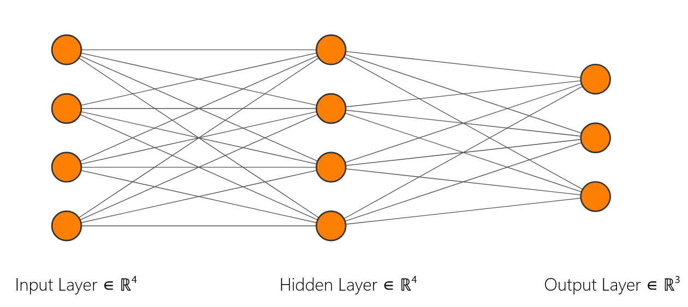

* cross-entropy: 0.0509

## 8

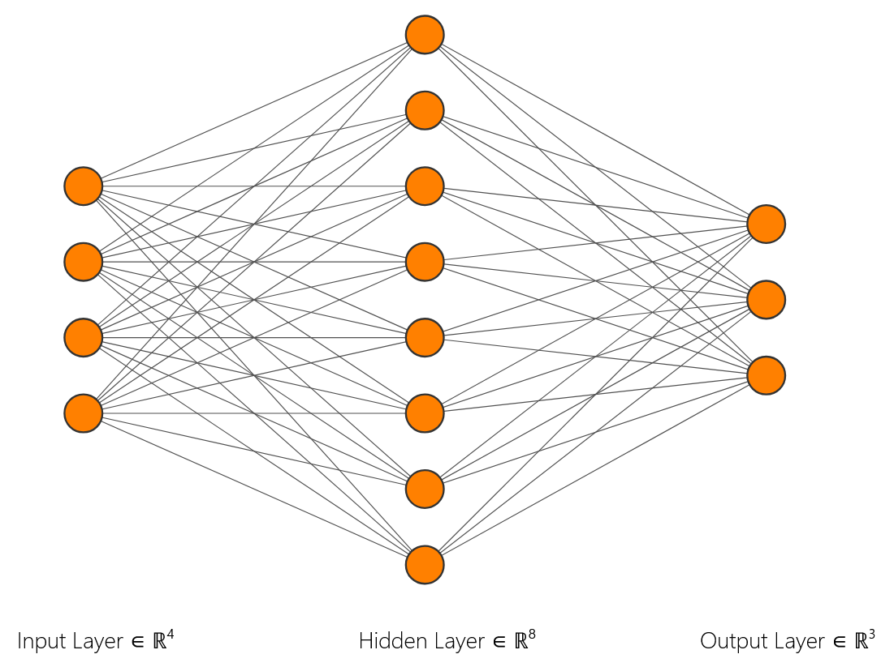

* cross-entropy: 0.0599

## 16

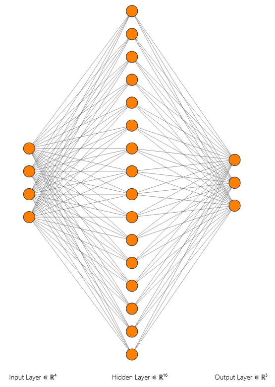

* cross-entropy: 0.0280

:::::


# Deep Learning

::: {.callout-note}
## Deep Learning

In our studies of artificial learning, **deep learning** is using multiple hidden layers.

:::

::: {.callout-note collapse="true"}
## Python Code

```{python}
#| eval: false
class NN2H(pl.LightningModule):
  # Neural Network object
  # assumes two hidden layers (and default learning rate: 0.01)
  # inheirited class from LightningModule (for faster computations)

    def __init__(self, input_layer_size, h1, h2,
                 output_layer_size, learning_rate = None):
        super().__init__()
        self.input_layer_size = input_layer_size #input layer size (number of explanatory variables)
        self.h1 = h1
        self.h2 = h2
        self.learning_rate = learning_rate if learning_rate is not None else 0.01
        self.output_layer_size = output_layer_size #output layer size: 3 (number of penguin species)
        self.fc1 = nn.Linear(input_layer_size, h1)
        self.fc2 = nn.Linear(h1, h2)
        self.fc3 = nn.Linear(h2, output_layer_size)
        self.test_step_outputs = []

    def forward(self, x):
        x = F.relu(self.fc1(x))
        x = F.relu(self.fc2(x))
        x = self.fc3(x)
        return x

    def training_step(self, batch, batch_idx): # what happen in each train step
        x, y = batch
        output = self(x)
        loss = F.cross_entropy(output, y)
        # self.log('train_loss', loss, on_epoch=True) # use this for logging (e.g. using TensorBoard)
        return {'loss':loss}

    def test_step(self, batch, batch_idx): # what happen in each test step
        x, y = batch
        output = self(x)
        loss = F.cross_entropy(output, y)
        self.test_step_outputs.append(loss)
        return {'loss':loss}

    def on_test_epoch_end(self):
        epoch_average = torch.stack(self.test_step_outputs).mean()
        self.log("test_epoch_average", epoch_average)
        self.test_step_outputs.clear()  # free memory

    def configure_optimizers(self):
        optimizer = torch.optim.SGD(self.parameters(), lr = lr)
        return optimizer
```
:::

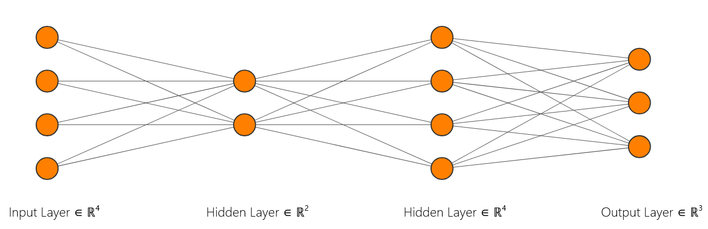


# Recurrent Neural Networks

::: {.callout-note}
## Recurrent Neural Networks

In order to move toward retaining some *memory* in our inputs to artificial intelligence models, we will here briefly discuss **recurrent neural networks**.

```{mermaid}
flowchart LR

input1[input]

neuron1[neuron]

output1[output]

input1 --> neuron1
neuron1 --> output1
neuron1 --> neuron1
```

As we *unfold* the network, we use the same weights and bias values between the layers.

:::

## Example: Crosswalk


* image source: [NYT](https://www.nytimes.com/2020/09/17/us/princeton-racism-federal-investigation.html)


We start with a sequence that has 

> Warning lights activated. Vehicles may not stop. Cross with caution. Warning lights activated. Vehicles may not stop. Cross with caution. Warning lights activated. Vehicles may not stop. Cross with caution. 

repeated over and over, and we hope that

* input "Warning" leads to a prediction of "lights"
* input "lights" leads to a prediction of "activated"
* input "activated" leads to a prediction of "Vehicles"
* input "Vehicles" leads to a prediction of "may"
* input "may" leads to a prediction of "stop"
* input "stop" leads to a prediction of "Cross"
* input "Cross" leads to a prediction of "with"
* input "with" leads to a prediction of "caution"
* input "caution" leads to a prediction of "Warning"

## Unfolding


### Warning

* Does input "Warning" lead to a prediction of "lights"?

```{mermaid}
flowchart TD

input1[Warning]

neuron1[ReLU]

output1[lights]

input1 -- 0.20x + 0.86 --> neuron1

neuron1 -- 0.91x - 0.25 --> output1
```


### lights

* Does input "lights" leads to a prediction of "activated"?

```{mermaid}
flowchart TD

input1[Warning]
input2[lights]

neuron1[ReLU]
neuron2[ReLU]

output1[NA]
output2[activated]

input1 -- 0.20x + 0.86 --> neuron1
input2 -- 0.20x + 0.86 --> neuron2

neuron1 -- 0.91x - 0.25 --> output1
neuron2 -- 0.91x - 0.25 --> output2

neuron1 -- -0.85x + 0.81 --> neuron2
```


### activated

* Does input "activated" leads to a prediction of "Vehicles"?

```{mermaid}
flowchart TD

input1[Warning]
input2[lights]
input3[activated]

neuron1[ReLU]
neuron2[ReLU]
neuron3[ReLU]

output1[NA]
output2[NA]
output3[Vehicles]

input1 -- 0.20x + 0.86 --> neuron1
input2 -- 0.20x + 0.86 --> neuron2
input3 -- 0.20x + 0.86 --> neuron3

neuron1 -- 0.91x - 0.25 --> output1
neuron2 -- 0.91x - 0.25 --> output2
neuron3 -- 0.91x - 0.25 --> output3

neuron1 -- -0.85x + 0.81 --> neuron2
neuron2 -- -0.85x + 0.81 --> neuron3
```


### Vehicles

* Does input "Vehicles" leads to a prediction of "may"?

```{mermaid}
flowchart TD

input1[Warning]
input2[lights]
input3[activated]
input4[Vehicles]

neuron1[ReLU]
neuron2[ReLU]
neuron3[ReLU]
neuron4[ReLU]

output1[NA]
output2[NA]
output3[NA]
output4[may]

input1 -- 0.20x + 0.86 --> neuron1
input2 -- 0.20x + 0.86 --> neuron2
input3 -- 0.20x + 0.86 --> neuron3
input4 -- 0.20x + 0.86 --> neuron4

neuron1 -- 0.91x - 0.25 --> output1
neuron2 -- 0.91x - 0.25 --> output2
neuron3 -- 0.91x - 0.25 --> output3
neuron4 -- 0.91x - 0.25 --> output4

neuron1 -- -0.85x + 0.81 --> neuron2
neuron2 -- -0.85x + 0.81 --> neuron3
neuron3 -- -0.85x + 0.81 --> neuron4
```


### may

* Does input "may" leads to a prediction of "not"?

```{mermaid}
flowchart TD

input1[Warning]
input2[lights]
input3[activated]
input4[Vehicles]
input5[may]

neuron1[ReLU]
neuron2[ReLU]
neuron3[ReLU]
neuron4[ReLU]
neuron5[ReLU]

output1[NA]
output2[NA]
output3[NA]
output4[NA]
output5[not]

input1 -- 0.20x + 0.86 --> neuron1
input2 -- 0.20x + 0.86 --> neuron2
input3 -- 0.20x + 0.86 --> neuron3
input4 -- 0.20x + 0.86 --> neuron4
input5 -- 0.20x + 0.86 --> neuron5

neuron1 -- 0.91x - 0.25 --> output1
neuron2 -- 0.91x - 0.25 --> output2
neuron3 -- 0.91x - 0.25 --> output3
neuron4 -- 0.91x - 0.25 --> output4
neuron5 -- 0.91x - 0.25 --> output5

neuron1 -- -0.85x + 0.81 --> neuron2
neuron2 -- -0.85x + 0.81 --> neuron3
neuron3 -- -0.85x + 0.81 --> neuron4
neuron4 -- -0.85x + 0.81 --> neuron5
```


### not

* Does input "not" leads to a prediction of "stop"?

```{mermaid}
flowchart TD

input1[Warning]
input2[lights]
input3[activate]
input4[Vehicles]
input5[may]
input6[not]

neuron1[ReLU]
neuron2[ReLU]
neuron3[ReLU]
neuron4[ReLU]
neuron5[ReLU]
neuron6[ReLU]

output1[NA]
output2[NA]
output3[NA]
output4[NA]
output5[NA]
output6[stop]

input1 -- 0.20x + 0.86 --> neuron1
input2 -- 0.20x + 0.86 --> neuron2
input3 -- 0.20x + 0.86 --> neuron3
input4 -- 0.20x + 0.86 --> neuron4
input5 -- 0.20x + 0.86 --> neuron5
input6 -- 0.20x + 0.86 --> neuron6

neuron1 -- 0.91x - 0.25 --> output1
neuron2 -- 0.91x - 0.25 --> output2
neuron3 -- 0.91x - 0.25 --> output3
neuron4 -- 0.91x - 0.25 --> output4
neuron5 -- 0.91x - 0.25 --> output5
neuron6 -- 0.91x - 0.25 --> output6

neuron1 -- -0.85x + 0.81 --> neuron2
neuron2 -- -0.85x + 0.81 --> neuron3
neuron3 -- -0.85x + 0.81 --> neuron4
neuron4 -- -0.85x + 0.81 --> neuron5
neuron5 -- -0.85x + 0.81 --> neuron6
```


# Vanishing Gradients

In our recurrent neural network with

* input layer size: 1
* hidden layer size: 1
* output layer size: 1

```{mermaid}
flowchart LR

input1[input]

neuron1[neuron]

output1[output]

input1 -- w_i,h + b_i,h --> neuron1
neuron1 -- w_h,0 + b_h,0 --> output1
neuron1 -- w_h,h + b_h,h --> neuron1
```

we have functions

* $L_{i,h} = w_{i,h}x + b_{i,h}$
* $L_{h,o} = w_{h,o}x + b_{h,o}$
* $L_{h,h} = w_{h,h}x + b_{h,h}$

and ReLU activation function

$$\text{ReLU}(x) = \text{max}(x,0)$$
whose derivative is

$$\frac{d\text{ReLU}}{dx} = \begin{cases} 1, & x \geq 0 \\ 0, & x < 0 \end{cases}$$

## Chain Rule

Toward back propagation, the derivative based on output $k$ given inputs $\{1, 2, ..., k\}$ is

$$\begin{array}{rcl}
\frac{\partial\text{SSR}}{\partial x_{k}} & = & \displaystyle\sum_{a = 1}^{k}
\frac{\partial\text{SSR}}{\partial L_{h,o}}
\left(\displaystyle\prod_{b=1}^{a-1}
\frac{\partial L_{h,o}}{\partial\text{ReLU}}\cdot
\frac{\partial\text{ReLU}}{\partial L_{h,h}}\cdot
\frac{\partial L_{h,h}}{L_{i,h}}
\right)
\frac{\partial L_{i,h}}{\partial x_{k}} \\
~ & = & \displaystyle\sum_{a = 1}^{k}
w_{i,h}
\left(\displaystyle\prod_{b=1}^{a-1}
w_{h,h}\right)
w_{h,0} \\
\end{array}$$

## Gradient Propagation


For today's example, the derivative is

$$\frac{\partial\text{SSR}}{\partial x_{k}} = \sum_{a = 1}^{k}
(0.20)
\left(\prod_{b=1}^{a-1}
(-0.85)
\right)
(0.91)$$

::::: {.panel-tabset}

## Math Review

Let us quickly recall some math

## exp

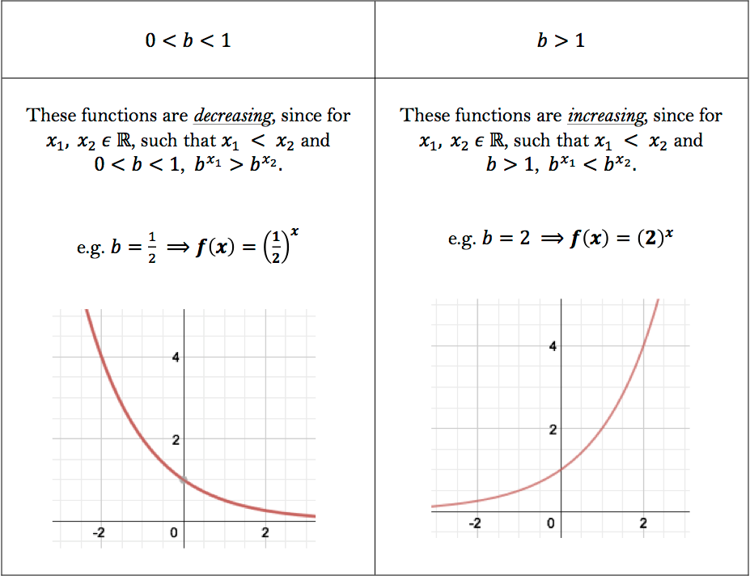

* image source: [University of Toronto](https://users.math.utoronto.ca/preparing-for-calculus/4_functions/we_5_exp_log.html)

## ratio

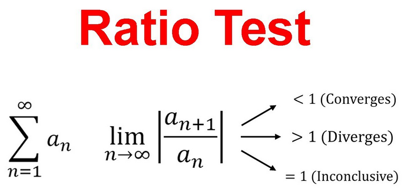

* image source: [Dan the Tutor](https://www.youtube.com/watch?v=qBFPSm0-41g)

:::::

::: {.callout-tip}
## Gradient Propagation

* we have **vanishing gradients** if $|w_{h,h}| < 1$
* we have **exploding gradients** if $|w_{h,h}| > 1$

In the above hypothetical example, since $$|w_{h,h}| = |-0.85| < 1$$
our model may be limited (forgetful) due to vanishing gradients.
:::


# Main Example: First Names

We will be exploring the [Pytorch RNN tutorial](https://docs.pytorch.org/tutorials/intermediate/char_rnn_classification_tutorial.html) by Sean Robertson.

::::: {.panel-tabset}

## data

* over 20,000 first names
* associated with 18 languages

## languages

:::: {.columns}

::: {.column width="30%"}
* Arabic
* Chinese
* Czech
* Dutch
* English
* French
:::

::: {.column width="5%"}
	
:::

::: {.column width="30%"}
* German
* Greek
* Irish
* Italian
* Japanese
* Korean
:::

::: {.column width="5%"}
	
:::

::: {.column width="30%"}
* Polish
* Portuguese
* Russian
* Scottish
* Spanish
* Vietnamese
:::

::::

## sample

For example, the Polish names are

Adamczak
Adamczyk
Andrysiak
Auttenberg
Bartosz
Bernard
Bobienski
Bosko
Broż
Brzezicki
Budny
Bukoski
Bukowski
Chlebek
Chmiel
Czajka
Czajkowski
Dubanowski
Dubicki
Dunajski
Dziedzic
Fabian
Filipek
Filipowski
Gajos
Gniewek
Gomolka
Gomulka
Gorecki
Górka
Górski
Grzeskiewicz
Gwozdek
Jagoda
Janda
Janowski
Jaskolski
Jaskulski
Jedynak
Jelen
Jez
Jordan
Kaczka
Kaluza
Kamiński
Kasprzak
Kava
Kedzierski
Kijek
Klimek
Kosmatka
Kowalczyk
Kowalski
Koziol
Kozlow
Kozlowski
Krakowski
Król
Kumiega
Lawniczak
Lis
Majewski
Malinowski
Maly
Marek
Marszałek
Maslanka
Mencher
Miazga
Michel
Mikolajczak
Mozdzierz
Niemczyk
Niemec
Nosek
Nowak
Pakulski
Pasternack
Pasternak
Paszek
Piatek
Piontek
Pokorny
Poplawski
Róg
Rudaski
Rudawski
Rusnak
Rutkowski
Sadowski
Salomon
Serafin
Sienkiewicz
Sierzant
Sitko
Skala
Slaski
Ślązak
Ślusarczyk
Ślusarski
Smolák
Sniegowski
Sobol
Sokal
Sokolof
Sokoloff
Sokolofsky
Sokolowski
Sokolsky
Sówka
Stanek
Starek
Stawski
Stolarz
Szczepanski
Szewc
Szwarc
Szweda
Szwedko
Walentowicz
Warszawski
Wawrzaszek
Wiater
Winograd
Winogrodzki
Wojda
Wojewódka
Wojewódzki
Wronski
Wyrick
Wyrzyk
Zabek
Zawisza
Zdunowski
Zdunowski
Zielinski
Ziemniak
Zientek
Żuraw

:::::

::: {.callout-warning}
## DCP 1

:::

# AI Frameworks

:::: {.columns}

::: {.column width="30%"}
### Keras

* Francois Chollet
* March 2015
* Greek for "horn"
* supports TensorFlow, JAX, PyTorch
:::

::: {.column width="10%"}
	
:::

::: {.column width="30%"}
### PyTorch

* Meta AI
* Sept 2016
* tensors intrinsic data type
* automatic differentiation
:::

::: {.column width="10%"}
	
:::

::: {.column width="20%"}
### Pytorch Lightning

* William Falcon
* May 2019
:::

::::


# LSTMs

::::: {.panel-tabset}

## Intro

:::: {.columns}

::: {.column width="40%"}
* Hochreiter and Schmidhuber, 1997
* addressing vanishing/exploding gradients
* novel architecture
:::

::: {.column width="10%"}
	
:::

::: {.column width="50%"}
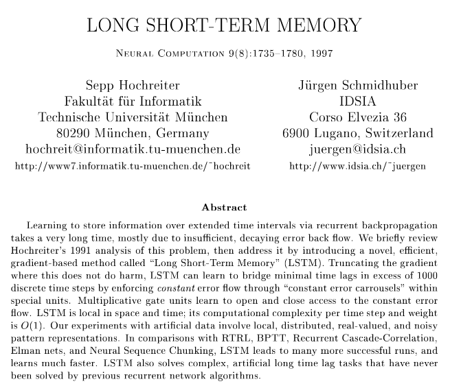
:::

::::

## Conclusion

* CEC: constant error carrousel
* cuts off memory leakage
* protection against irrelevant inputs

## Methods

Each *module* of a **Long Short Term Memory** (LSTM) network has

* 3 inputs: data input, long-term memory (aka **forget gate**), short-term memory (aka **output gate**)

and outputs new values for the forget gate and the output gate


* image source: [Chris Olah](https://colah.github.io/posts/2015-08-Understanding-LSTMs/)

## Results

applied LSTMs on

* sequences of words
* sequences of numbers
* noisy sequences
* math function values
* temporal sequences

:::::


# GRUs

::: {.callout-tip}
## GRU

Each *module* of a **Gated Recurrent Unit** (GRU) network has

* *2* inputs: data input, long-term memory (aka **forget gate**)

and outputs a new value for the forget gate along with the data prediction.  Hence, the GRU architecture is simpler than an LSTM, but can produce similar results.

:::

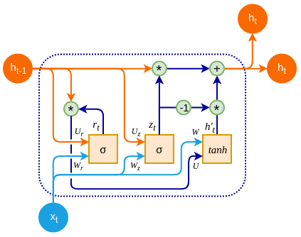

* image source: [O'Reilly](https://www.oreilly.com/library/view/advanced-deep-learning/9781789956177/8ad9dc41-3237-483e-8f6b-7e5f653dc693.xhtml)

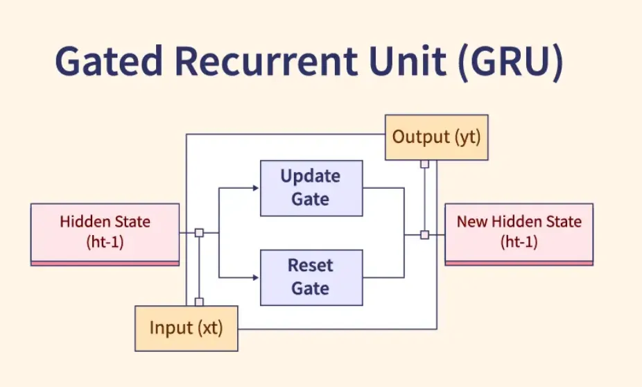

* image source: [Harshed Abdulla](https://medium.com/@harshedabdulla/understanding-gated-recurrent-units-grus-in-deep-learning-4404599dcefb)

::: {.callout-note}
## Long-term memory

Both LSTM and GRU architectures allow for processing of sequences of data while avoiding the vanishing gradient problem.

:::

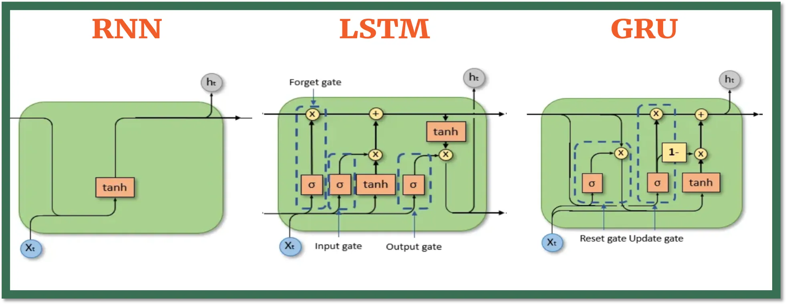

::: {.callout-warning}
## DCP 2
:::


# Ethics Enclave: AI Legislation Tracker

:::: {.columns}

::: {.column width="60%"}

* Each student could be assigned a different state

    - Derek will provide an example
    - Some students may volunteer to focus on a different country

* Summarize the bills and voting

    - Which states are taking a vertical approach (akin to USA) or a horizontal approach (akin to EU)
    - Which states seem to push for more legislation?

* Tech? Perusall?

* Feedback mechanism.  For example,

    - The Georgia student would read over the work done by the Hawaii student
    - The Hawaii student would read over the work done by the Idaho student, etc.

* Time commitment: about 10 minutes per class over 4 class sessions

* Learning goals

    - compare and contrast local government approaches to AI regulation
    - practice literature searches with contemporary media	
    
:::

::: {.column width="10%"}
	
:::

::: {.column width="30%"}


* image source: [Traverse Legal](https://www.traverselegal.com/blog/ai-legislation/)
:::

::::

::: {.callout-warning}
## DCP 3
:::

# Preview: Word Prediction

```{mermaid}
flowchart LR

input1[eggs]
input2[bread]
stem1[pairs]
stem2[well]
stem3[with]
output1[bacon]
output2[butter]

input1 --> stem1
input2 --> stem1
stem1 --> stem2
stem2 --> stem3
stem3 --> output1
stem3 --> output2
```

* "eggs pairs well with bacon"
* "bread pairs well with butter"
* but how to represent words as numbers?

    - later: sessions about NLP (natural language programming)


# Quo Vadimus?

:::: {.columns}

::: {.column width="55%"}
* due this Friday (October 30):

    - Poster Feedback (2 hours)
    - Precept 6 (1 hour)
    - Project Proposal (1/2 hour)
  
:::

::: {.column width="10%"}
	
:::

::: {.column width="35%"}


* Saturday, October 31
* 9 AM
* McDonnell Hall, Room A01
:::

::::


# Footnotes

::: {.callout-note collapse="true"}

## (optional) Additional Resources and References

* derivation of the [derivative of cross entropy](https://shivammehta25.github.io/posts/deriving-categorical-cross-entropy-and-softmax/) by Shivam Mehta

:::

::: {.callout-note collapse="true"}
## Session Info

```{r}
sessionInfo()
```
:::


:::: {.columns}

::: {.column width="45%"}
	
:::

::: {.column width="10%"}
	
:::

::: {.column width="45%"}

:::

::::

::::: {.panel-tabset}


:::::