```{r}
#| echo: false
#| message: false
#| warning: false

library("ggtext")
library("palmerpenguins")
library("patchwork")
library("tidyverse")

penguins_df <- penguins |>
  na.omit()

adelie_color = "#fb7504"
chinstrap_color = "#c65ccc"
gentoo_color = "#067476"
```

# Session 14: Image Processing

## Learning objectives:

:::: {.columns}

::: {.column width="45%"}
- Explore image processing
- Introduce image augmentation
- Perform Feature Extraction
:::

::: {.column width="10%"}

:::

::: {.column width="45%"}
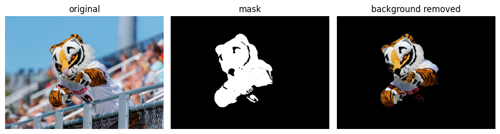
:::

::::

# Generative AI

::::: {.panel-tabset}

## Definition

:::: {.columns}

::: {.column width="75%"}
* "Generative AI is a form of artificial intelligence that is designed to generate content, including text, images, video and music. It uses large language models and algorithms to analyze patterns in datasets to mimic the style or structure of specific types of content."
* [quote and image source](https://www.eweek.com/artificial-intelligence/generative-ai-vs-machine-learning/)
:::

::: {.column width="25%"}

:::

::::

## Dall-E

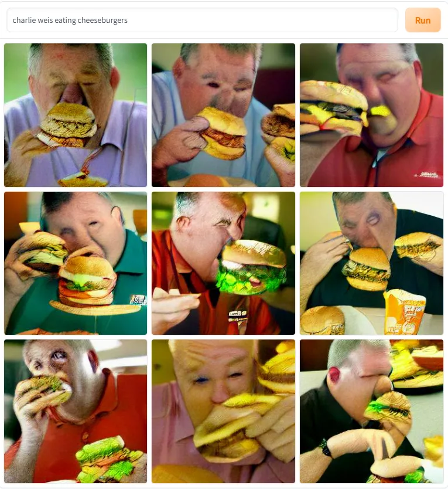

[image source](https://www.onefootdown.com/2022/6/21/23175949/notre-dame-football-immersive-and-horrifying-dall-e-mini-art-experience-gumbo-pitbull-cheeseburgers)

### Stable Diffusion


[image source](https://www.geeky-gadgets.com/stable-diffusion-sdxl-beginners-guide/)

:::::


# GANS

## Overview

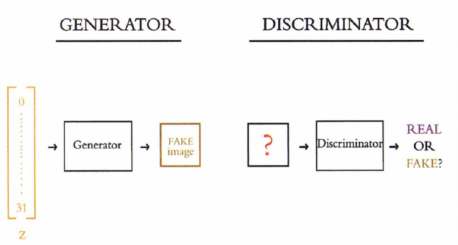

* image source: [Deep Learning Illustrated](https://www.deeplearningillustrated.com/)

## Discriminator

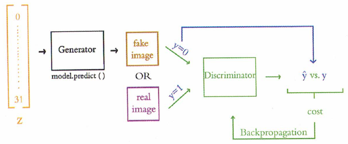

* image source: [Deep Learning Illustrated](https://www.deeplearningillustrated.com/)

## Generator

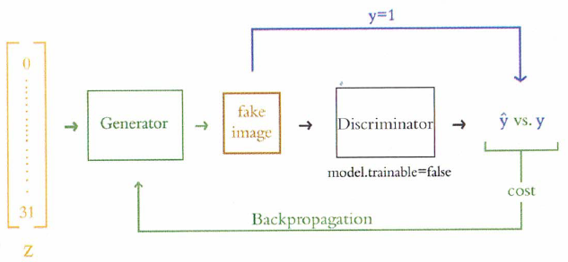

* image source: [Deep Learning Illustrated](https://www.deeplearningillustrated.com/)

::: {.callout-tip}
## GAN Objectives

* the goal of a generator is to create better fake images
* the goal of a discriminator is to better classify fake images

:::

## Adversarial Network

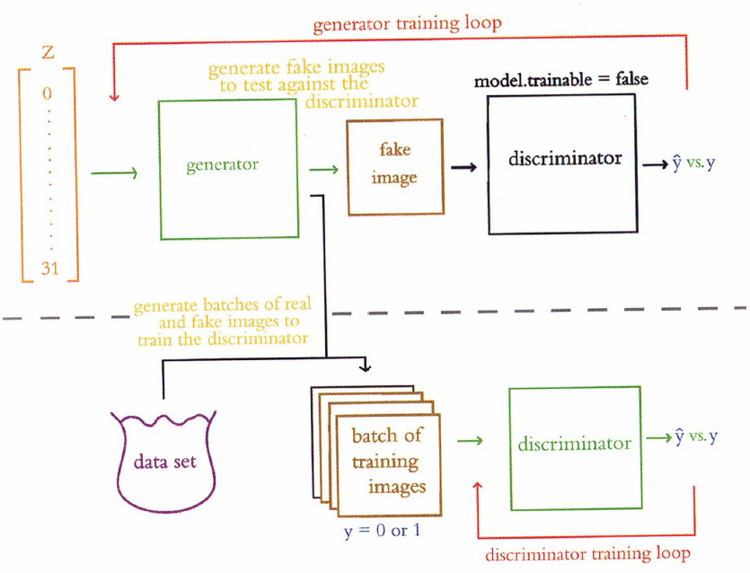

* image source: [Deep Learning Illustrated](https://www.deeplearningillustrated.com/)

## Initial Results

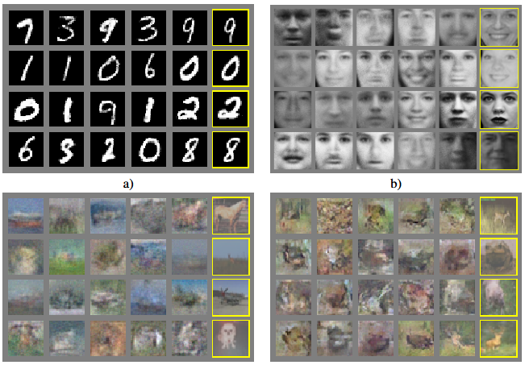
# Activity: Quick Draw!

::::: {.panel-tabset}

## App

:::: {.columns}

::: {.column width="30%"}
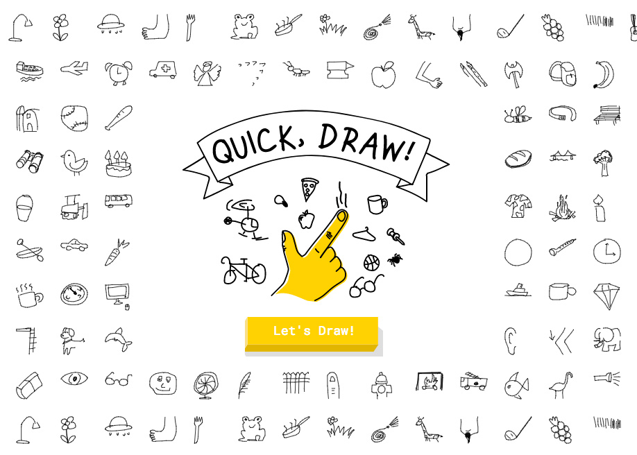	
:::

::: {.column width="10%"}
	
:::

::: {.column width="60%"}
Try out Quick Draw!

* [https://quickdraw.withgoogle.com/](https://quickdraw.withgoogle.com/)
* app will ask you to sketch 6 images

    * and it will try to recognize your artwork

* caution: there is sound

:::

::::

## Lions

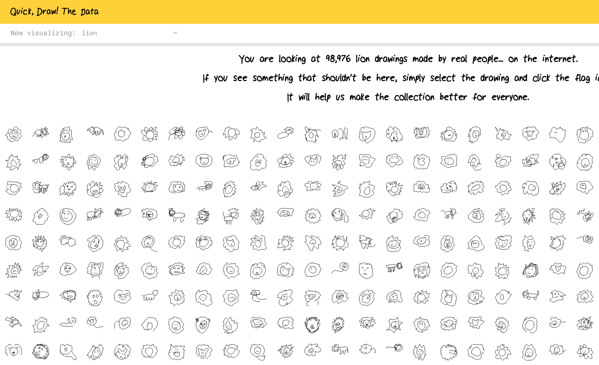

## Tigers

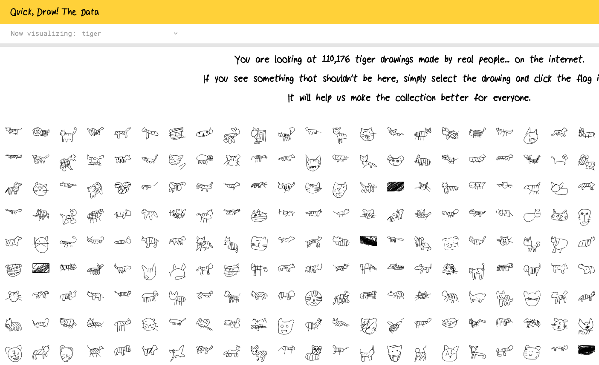

## Penguins

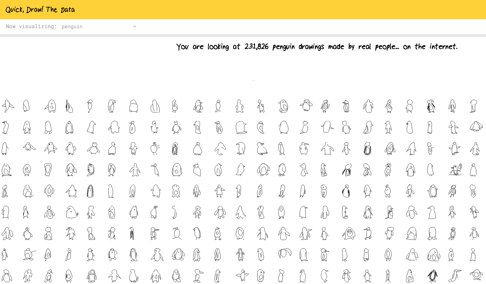

:::::

::: {.callout-warning}
## DCP1
:::

# Image Processing

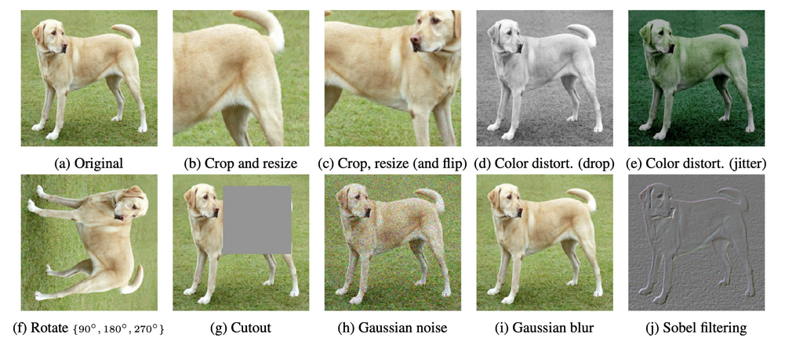

* image source: [A Simple Framework for Contrastive Learning of Visual Representations, Chen et al., ICML 2020](https://arxiv.org/abs/2002.05709)


* image source: [Princeton Sports](https://tigerlife.princeton.edu/sports)


# Feature Extraction

::: {.callout-tip}
## Feature Extraction

It is inefficient to input each pixel of an image into a neural network, especially considering the loss of spatial information.  Instead, we seek aggregation methods to simultaneously reduce data size and retain spatial information.
:::

## Color Histograms

::::: {.panel-tabset}

### RGB

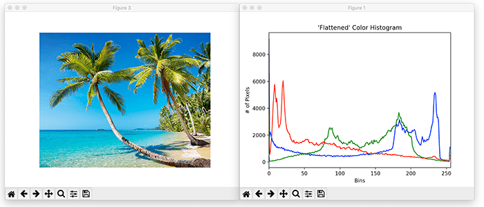

* image source: [PyImageSearch](https://pyimagesearch.com/2021/04/28/opencv-image-histograms-cv2-calchist/)


### Comparisons

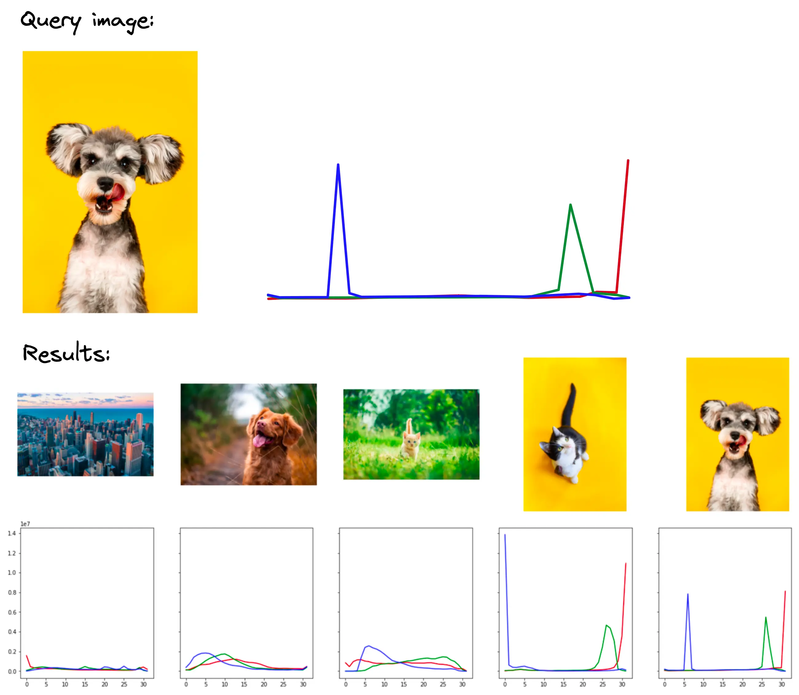

* image source: [Pinecone](https://www.pinecone.io/learn/series/image-search/color-histograms/)

:::::


::: {.callout-warning}
## DCP2
:::

# Saliency Maps

::: {.callout-tip}
## Interpretability of Image Models

If you want to encourage interpretability of your image models, consider using saliency maps
:::

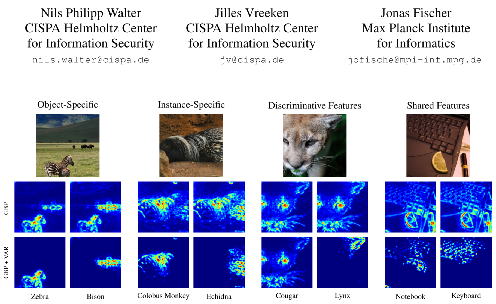

* image source: [Walter, et al](https://www.themoonlight.io/en/review/now-you-see-me-a-framework-for-obtaining-class-relevant-saliency-maps)


# Ethics Enclave: AI Legislation Tracker

:::: {.columns}

::: {.column width="60%"}

* Each student could be assigned a different state

    - Derek will provide an example
    - Some students may volunteer to focus on a different country

* Summarize the bills and voting

    - Which states are taking a vertical approach (akin to USA) or a horizontal approach (akin to EU)
    - Which states seem to push for more legislation?

* Tech? Perusall?

* Feedback mechanism.  For example,

    - The Georgia student would read over the work done by the Hawaii student
    - The Hawaii student would read over the work done by the Idaho student, etc.

* Time commitment: about 10 minutes per class over 4 class sessions

* Learning goals

    - compare and contrast local government approaches to AI regulation
    - practice literature searches with contemporary media	
    
:::

::: {.column width="10%"}
	
:::

::: {.column width="30%"}


* image source: [Traverse Legal](https://www.traverselegal.com/blog/ai-legislation/)
:::

::::


::: {.callout-warning}
## DCP3
:::

# ImageNet

:::: {.columns}

::: {.column width="45%"}
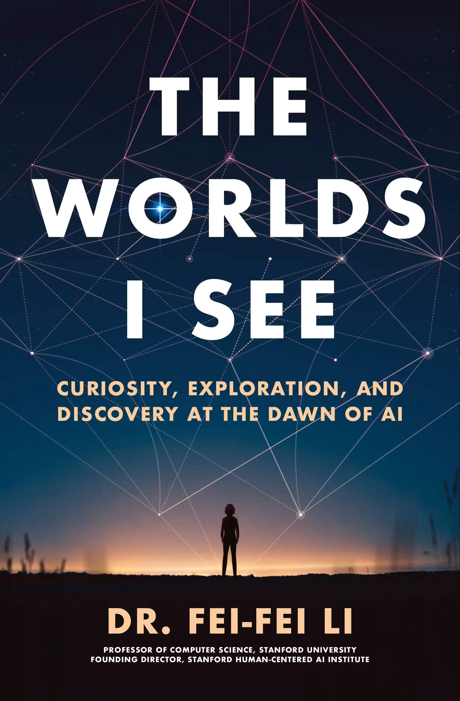
:::

::: {.column width="10%"}
	
:::

::: {.column width="45%"}
* Dr Fei Fei Li
* Princeton Class of 1999
* Pre-Read Selection for Class of 2028

> Biederman's number: "30,000 unique concepts might provide a complete foundation for understanding the visual world"

* ImageNet competition
* AlexNet: solved by convolutional neural networks in 2012

:::

::::

## Image Augmentation

* rotation
* translation
* reflections
* etc.

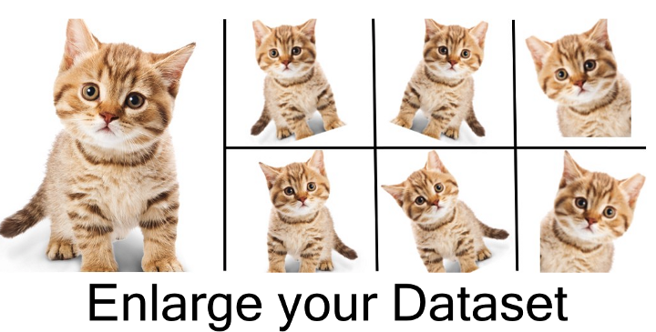

* image source: [Arun Gandhi](https://nanonets.com/blog/data-augmentation-how-to-use-deep-learning-when-you-have-limited-data-part-2/)


# Quo Vadimus?

:::: {.columns}

::: {.column width="60%"}
* due this Friday (October 30):

    - Poster Feedback (1.5 hours)
    - Precept 6 (1 hour)
    - Project Proposal (1/2 hour)

* Exam: November 18
  
:::

::: {.column width="10%"}
	
:::

::: {.column width="30%"}
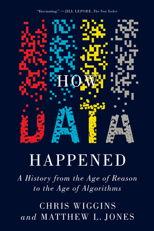

* Saturday, October 31
* 9 AM
* McDonnell Hall, Room A01
:::

::::


# Footnotes

::: {.callout-note collapse="true"}

## (optional) Additional Resources and References

* [Pytorch history](https://alexmoltzau.medium.com/pytorch-governance-and-history-2e5889b79dc1) by Alex Moltzau

:::

::: {.callout-note collapse="true"}
## Session Info

```{r}
sessionInfo()
```
:::


:::: {.columns}

::: {.column width="45%"}
	
:::

::: {.column width="10%"}
	
:::

::: {.column width="45%"}

:::

::::

::::: {.panel-tabset}


:::::