```{r}
#| echo: false
#| message: false
#| warning: false

```

# Session 15: Convolutional Neural Networks

## Learning objectives:

:::: {.columns}

::: {.column width="45%"}
- Continue exploring generative adversarial networks
- Motivate convolutional neural networks
- Compute convolutions
:::

::: {.column width="10%"}

:::

::: {.column width="45%"}
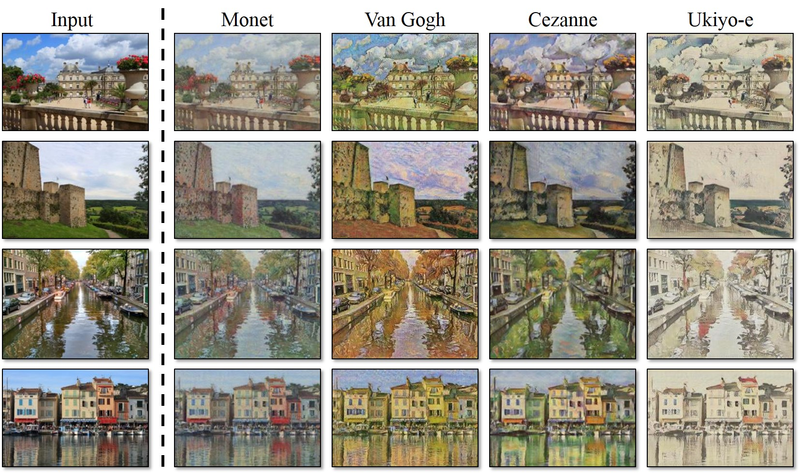

* image credit: [Jun-Yan Zhu, et al.](https://junyanz.github.io/CycleGAN/)
:::

::::


# Conditional GANs

::: {.callout-note}
## cGANs

"We investigate conditional adversarial networks as a general-purpose solution to image-to-image translation problems. These networks not only learn the mapping from input image to output image, but also **learn a loss function** to train this mapping. This makes it possible to apply the same generic approach to problems that traditionally would require very different loss formulations."

* [Isola, et al.](https://phillipi.github.io/pix2pix/)
:::

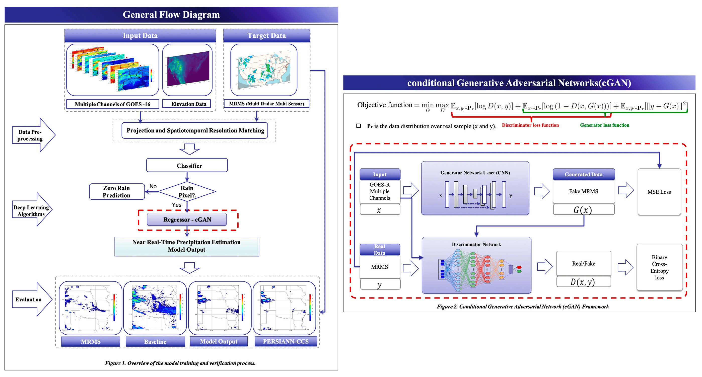

* image source: [Hayatbini, et al.](https://www.mdpi.com/2072-4292/11/19/2193#)

## Activity: Pix2Pix Image-to-Image

::::: {.panel-tabset}

## App

:::: {.columns}

::: {.column width="45%"}
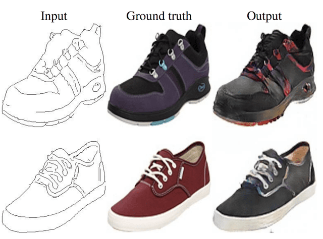	
:::

::: {.column width="10%"}
	
:::

::: {.column width="45%"}
* [app (link)](https://affinelayer.com/pixsrv/) by Christopher Hesse (no longer active)
* [GitHub repo](https://github.com/affinelayer/pix2pix-tensorflow)
* [TensorFlow code](https://www.tensorflow.org/tutorials/generative/pix2pix)
:::

::::

## ex1

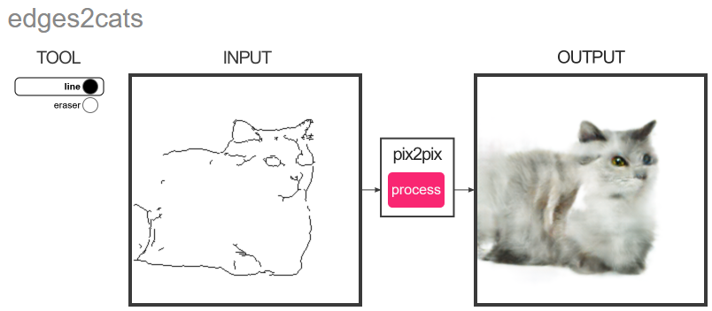

## ex2

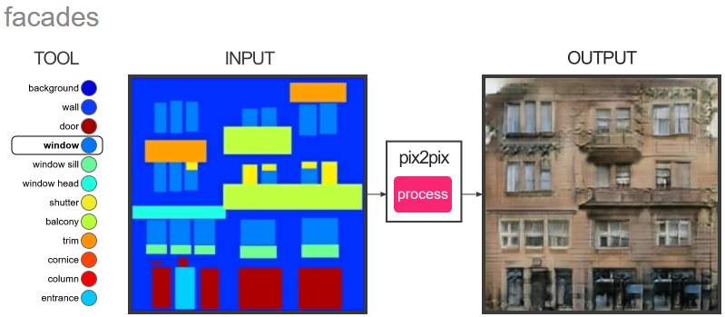

## ex1

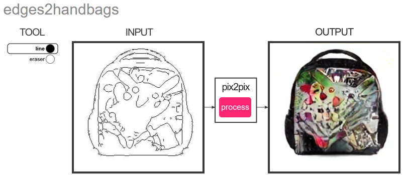

:::::

# Activity: Pix2Pix Instruct

::::: {.panel-tabset}

## App

:::: {.columns}

::: {.column width="45%"}
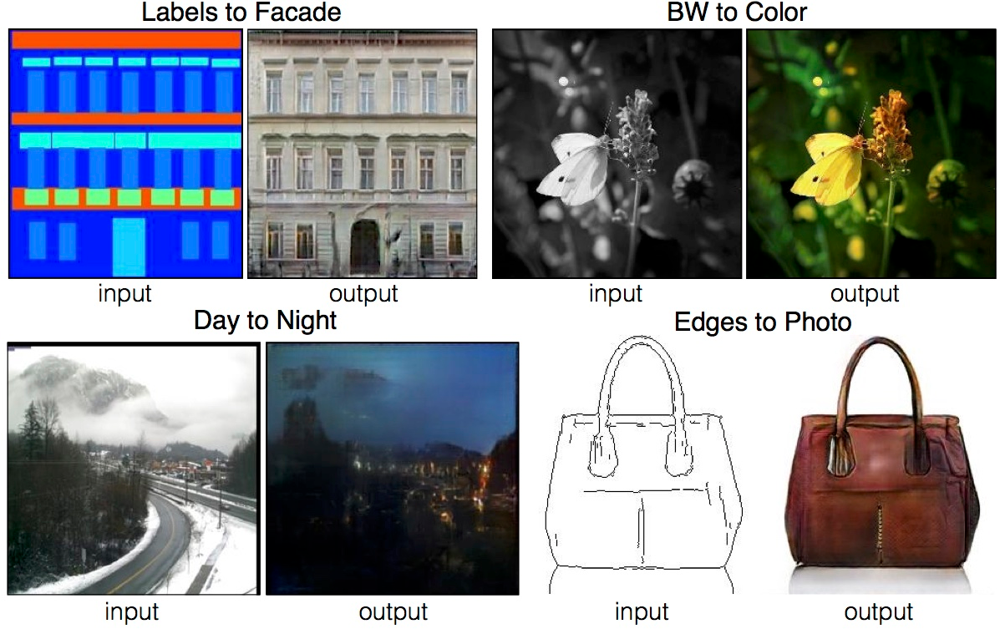	
:::

::: {.column width="10%"}
	
:::

::: {.column width="45%"}
* [app (link)](https://huggingface.co/spaces/timbrooks/instruct-pix2pix) by Tim Brooks (no longer active)
* [GitHub repo](https://github.com/timothybrooks/instruct-pix2pix)

:::

::::

## ex1

:::: {.columns}

::: {.column width="45%"}

:::

::: {.column width="10%"}
	
:::

::: {.column width="45%"}

:::

::::

## ex2

:::: {.columns}

::: {.column width="45%"}

:::

::: {.column width="10%"}
	
:::

::: {.column width="45%"}
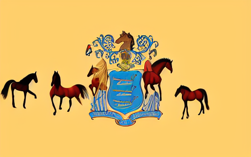
:::

::::

## ex3

:::: {.columns}

::: {.column width="45%"}

:::

::: {.column width="10%"}
	
:::

::: {.column width="45%"}

:::

::::

## ex2025

To jazz up a session about computer vision, I told my students that it used to be quite innovative to prompt a multimodal chatbot with something like "Turn people into ramen". Here is what one of our students then made in Copilot.

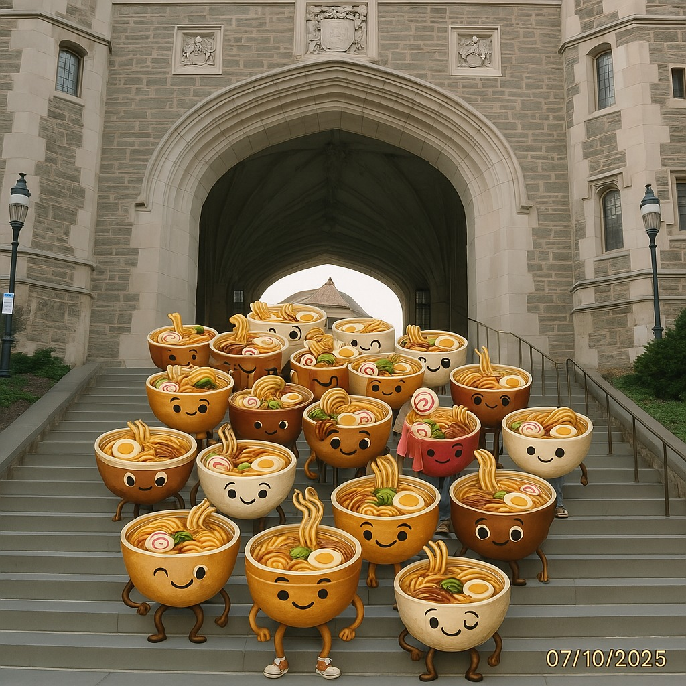

:::::


# Stacked GANs

::: {.callout-note}
## Stacked GANs

*  "Stage-I GAN sketches the primitive shape and colors of the object based on the given text description, yielding Stage-I low-resolution images"
* " Stage-II GAN takes Stage-I results and text descriptions as inputs, and generates high-resolution images with photo-realistic details"

:::

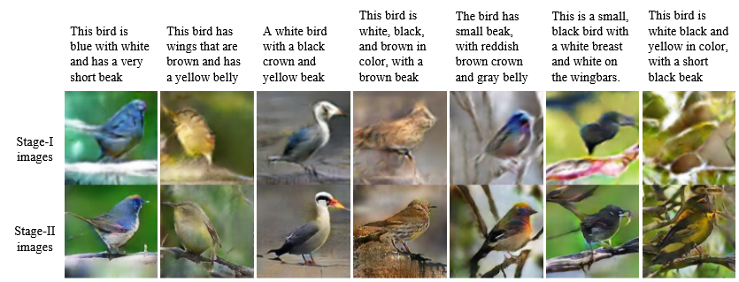

## Architecture

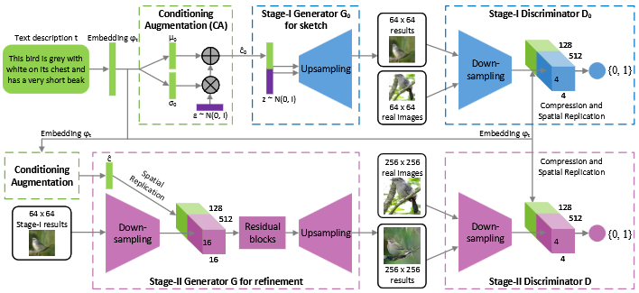

## Scaling

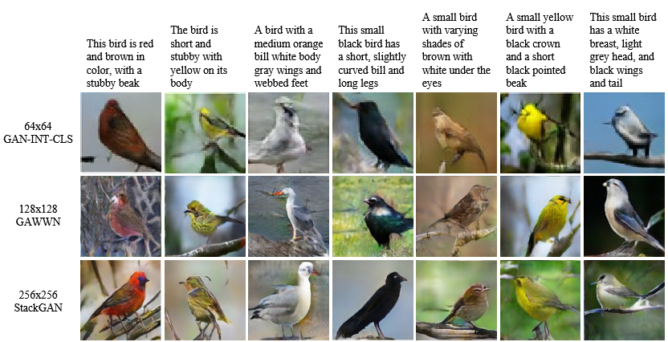


# Cycle GANs

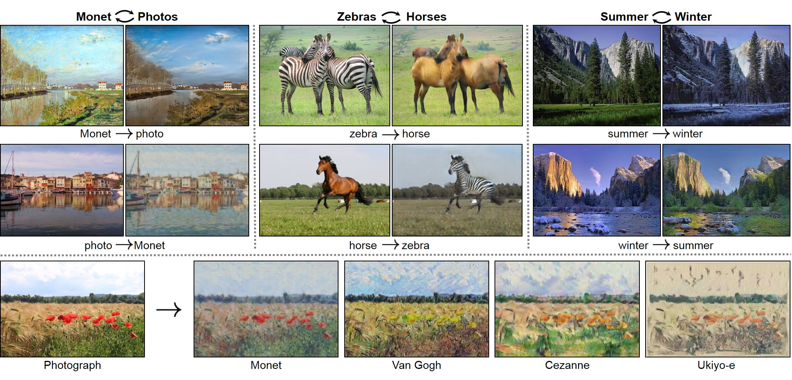

::: {.callout-note}
## cGANs

* "... learning to translate an image from a source domain $X$ to a target domain $Y$ in the absence of paired examples ..." --- [Jun-Yan Zhu, et al., 2017](https://junyanz.github.io/CycleGAN/)

:::


## Architecture

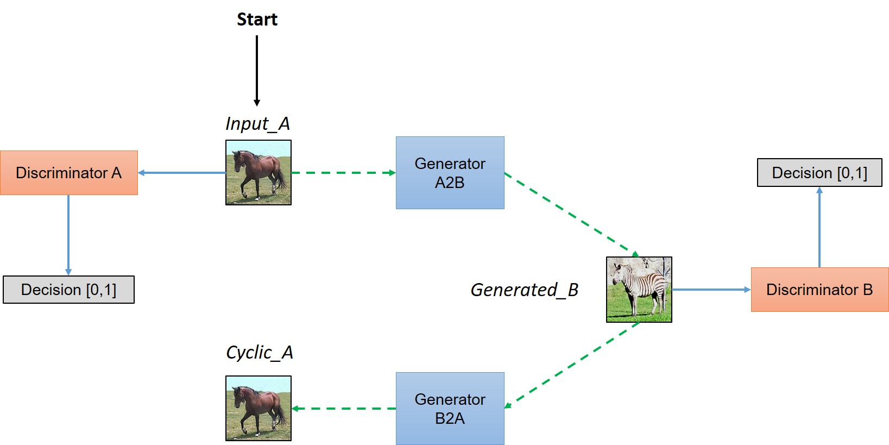

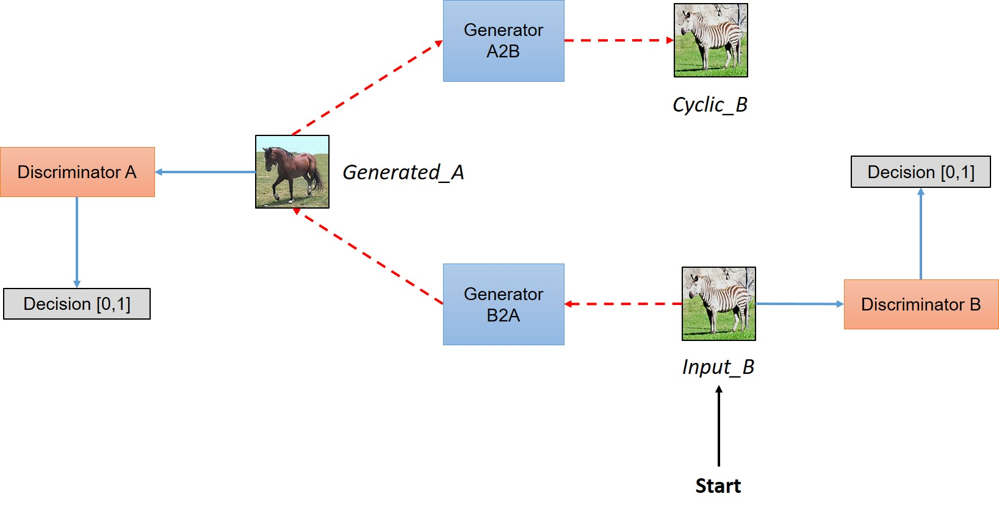

* images source: [Bansal and Rathore](https://hardikbansal.github.io/CycleGANBlog/)

::: {.callout-tip}
## cGAN Objective

In a cyclic GAN, the generator and discriminator converge toward a Nash equilibrium.

:::

::: {.callout-warning}

## DCP1

:::


# Convolutional Neural Networks

## Image Classification Example: MNIST Dataset

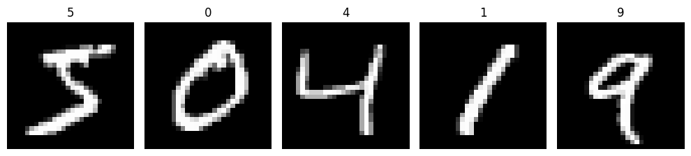

*Figure: Example MNIST digits*

- Consider an image classification task using the **MNIST dataset**.
- Contains **70,000 grayscale images** of handwritten digits.
- Each image is **28×28 pixels** in size.
- There are **10 classes** (digits 0–9).
- When using a dense neural network, we **flatten** each 28×28 image into a 784-dimensional vector.
- This process **destroys the two-dimensional structure** that humans use to perceive spatial relationships.
- Human vision is inherently **two-dimensional**, and spatial patterns—edges, shapes, and local contrast—are crucial for recognition.

## Limitations of Dense Networks for Image Data

- Flattening images removes spatial structure—but there's also a **computational problem**.
- Each neuron in a dense layer connected to a 28×28 grayscale image needs:

  28 × 28 + 1 = 785 parameters (weights + bias).
- For larger images, the parameter count grows rapidly.
- For example: 200×200 RGB image
  - 200 × 200 × 3 = 120,000 inputs per neuron
  - ⇒ 120,001 parameters per neuron
  - For 64 neurons in the first hidden layer ⇒ nearly **8 million parameters**.
- **Convolutional Neural Networks (CNNs)** address these issues by exploiting **local spatial structure** and **weight sharing**.

## What Is a Convolutional Neural Network (CNN)?

- A **Convolutional Neural Network (CNN)**—also called a **ConvNet**—is a neural network that includes one or more **convolutional layers**.
- These layers allow the network to efficiently process **spatial patterns** in data, such as images.
- CNNs are particularly powerful for **computer vision tasks** because they can capture:
  - Local structures (edges, corners, textures)
  - Spatial hierarchies (shapes, objects)
- Each convolutional layer applies a small matrix of weights (called a **kernel**, **filter**, or **convolution matrix**) across the image.

## 2D Convolution: The Core Operation

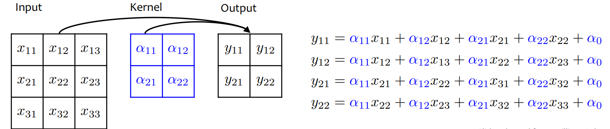

- Pick a small matrix *F* (e.g., 2 × 2 or 3 × 3) of weights — the **kernel** or **filter**.
- Slide *F* across the image and compute the **inner product** between *F* and each local patch.
- Replace the center pixel with the computed value to form the **feature map**.
- Different kernels capture different **low-level features**: edges, corners, textures, etc.
- To detect new patterns, learn new weights in *F*.

<small>Image source: <https://www.cs.cmu.edu/~mgormley/courses/10601-s24//slides/lecture17-cnn.pdf></small>

## Convolution vs. Dense Layers

- The **mathematical operation** of a convolutional layer is similar to that of a neuron:

  $$z = \sum w_{ij} x_{ij} + b, \quad a = \sigma(z)$$

- The key difference:
  - A dense layer has a **unique weight for every input**.
  - A convolutional layer uses a **small kernel** (e.g., 3 × 3) whose weights are **shared** across spatial locations.
- This **weight sharing** reduces the number of parameters by orders of magnitude.
- The same filter detects the same pattern **anywhere in the image**.

*Check out:* <https://ezyang.github.io/convolution-visualizer/>

## Multiple Filters in a Convolutional Layer

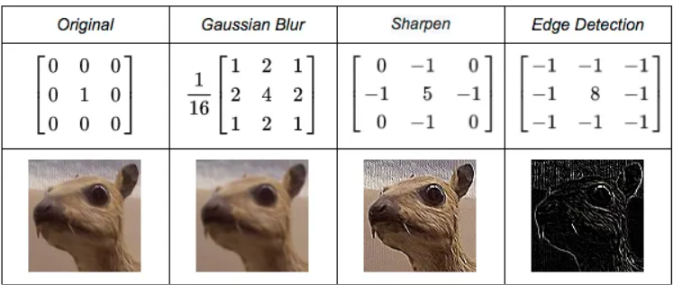

- A convolutional layer usually applies **multiple filters** (kernels) in parallel.
- Each filter learns to detect a different type of **pattern or feature**.
- The outputs from all filters form a stack of **feature maps**.
- These maps together capture richer information about the input image.

<small>Image source: <https://medium.com/@abhishekjainindore24/all-about-convolutions-kernels-features-in-cnn-c656616390a1></small>

## Applying Convolution to Multiple Layers

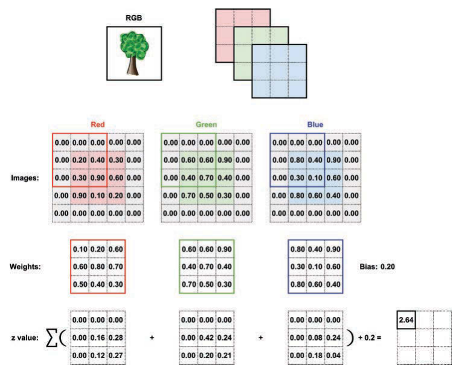

<small>Image source: *Deep Learning Illustrated*</small>

## Activation Maps from Multiple Filters

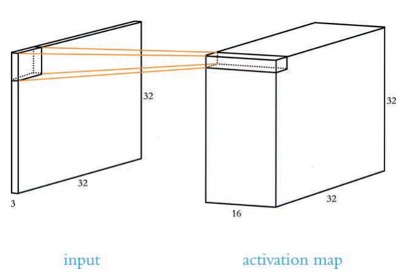

*Figure: Each filter produces a feature map highlighting specific image regions it responds to.*

<small>Image source: *Deep Learning Illustrated*</small>

- The first convolutional layer may contain kernels that detect simple patterns such as vertical or horizontal lines, or color transitions.
- Each filter scans the image and produces a **high activation** when its preferred pattern appears.
- These activation maps serve as the input to the next layer, allowing the network to learn from spatial features directly.

## From Low-Level to High-Level Features

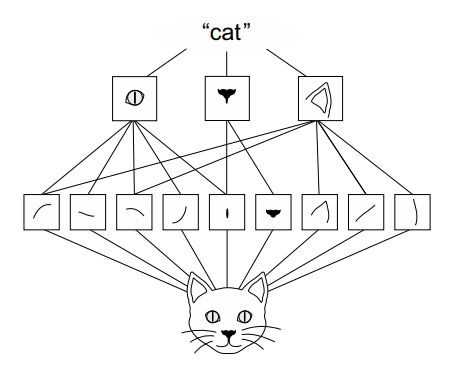

*Figure: Deeper layers combine low-level features into more abstract representations.*

<small>Image source: *Deep Learning with Python*</small>

- Early layers learn to detect **edges, corners, and simple shapes**.
- Middle layers capture **textures and patterns**.
- Deep layers combine these into **high-level features**, such as object parts or entire objects.
- This creates a **feature hierarchy**: edges → shapes → textures → objects.

::: {.callout-warning}

## DCP2

:::


# Convolutional Layers

## Key Features of Convolutional Layers

- **Position Invariance:** Convolutional layers enable the network to recognize features **regardless of their location** in the image. A single kernel can identify its corresponding pattern anywhere in the input.
- **Preservation of Spatial Structure:** CNNs operate on the **two-dimensional structure** of images, learning features within their local spatial context.
- **Parameter Efficiency:** By using small kernels and shared weights, convolutional layers require **far fewer parameters** than dense layers, improving computational efficiency.
- **Improved Performance:** CNNs achieve superior accuracy in computer vision tasks such as image classification and object detection.

## Convolutional Layer Hyperparameters

- Several **hyperparameters** determine the number of weights, biases, and overall behavior of a convolutional layer.
- The most important ones are:
  - **Kernel size** – defines the receptive field of the filter.
  - **Stride length** – defines how far the kernel moves at each step.
  - **Padding** – controls how the image borders are handled.
- Together, these control:
  - The spatial size of the output feature map,
  - The number of learnable parameters,
  - And the computational cost of the convolution.

## Kernel Size

- The **kernel size** (or **filter size**, or **receptive field**) determines how many pixels are combined in each operation.
- Common choices:
  - 3 × 3, standard in most modern CNNs.
  - 5 × 5, sometimes used for slightly larger receptive fields.
  - 7 × 7, used rarely; larger filters can be harder to train effectively.
- If the kernel is too small (2 × 2), it can't capture meaningful structures; if too large, it may mix too many competing features.

## Stride Length

- The **stride** defines the number of pixels the kernel shifts each time it moves across the image.
- Typical values:
  - *S* = 1, default; retains high spatial resolution.
  - *S* = 2, halves spatial resolution; faster computation.
  - *S* > 3, usually suboptimal; may skip important regions.
- Increasing stride **reduces computation** but also reduces the spatial detail captured.

## Padding

- **Padding** adds extra pixels (zeros) around the image border.
- Purpose:
  - Controls the output size of the feature map.
  - Ensures border pixels are treated equally.
- Example: For a 28 × 28 image and a 5 × 5 kernel, adding 2 zeros on each side maintains output size.
- Output size can be computed by:

  $$\text{Output size} = \frac{D - F + 2P}{S} + 1$$

  where:
  - *D* = input dimension
  - *F* = kernel size
  - *P* = padding
  - *S* = stride

## Pooling Layers

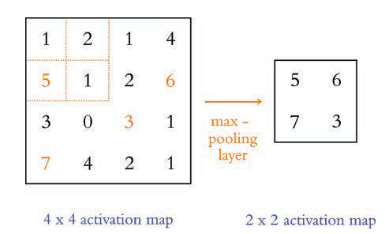

*Figure: Max-pooling operation with a 2 × 2 filter and stride 2. Only the maximum value from each region is kept.*

<small>Image source: *Deep Learning Illustrated*</small>

- **Purpose:** Reduce the number of parameters and computation while helping to prevent overfitting.
- Like convolutional layers, pooling layers have:
  - A **filter size** (typically 2 × 2)
  - A **stride length** (typically 2)
- The filter slides over the input feature map.
- At each step, it applies a data-reducing operation, most commonly the **max operation**.
- **Max Pooling:** keeps only the largest activation in each 2 × 2 region, effectively downsampling by a factor of 4.

## From Convolution to Classification

- After several **convolution + pooling** layers, the network has learned hierarchical spatial features.
- These features are stored in the final set of **activation maps**.
- A **Flatten layer** converts these 2D feature maps into a 1D vector.
- The vector is passed to one or more **fully connected (dense) layers** that combine the extracted features.
- The final layer (often with a **softmax activation**) outputs a probability distribution over classes.

*Check out:* <https://adamharley.com/nnvis/cnn/2d.html>

## Flattening the Feature Maps

- After several **convolution + pooling** layers, the output is a 3D tensor:

  (*H*, *W*, *C*)

  where:
  - *H* = height
  - *W* = width
  - *C* = number of feature maps (filters)
- The **Flatten layer** reshapes this 3D tensor into a single 1D vector of length:

  *H* × *W* × *C*

- This 1D vector becomes the input to one or more **fully connected (dense) layers**.
- Finally, the dense layers perform **classification** (often using a softmax output layer).

## CNN Architecture Overview

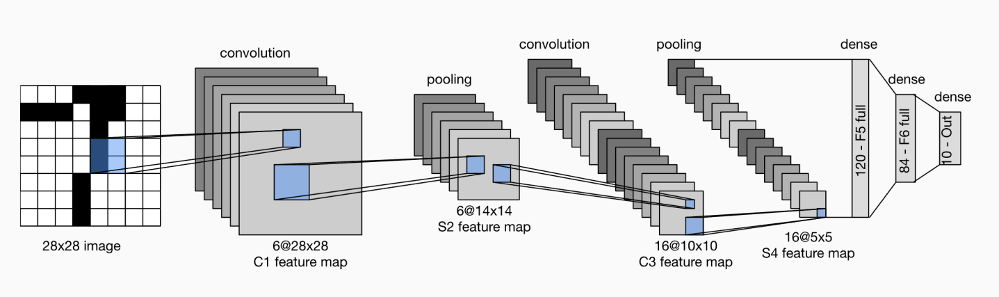

*Figure: Example of a CNN pipeline. Sequential layers extract features, downsample, and classify.*

- The network starts with the raw input image (e.g., 28×28 grayscale digit).
- **Convolution layers** extract local features (edges, textures).
- **Pooling layers** downsample feature maps and retain the strongest activations.
- **Flatten layer** converts 3D feature maps into a 1D vector.
- **Fully connected layers** combine extracted features to perform classification.
- The final **output layer** (e.g., softmax) produces probabilities over classes.

<small>Image source: Zhang, Lipton, Li, and Smola, *Dive Into Deep Learning* (2023)</small>


# Convolution Example

::::: {.panel-tabset}

## Feature Map

:::: {.columns}

::: {.column width="45%"}
$$ \begin{array}{rrrr}	
  16 & 3 & 2 & 13 \\
  5 & 10 & 11 & 8 \\
  9 & 6 & 7 & 12 \\
  4 & 15 & 14 & 1 \\
\end{array}$$
:::

::: {.column width="10%"}
	
:::

::: {.column width="45%"}
* 4 rows
* 4 columns

:::

::::

## Moving Window

:::: {.columns}

::: {.column width="45%"}
$$ \begin{array}{rrrr}	
  16 & 3 & 2 & 13 \\
  5 & 10 & 11 & 8 \\
  9 & 6 & 7 & 12 \\
  4 & 15 & 14 & 1 \\
\end{array}$$

* kernel size: 2
* padding: 0
* stride length: 1
:::

::: {.column width="10%"}
	
:::

::: {.column width="45%"}

$$ \begin{array}{rrr}	
  16 & 11 & 13 \\
  10 & 11 & 12 \\
  15 & 15 & 14 \\
\end{array}$$


* 3 rows
* 3 columns

:::

::::

## Kernel Size

:::: {.columns}

::: {.column width="45%"}
$$ \begin{array}{rrrr}	
  16 & 3 & 2 & 13 \\
  5 & 10 & 11 & 8 \\
  9 & 6 & 7 & 12 \\
  4 & 15 & 14 & 1 \\
\end{array}$$

* kernel size: 3
* padding: 0
* stride length: 1
:::

::: {.column width="10%"}
	
:::

::: {.column width="45%"}

$$ \begin{array}{rr}	
  16 & 13 \\
  15 & 15 \\
\end{array}$$


* 2 rows
* 2 columns

:::

::::

## Stride Length

:::: {.columns}

::: {.column width="45%"}
$$ \begin{array}{rrrr}	
  16 & 3 & 2 & 13 \\
  5 & 10 & 11 & 8 \\
  9 & 6 & 7 & 12 \\
  4 & 15 & 14 & 1 \\
\end{array}$$

* kernel size: 2
* padding: 0
* stride length: 2
:::

::: {.column width="10%"}
	
:::

::: {.column width="45%"}

$$ \begin{array}{rr}	
  16 & 13 \\
  15 & 14 \\
\end{array}$$


* 2 rows
* 2 columns

:::

::::

## Padding

:::: {.columns}

::: {.column width="45%"}
$$ \begin{array}{rrrrrr}
  0 & 0 & 0 & 0 & 0 & 0 \\
  0 & 16 & 3 & 2 & 13 & 0 \\
  0 & 5 & 10 & 11 & 8 & 0 \\
  0 & 9 & 6 & 7 & 12 & 0 \\
  0 & 4 & 15 & 14 & 1 & 0 \\
  0 & 0 & 0 & 0 & 0 & 0 \\
\end{array}$$

* kernel size: 3
* padding: 1
* stride length: 1
:::

::: {.column width="10%"}
	
:::

::: {.column width="45%"}

$$ \begin{array}{rrrr}	
  16 & 16 & 13 & 13 \\
  16 & 16 & 13 & 13 \\
  15 & 15 & 15 & 14 \\
  15 & 15 & 15 & 14 \\
\end{array}$$


* 4 rows
* 4 columns

:::

::::

:::::

::: {.callout-warning}

## DCP3

:::


# Ethics Enclave: DeepfakeBench

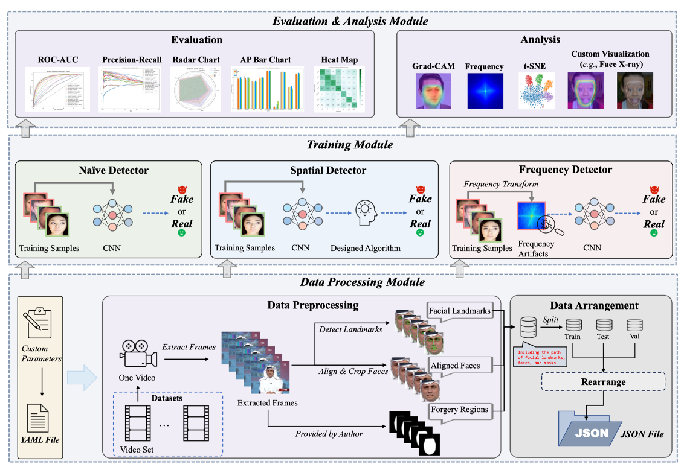

* image source: [DeepfakeBench](https://github.com/SCLBD/DeepfakeBench)


# Unsupervised Representation Learning

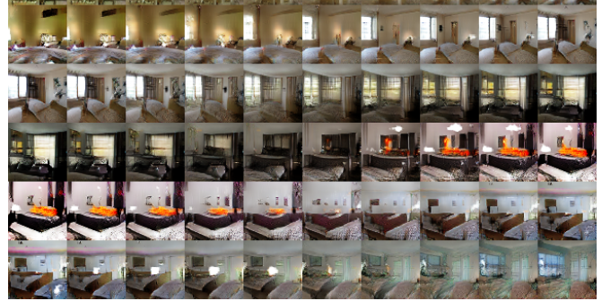

* image source: [Radford, et al, 2016](https://arxiv.org/abs/1511.06434)

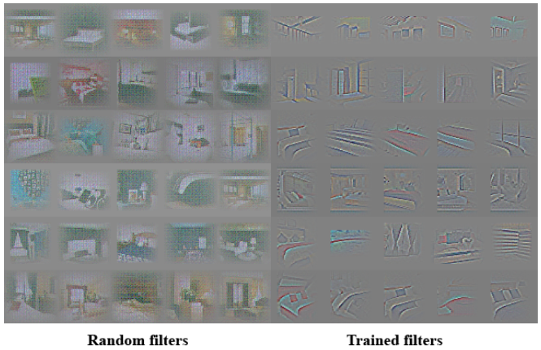

* image source: [Radford, et al, 2016](https://arxiv.org/abs/1511.06434)

::::: {.panel-tabset}

## Image Space

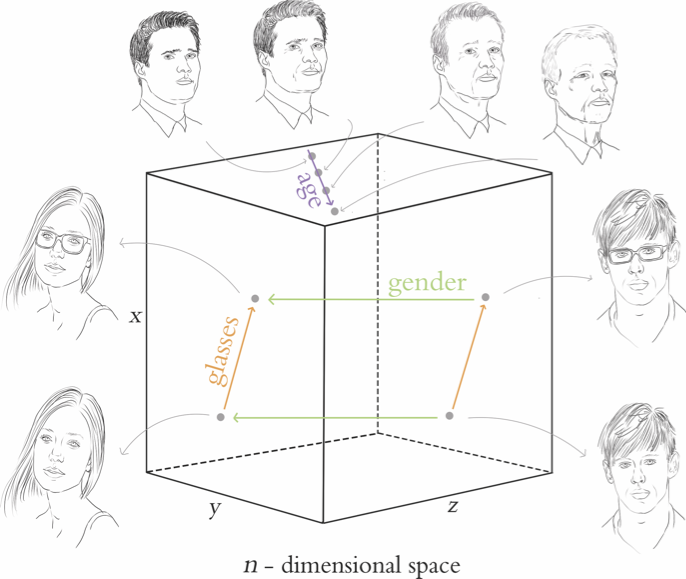

* image source: [Deep Learning Illustrated](https://www.deeplearningillustrated.com/)

## ex1

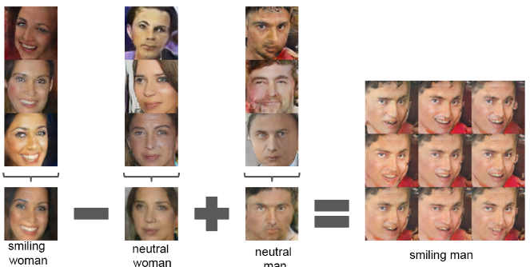

* image source: [Radford, et al, 2016](https://arxiv.org/abs/1511.06434)

## ex2

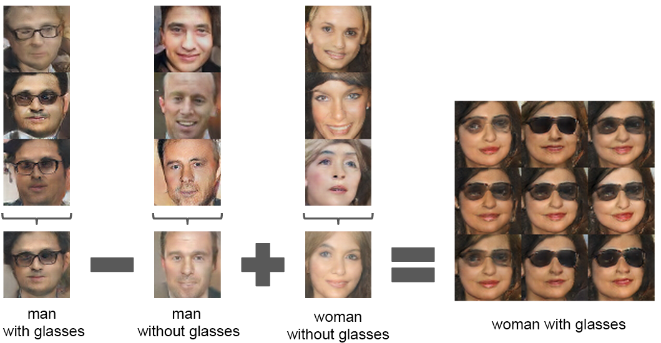

* image source: [Radford, et al, 2016](https://arxiv.org/abs/1511.06434)

:::::


# Quo Vadimus?

:::: {.columns}

::: {.column width="45%"}
* due this Friday (Nov 6):

    - Precept 7 (1.5 hours)
    - Multipass: DeepSeek (20 minutes)
    - Literature Search (10 minutes)
    
        - one per person
    
* exam: Nov 18
  
:::

::: {.column width="10%"}
	
:::

::: {.column width="45%"}
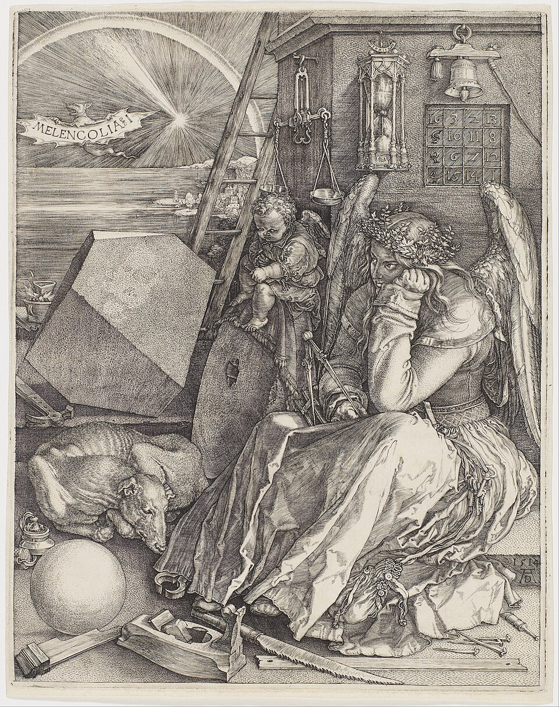
:::

::::


# Footnotes

::: {.callout-note collapse="true"}

## (optional) Additional Resources and References

Today's slides were adapted by lectures by DataX postdocs Mufan Li and Omar Hagrass

* convolutions

    - [Python examples](https://www.geeksforgeeks.org/deep-learning/introduction-to-pooling-layer-cnn/) by Geeks for Geeks

* deep fake guidance:

    - [Witness Media Lab](https://lab.witness.org/backgrounder-deepfakes-in-2021/)
    - [MIT Center for Advanced Virtuality](https://deepfakes.virtuality.mit.edu/)
    - [Reddit post](https://old.reddit.com/r/Futurology/comments/1nyq6m2/sora_2_released_how_to_spot_deepfakes/) from r/Futurology

* [flag of New Jersey](https://www.britannica.com/topic/flag-of-New-Jersey) article at Britannica

:::


::: {.callout-note collapse="true"}
## Session Info

```{r}
sessionInfo()
```
:::


:::: {.columns}

::: {.column width="45%"}
	
:::

::: {.column width="10%"}
	
:::

::: {.column width="45%"}

:::

::::

::::: {.panel-tabset}


:::::