```{r}
#| echo: false
#| message: false
#| warning: false

```

# 16: NLP (Bag of Words)

## Learning objectives:

:::: {.columns}

::: {.column width="45%"}
- Motivate natural language processing
- Explore the early adapations
- Compute word frequencies
:::

::: {.column width="10%"}

:::

::: {.column width="45%"}
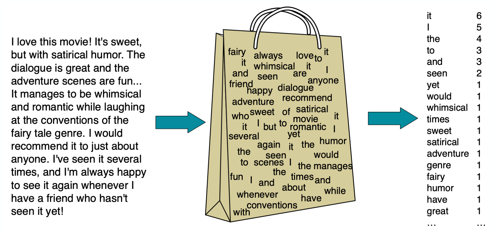
:::

::::


# Natural language processing

**NLP:** developing computer programs to classify, analyze and predict human language.

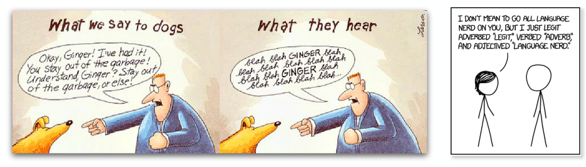

NLP involves computer science, mathematics, linguistics and more.

---

## Data structure

So far our input **data** has looked like this — a numeric matrix of samples × features, or an image as a grid of pixel intensities:

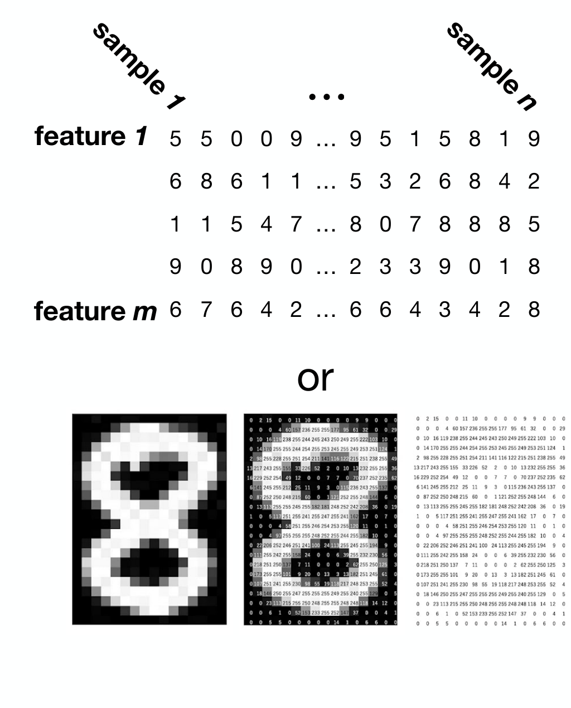

**But now we have:** unstructured text — books, research papers, Wikipedia, Reddit, the New York Times, …


---

## How do we apply statistics to language?

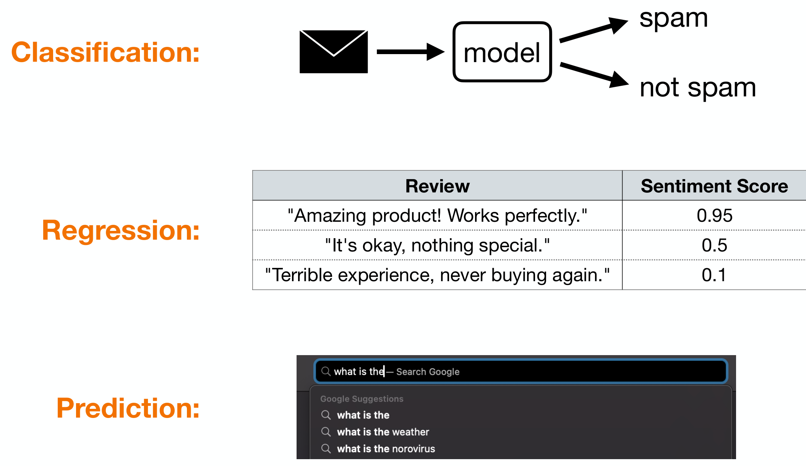

- **Classification:** email → model → *spam* / *not spam*
- **Regression:**

  | Review | Sentiment Score |
  |---|:-:|
  | "Amazing product! Works perfectly." | 0.95 |
  | "It's okay, nothing special." | 0.5 |
  | "Terrible experience, never buying again." | 0.1 |

- **Prediction:** search autocomplete — "what is the" → "what is the weather", "what is the norovirus", …

---

## NLP tasks we will look at

1. How to build a model for **text classification**
2. How to define **numerical representations of words**
3. How to **predict the next word** in a sentence

---

## Tasks in Natural Language Processing


- NLP has many applications
- Active field of research

Applications: language translation, smart assistants, document analysis, online searches, predictive text, automatic summarization, social media monitoring, chatbots, sentiment analysis, email filtering.

*Source: <https://datasciencedojo.com/blog/natural-language-processing-applications/>*

---

## Protein Language Models

Protein structure/function can be **represented** by language models.

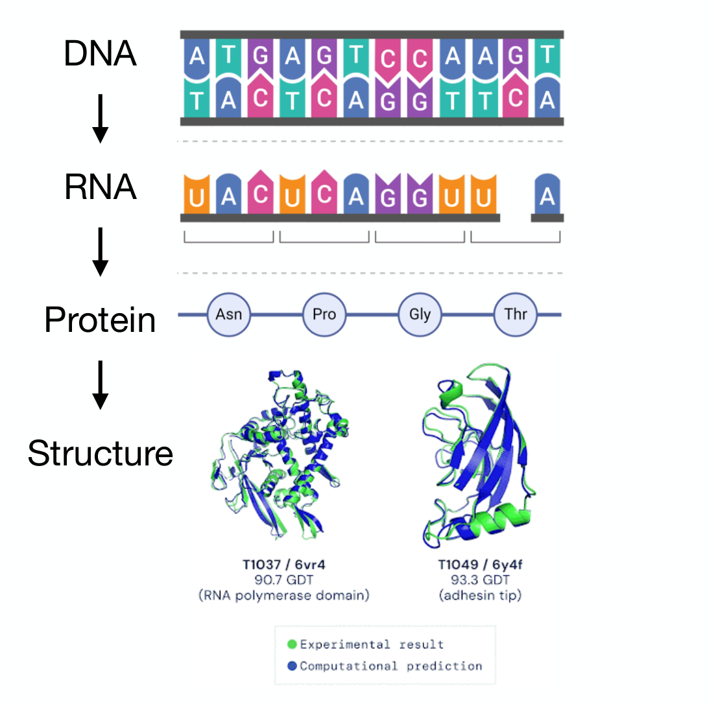

- Amino acids can be thought of as **"words"**
- A sequence of amino acids defines the protein **"sentence"**

*Jumper et al., Nature, 2021; Bittrich et al., Sci Rep, 2019*

---

# Modern Applications

**Question answering:** "what should I teach for an NLP course?"

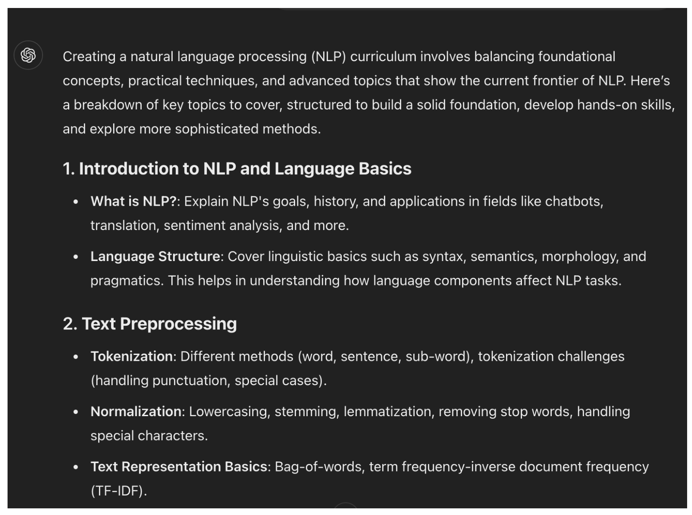

**Text to image:** "astronaut riding a horse by Hiroshige"


---

## Translation

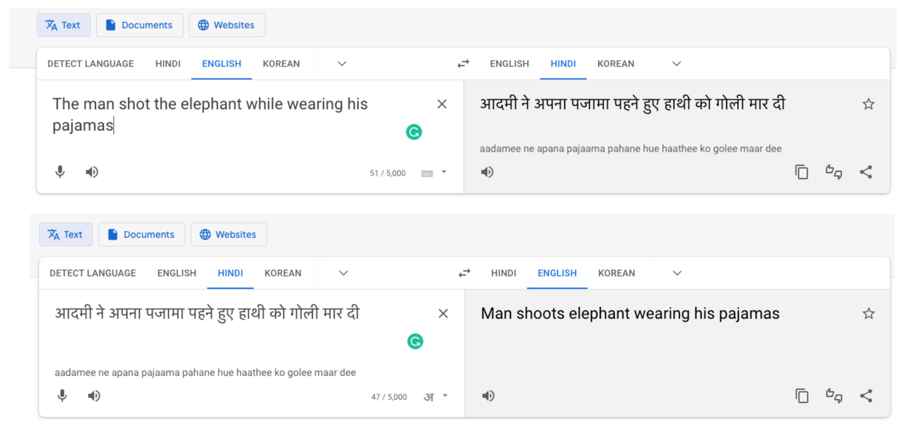

- English → Hindi: "The man shot the elephant while wearing his pajamas" → आदमी ने अपना पजामा पहने हुए हाथी को गोली मार दी
- Hindi → English (round trip): → "Man shoots elephant wearing his pajamas"

*(Based on Google Translate result in 2023-01)*

---

# Why is language processing difficult?

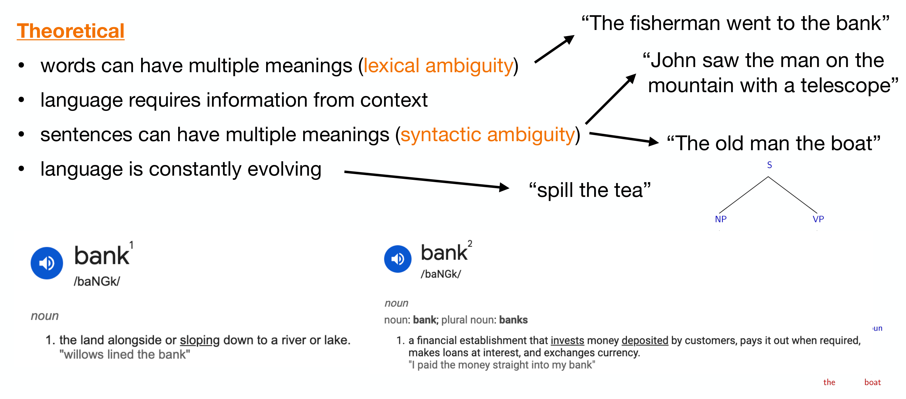

### Theoretical
- Words can have multiple meanings (**lexical ambiguity**) — *"The fisherman went to the bank"*
- Language requires information from context
- Sentences can have multiple meanings (**syntactic ambiguity**) — *"John saw the man on the mountain with a telescope"*, *"The old man the boat"*
- Language is constantly evolving — *"spill the tea"*

### Practical
- Data preprocessing, validation
- Data management (e.g., data from the internet)
- Accents and dialects

---

::: {.callout-warning}
## DCP1
:::


# Terminology in NLP

- **Language model** – a model that analyzes or predicts text by assigning probabilities to sequences of words
- **Tokenization** – splitting longer text into smaller parts (tokens), e.g., a sentence into individual words
- **Corpus** – a collection of texts
- **Stop words** – words that are removed from text because they contribute little meaning, e.g., *the, and, a*
- **Bag of words** – a language representation model that only considers the occurrence of words in a text
- **n-gram** – a language representation model that considers contiguous sections of *n* items in a text

Example 3-gram: "the old man the boat" → {"the old man", "old man the", "man the boat"}

---

## NLP in application – text classification

- **Spam detection:** email → model → *spam* / *not spam*
- **Sentiment analysis:** review → model → *positive* / *negative*

---

## Other examples of text classification

**Subject categorization** — Medical Subject Heading (MeSH) Categorization:

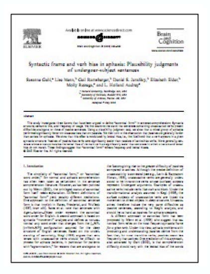

- A. Anatomy
- B. Organisms
- C. Diseases
- D. Chemicals and Drugs
- …

**Federalist papers:**

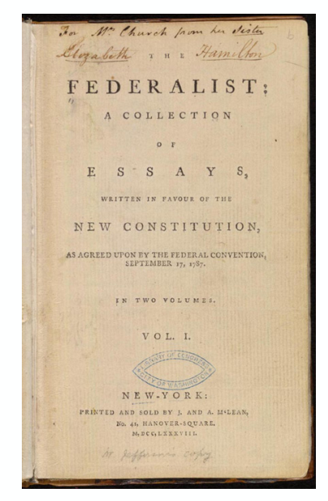

- 1787–1788: 85 anonymous essays written by Hamilton, Madison and Jay to try and convince New York to ratify the U.S. Constitution
- Authorship of 12 of the letters in dispute
- Solved using Bayesian methods

---


# Text Classification

## Text classification – spam filter (rule based)

Let's consider making a spam filter. Is it possible to use a rule-based system and heuristics?

- If document contains a word in $S = \{\text{word}_1, \text{word}_2, \dots, \text{word}_n\}$, then spam
  - could include e.g. medicine names, web domains, dollars, etc.
- If document contains mostly capital letters, then spam
- If …

Can be very effective for certain cases, but is not well defined or generalized.

---

## Text classification – statistical approach

**Input:** a set of $n$ **labeled documents**, $D = \{(c_1, \mathbf{x}_1), (c_2, \mathbf{x}_2), \dots, (c_n, \mathbf{x}_n)\}$

- where $\mathbf{x}_i$ is a document containing ordered words $\{x_1, x_2, \dots, x_k\}$
- and $c_i \in C$ is a label corresponding to spam (+1) or not spam (−1)

**Output:** a trained classifier $h : \mathbf{X} \to C$

- given a set of new documents, we can use $h$ to predict the class

Possible models: naive Bayes, logistic regression, SVM, neural network.

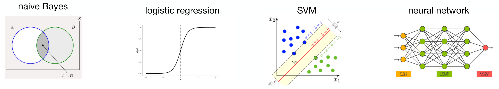

---

# Naive Bayes

## Naive Bayes spam filter — goal

**Goal:** build a text classification model to identify emails as spam or not spam.

Given a training dataset $D = \{(c_1, \mathbf{x}_1), \dots, (c_n, \mathbf{x}_n)\}$ where $c \in \{+1, -1\}$ is a label and $\mathbf{x}$ is a text document, we want a model to compute:

$$h(\mathbf{x}) = \arg\max_c P(c \mid \mathbf{x})$$

the probability of a class given the input text data. How to compute $P(c \mid \mathbf{x})$?

*This is difficult to estimate for continuous or high-dimensional data!*

---

## Naive Bayes spam filter — estimating probabilities by counting

We seek to compute $P(c_i = c \mid \mathbf{x}_i = \mathbf{x})$.

Recall that

$$P(X = x) = \frac{\sum_{i=1}^{n} I(x_i = x)}{n}$$

e.g., for coin flips HHHHT: $P(X = \text{heads}) = 4/5$, $P(X = \text{tails}) = 1/5$.

Then for the conditional probability:

$$P(y \mid x) = \frac{P(y, x)}{P(x)} = \frac{\sum I(x_i = x \wedge y_i = y)}{\sum I(x_i = x)}$$

---

## Naive Bayes spam filter — the problem

Consider this expression for text data:

$$P(c \mid \mathbf{x}) = P(c \mid x_1, x_2, x_3, \dots, x_d)$$

This implies that in order to compute $P(c \mid \mathbf{x})$, we need to have seen that *specific* email to know if it's spam.

This is impractical given the enormous space of text data!

---

## Naive Bayes spam filter — Bayes rule

Let's try applying Bayes rule:

$$P(c \mid \mathbf{x}) = \frac{P(\mathbf{x} \mid c)\,P(c)}{P(\mathbf{x})} \propto P(\mathbf{x} \mid c)\,P(c)$$

- $P(\mathbf{x} \mid c)$: likelihood of the data given the label
- $P(c)$: prior probability of spam or not spam

This is our **Bayes classifier**:

$$h(\mathbf{x}) = \arg\max_c P(c \mid \mathbf{x}) = \arg\max_c P(\mathbf{x} \mid c)\,P(c)$$

How can we estimate $P(\mathbf{x} \mid c)$, the likelihood of the data?

---

## Naive Bayes spam filter — the naive assumption

How do we estimate $\hat{P}(\mathbf{x} \mid c)$?

$$P(\mathbf{x} \mid c) = P(x_1, x_2, x_3, \dots, x_d \mid c)$$

*This is also difficult to compute!* Let's make the **naive Bayes** assumption:

all **features** ("words") in $\mathbf{x}$ are **independent** — this is our **bag of words** model.


---

## Naive Bayes spam filter — the likelihood

Using **naive Bayes**:

$$P(\mathbf{x} \mid c) \approx P(x_1 \mid c)\,P(x_2 \mid c)\,P(x_3 \mid c) \cdots P(x_d \mid c)$$


$$\hat{P}(x_i \mid c_j) = \frac{\text{Count}(x_i, c_j)}{\sum_{x \in V} \text{Count}(x, c_j)}$$

$$\hat{P}(\mathbf{x} \mid c) = \prod_{i}^{d} P(x_i \mid c) \quad\Longrightarrow\quad \log \hat{P}(\mathbf{x} \mid c) = \sum_{i}^{d} \log P(x_i \mid c)$$

---

## Naive Bayes spam filter — the prior

Bayes classifier: $h(\mathbf{x}) = \arg\max_c P(c \mid \mathbf{x}) = \arg\max_c P(\mathbf{x} \mid c)\,P(c)$

How can we estimate $P(c)$, the probability that an email is spam or not?

$$\hat{P}(c_j) = \frac{\sum_{k}^{n} I(c_k = c_j)}{n} = \frac{\text{Count}(c_j)}{n}$$

where $I(c_k = c_j)$ is 1 if $c_k = c_j$, 0 otherwise.

---

## Naive Bayes spam filter — putting it all together

Input: a set of labeled documents $D = \{(c_k, \mathbf{x}_k)\}_{k=1}^{n}$

1. Compute the vocabulary $V$
2. Estimate the priors: $\hat{P}(c_j) = \dfrac{\text{Count}(c_j)}{n}$
3. Estimate the naive data likelihood: $\hat{P}(x_i \mid c_j) = \dfrac{\text{Count}(x_i, c_j)}{\sum_{x \in V} \text{Count}(x, c_j)}$
4. Prediction given a new document:

$$\hat{c} = \arg\max_c \sum_{i}^{n} \log \hat{P}(x_i \mid c_j) + \log \hat{P}(c_j)$$

**Q:** What about words that appear in the test set but not in training?

---

## Data sparsity and smoothing

E.g., what if Count("fantastic", spam) = 0? That implies

$$P(x_i = \text{fantastic} \mid c = \text{spam}) = 0$$

so in

$$\hat{c} = \arg\max_c \sum_{i}^{n} \log \hat{P}(x_i \mid c_j) + \log \hat{P}(c_j)$$

this term would become 0 for $c$ = spam (i.e., $\log 0 = -\infty$)!

Instead we apply a **smoothing** parameter $\alpha$:

$$\hat{P}(x_i \mid c_j) = \frac{\text{Count}(x_i, c_j) + \alpha}{\sum_{x \in V} \text{Count}(x, c_j) + \alpha\,|V|}$$

---

## Naive Bayes spam filter – summary

- (+) Fast to compute, low storage requirements
- (+) Can use many different features (e.g., number of capital words, hour email sent, …)
- (+) Works well with small amounts of training data
- (−) Independence assumption is too strong

Notes:
- Several extensions to naive Bayes (e.g., binary naive Bayes)
- Can also be formulated as a discriminative problem (logistic regression)


# Ethics Enclave: AI Legislation Tracker

## Arizona (example)

::::: {.panel-tabset}

## Politics


* image source: [American Oversight](https://americanoversight.org/reports-and-features/how-the-arizona-election-audit-has-already-been-compromised/)

## Deepfakes

:::: {.columns}

::: {.column width="45%"}
### HB 2394 

(sponsored by Rep. Alexander Kolodin, R) lets candidates and others go to court to get an official ruling that a “digital impersonation” of them is fake. Kolodin drew attention for saying he used ChatGPT to help draft the bill’s definition of a deepfake.	

--- Claude
:::

::: {.column width="10%"}
	
:::

::: {.column width="45%"}
### SB 1359 

requires disclosure on AI-generated deceptive media about candidates distributed in the run-up to an election.

--- Claude
:::

::::

## Healthcare

:::: {.columns}

::: {.column width="45%"}
### HB 2175 

bars insurers from denying claims or prior authorizations based on AI alone. A licensed medical professional has to review those denials personally. It was sponsored by Rep. Julie Willoughby (R), an ER nurse, signed by Hobbs, and takes effect in 2026.	

--- Claude
:::

::: {.column width="10%"}
	
:::

::: {.column width="45%"}

:::

::::

## Legal


* image source: [New York Post](https://nypost.com/2025/05/07/us-news/man-shot-dead-in-road-rage-incident-reincarnated-in-ai-video-to-deliver-message-to-his-killer-in-court/)

## Data Centers


* image source: [No Desert Data Center](https://www.reddit.com/r/Tucson/comments/1m8i8t8/boo_to_project_blue/)

:::::

::: {.callout-warning}
## DCP2
:::


# Document classification

**Idea:** documents that contain similar distributions of words are related.

This is referred to as **latent semantic analysis**.

We can classify texts by creating a **term-document matrix**. Example — word counts across plays, where each column is a document vector $v_i \in \mathbb{R}^d$:

|        | As You Like It | Twelfth Night | Julius Caesar | Henry V |
|--------|:-:|:-:|:-:|:-:|
| battle | 1 | 0 | 7 | 13 |
| good   | 114 | 80 | 62 | 89 |
| …      | … | … | … | … |
| fool   | 36 | 58 | 1 | 4 |
| wit    | 20 | 15 | 2 | 3 |

---

## Documents and vectors

Using only the words *battle* and *fool*:

| | As You Like It | Twelfth Night | Julius Caesar | Henry V |
|---|:-:|:-:|:-:|:-:|
| battle | 1 | 0 | 7 | 13 |
| fool | 36 | 58 | 1 | 4 |

$$\text{"Twelfth Night"} = \begin{bmatrix} 0 \\ 58 \end{bmatrix} \quad \text{"As You Like It"} = \begin{bmatrix} 1 \\ 36 \end{bmatrix} \quad \text{"Henry V"} = \begin{bmatrix} 13 \\ 4 \end{bmatrix} \quad \text{"Julius Caesar"} = \begin{bmatrix} 7 \\ 1 \end{bmatrix}$$

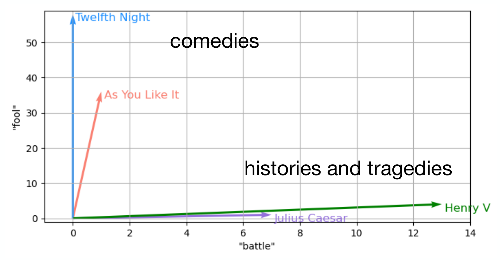

The comedies point along the "fool" axis; the histories and tragedies point along the "battle" axis.

---

## Vector similarity – review

We have many notions of **similarity** that can be used to compare vectors $\mathbf{x} = \begin{bmatrix} x_1 \\ x_2 \end{bmatrix}$, $\mathbf{y} = \begin{bmatrix} y_1 \\ y_2 \end{bmatrix}$:

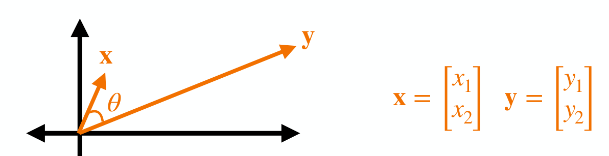

- **Euclidean distance:** $\|\mathbf{x} - \mathbf{y}\| = \sqrt{(x_1 - y_1)^2 + (x_2 - y_2)^2}$
- **Dot product:** $\mathbf{x}^\top \mathbf{y} = \langle \mathbf{x}, \mathbf{y} \rangle = x_1 y_1 + x_2 y_2$
- **Cosine similarity:** $\mathbf{x}^\top \mathbf{y} = \|\mathbf{x}\|\|\mathbf{y}\| \cos(\theta)$, so

$$\cos(\theta) = \frac{\mathbf{x}^\top \mathbf{y}}{\|\mathbf{x}\|\|\mathbf{y}\|} = \frac{x_1 y_1 + x_2 y_2}{\sqrt{x_1^2 + x_2^2}\,\sqrt{y_1^2 + y_2^2}}$$

---

# Vectors

**Big picture question:** how do we **represent** the meaning of words as **vectors**?

**Example:** which words are most similar: "the", "cat", "dog", "animal"?

**Goal:** we want to construct (or learn) a vector representation of every word.

$$\text{"the"} = \begin{bmatrix} 0.325 \\ 0.109 \\ 0.255 \\ 0.881 \end{bmatrix} \quad \text{"cat"} = \begin{bmatrix} -0.855 \\ -0.009 \\ 0.431 \\ 0.218 \end{bmatrix} \quad \text{"dog"} = \begin{bmatrix} -0.897 \\ -0.151 \\ 0.545 \\ 0.133 \end{bmatrix} \quad \text{"animal"} = \begin{bmatrix} -0.723 \\ -0.207 \\ 0.629 \\ -0.033 \end{bmatrix}$$

similarity(cat, dog) > similarity(cat, animal) > similarity(cat, the)

---

## Words as discrete symbols

For the bag of words model, we make the assumption that all words are **discrete**.

This idea is known as **one-hot encoding**. Each word vector has one 1, the rest 0s:

```
 tree = [0, 0, 0, 0, 0, 0, 1, 0]
  cat = [0, 0, 1, 0, 0, 0, 0, 0]
tiger = [0, 0, 0, 0, 1, 0, 0, 0]
```

Any problems with this model?

- Vectors are **orthogonal** and contain no notion of similarity, i.e. $w_i^\top w_j = 0 \;\; \forall i, j,\ i \neq j$
- Vector dimension = number of words in vocabulary (usually > 100,000)

---

## Word vectors

Let $\mathbf{w}_i \in \mathbb{R}^d$ be a vector representing the $i^{\text{th}}$ word:

$$\mathbf{w}_i = [x_1, x_2, x_3, \dots, x_d]^\top$$

We want to construct **dense vectors** that meaningfully encode each word.

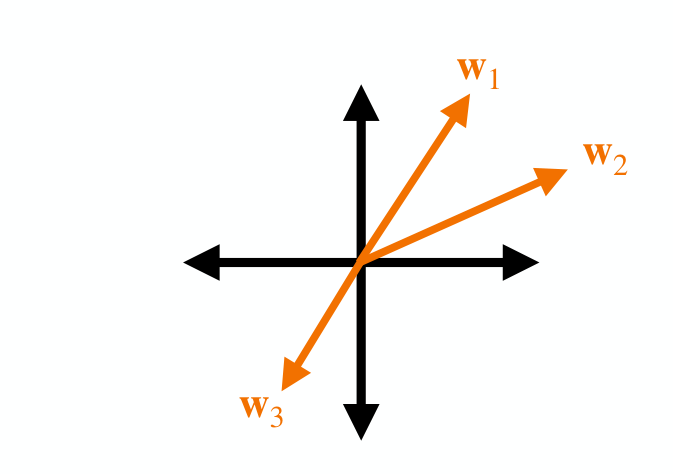

Desired properties:
- Dimensionality of the vectors $d \ll$ number of words
- Words with similar meaning have similar vectors

---

## Word vectors – visualization

$$\text{cat} = [0.325, -0.109, -0.255, 0.881, 0.017, 0.627, -0.390, 0.424, \dots, -0.920]^\top, \qquad \mathbf{x} \in \mathbb{R}^{200}$$

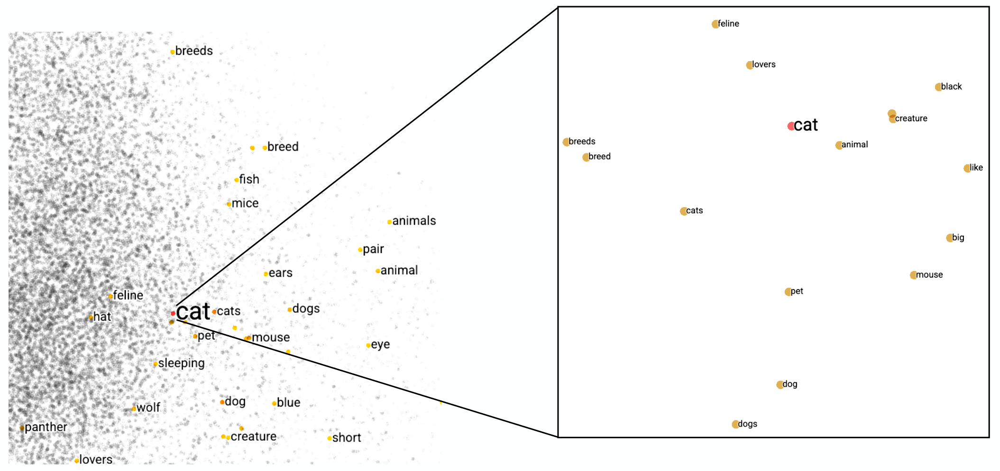

Vocabulary $V$ = 10,000; the zoomed-in view shows the 15 nearest neighbors of "cat".

Let's look at **word embeddings**: <https://projector.tensorflow.org/>

---

## How to represent the meaning of a word?

- **Definition (meaning)** – the idea represented by a word or phrase
- **Denotational semantics** – pairing between a signifier (word) and signified (idea):
  tree ⇔ {🌲, 🌳, 🌴}

Construct representation by similarities from semantics (e.g., synonyms):
- synonyms: car/automobile; antonyms: dark/light
- words that are not synonyms or antonyms but share some meaning, e.g. cat/dog, car/bicycle
- and words that are not similar but are still related, e.g. coffee/cup, chef/menu

---

## Word meaning from linguistic tools

**WordNet:** a lexical database of semantic relations — <https://wordnet.princeton.edu/>

Synonym sets, word associations, hierarchy, categories.

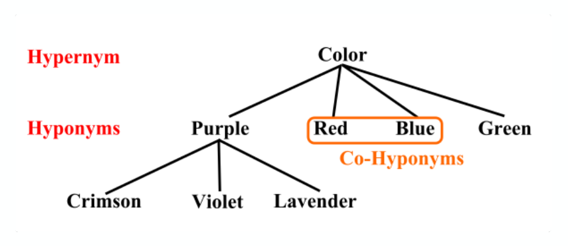

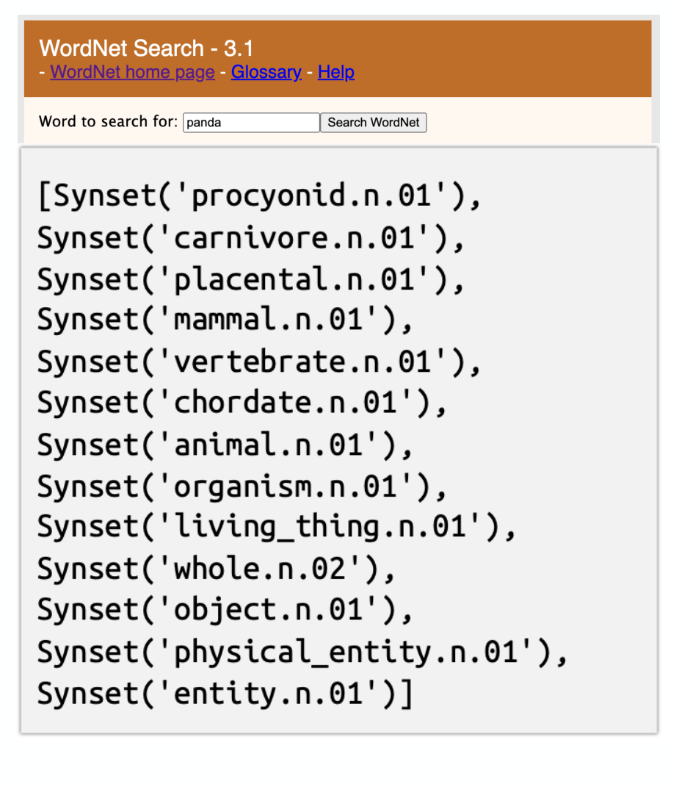

Great resource, but requires human annotations, words are constantly changing, lacks nuance (e.g., abstracts), and has no inherent numerical structure.

---

## Representing words by context

**Distributional semantics:** a word's **meaning** is given by the words that **frequently** appear close-by.

> "You shall know a word by the company it keeps" (J. R. Firth 1957: 11)


One of the most successful ideas in modern statistical NLP.

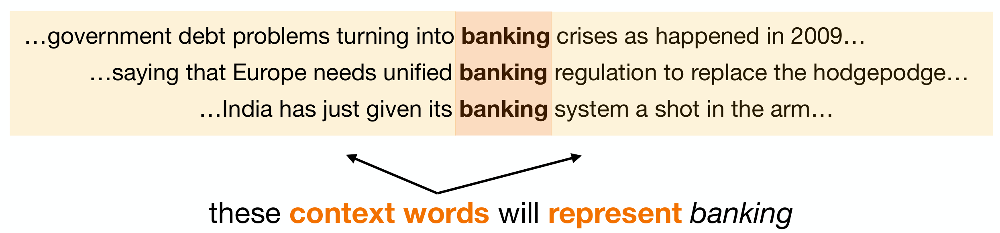

These **context words** will **represent** *banking*.

---

## Distributional hypothesis

**"Ong choy"**
- Ong choy is delicious sautéed with garlic
- Ong choy is superb over rice
- Ong choy leaves with salty sauces

You may have previously seen:
- spinach **sautéed with garlic over rice**
- chard stems and **leaves** are **delicious**
- collard greens and other **salty** leafy greens


*Ipomoea aquatica*, widely known as water spinach.

---

## Word vectors from co-occurrence matrix

How can we employ the distributional hypothesis computationally?

**Idea:** accumulate statistics for what words appear near each other.

Each column (word) contains counts of how often $w_i$ appears next to $w_j$. There's a choice of how many context words to include in the counting (**window size**).

Example corpus: "I like statistics", "I like NLP", "I enjoy coffee"

| count | I | like | statistics | NLP | enjoy | coffee |
|---|:-:|:-:|:-:|:-:|:-:|:-:|
| **I** | 0 | 2 | 0 | 0 | 1 | 0 |
| **like** | 2 | 0 | 1 | 1 | 0 | 0 |
| **statistics** | 0 | 1 | 0 | 0 | 0 | 0 |
| **NLP** | 0 | 1 | 0 | 0 | 0 | 0 |
| **enjoy** | 1 | 0 | 0 | 0 | 0 | 1 |
| **coffee** | 0 | 0 | 0 | 0 | 1 | 0 |

---

::: {.callout-warning}
## DCP3
:::


## Improving the co-occurrence matrix

**Problem 1** – raw counts lead to bad vector representations.
- Frequency is clearly useful information, but overly frequent words are not informative context words.
- Solution: introduce a **weighted function**.

**Problem 2** – the co-occurrence matrix $A \in \mathbb{R}^{|V| \times |V|}$ is large and sparse.
- Solution: introduce the **Singular Value Decomposition (SVD)**.

---


# Pointwise Mutual Information

Problem 1 – raw counts lead to bad vector representations.

Instead we will introduce **Pointwise Mutual Information (PMI)**:

$$\text{PMI}(w_1, w_2) = \log_2 \frac{P(w_1, w_2)}{P(w_1)\,P(w_2)}$$

Do *word 1* and *word 2* co-occur more or less than if they were independent?

- $\text{PMI}(w_1, w_2) > 0 \Rightarrow P(w_1, w_2) > P(w_1)P(w_2)$
- $\text{PMI}(w_1, w_2) < 0 \Rightarrow P(w_1, w_2) < P(w_1)P(w_2)$

Typically we use **Positive** Pointwise Mutual Information:

$$\text{PPMI}(w_1, w_2) = \max\left(\log_2 \frac{P(w_1, w_2)}{P(w_1)\,P(w_2)},\ 0\right)$$

---

## Pointwise Mutual Information (example)

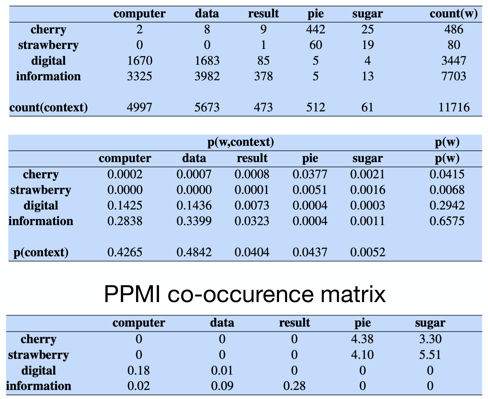

$$\text{PPMI}(w, c) = \max\left(\log_2 \frac{P(w, c)}{P(w)\,P(c)},\ 0\right)$$

PPMI(information, data) = ?

- $P(w = \text{information}, c = \text{data}) = 3982 / 11716 = 0.3399$
- $P(w = \text{information}) = 7703 / 11716 = 0.6575$
- $P(c = \text{data}) = 5677 / 11716 = 0.4842$

$$\log_2\left(\frac{0.3399}{0.6575 \cdot 0.4842}\right) \approx 0.09$$

---

## Augmented co-occurrence matrix

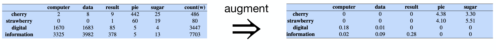

Problem 2 – the co-occurrence matrix is large and sparse:
- Very **high-dimensional**, $A \in \mathbb{R}^{100{,}000 \times 100{,}000}$ (requires a lot of memory even though sparse)
- Can be less robust for some models. How to reduce the dimensionality?

---


# Quo Vadimus?

:::: {.columns}

::: {.column width="50%"}
* due this Friday (Nov 6):

    - Precept 7 (1.5 hours)
    - Multipass: DeepSeek (20 minutes)
    - Literature Search (10 minutes)
    
        - one per person
    
* exam: Nov 18
  
:::

::: {.column width="10%"}
	
:::

::: {.column width="40%"}


* image source: [GenAI Academy](https://www.linkedin.com/feed/update/urn:li:activity:7521482762902593536/)
:::

::::


# Footnotes

::: {.callout-note collapse="true"}

## (optional) Additional Resources and References

* Today's slides were adapted by lectures by DataX postdocs Eric Verkebe and Giuseppe Ferro

   - which in turn adapted from materials by Dan Jurafsky, Chris Manning and Karthik Narasimhan

:::


::: {.callout-note collapse="true"}
## Session Info

```{r}
sessionInfo()
```
:::


:::: {.columns}

::: {.column width="45%"}
	
:::

::: {.column width="10%"}
	
:::

::: {.column width="45%"}

:::

::::

::::: {.panel-tabset}


:::::