```{r}
#| echo: false
#| message: false
#| warning: false

```

# 17: NLP (Word2Vec)

## Learning objectives:

:::: {.columns}

::: {.column width="45%"}
- Motivate natural language processing
- Explore the early adapations
- Compute word frequencies
:::

::: {.column width="10%"}

:::

::: {.column width="45%"}
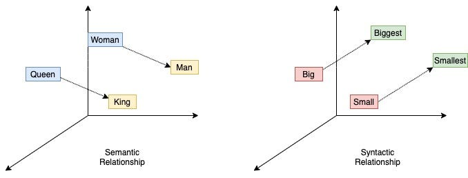

* image source: [Nikhil Birajar](https://towardsdatascience.com/word2vec-research-paper-explained-205cb7eecc30/)
:::

::::


# Vectors

**Big picture question:** how do we **represent** the meaning of words as **vectors**?

**Example:** which words are most similar: "the", "cat", "dog", "animal"?

**Goal:** we want to construct (or learn) a vector representation of every word.

$$\text{"the"} = \begin{bmatrix} 0.325 \\ 0.109 \\ 0.255 \\ 0.881 \end{bmatrix} \quad \text{"cat"} = \begin{bmatrix} -0.855 \\ -0.009 \\ 0.431 \\ 0.218 \end{bmatrix} \quad \text{"dog"} = \begin{bmatrix} -0.897 \\ -0.151 \\ 0.545 \\ 0.133 \end{bmatrix} \quad \text{"animal"} = \begin{bmatrix} -0.723 \\ -0.207 \\ 0.629 \\ -0.033 \end{bmatrix}$$

similarity(cat, dog) > similarity(cat, animal) > similarity(cat, the)

---

## Words as discrete symbols

For the bag of words model, we make the assumption that all words are **discrete**.

This idea is known as **one-hot encoding**. Each word vector has one 1, the rest 0s:

```
 tree = [0, 0, 0, 0, 0, 0, 1, 0]
  cat = [0, 0, 1, 0, 0, 0, 0, 0]
tiger = [0, 0, 0, 0, 1, 0, 0, 0]
```

Any problems with this model?

- Vectors are **orthogonal** and contain no notion of similarity, i.e. $w_i^\top w_j = 0 \;\; \forall i, j,\ i \neq j$
- Vector dimension = number of words in vocabulary (usually > 100,000)

---

## Word vectors

Let $\mathbf{w}_i \in \mathbb{R}^d$ be a vector representing the $i^{\text{th}}$ word:

$$\mathbf{w}_i = [x_1, x_2, x_3, \dots, x_d]^\top$$

We want to construct **dense vectors** that meaningfully encode each word.

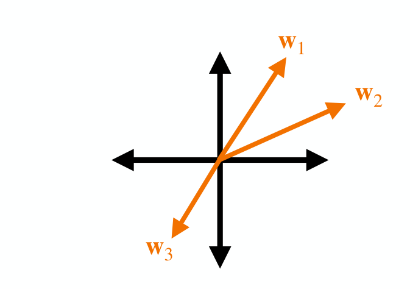

Desired properties:
- Dimensionality of the vectors $d \ll$ number of words
- Words with similar meaning have similar vectors

---

## Word vectors – visualization

$$\text{cat} = [0.325, -0.109, -0.255, 0.881, 0.017, 0.627, -0.390, 0.424, \dots, -0.920]^\top, \qquad \mathbf{x} \in \mathbb{R}^{200}$$

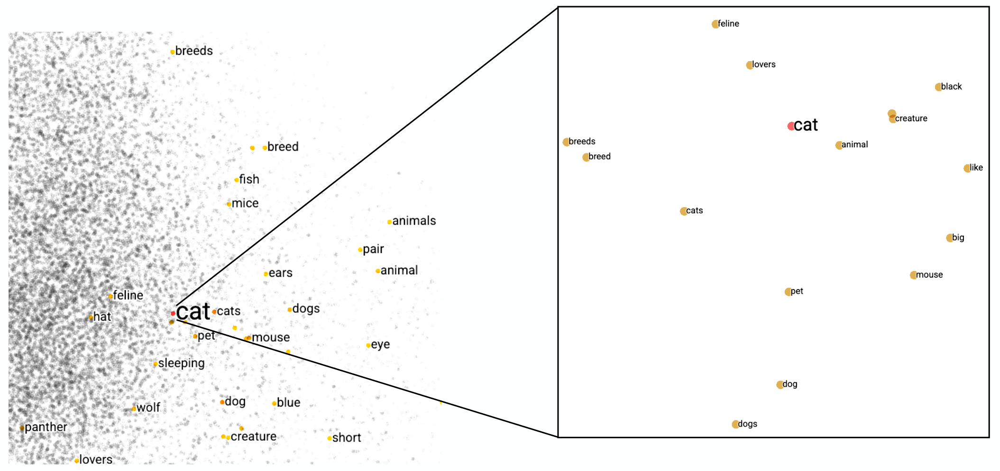

Vocabulary $V$ = 10,000; the zoomed-in view shows the 15 nearest neighbors of "cat".

Let's look at **word embeddings**: <https://projector.tensorflow.org/>

---

## How to represent the meaning of a word?

- **Definition (meaning)** – the idea represented by a word or phrase
- **Denotational semantics** – pairing between a signifier (word) and signified (idea):
  tree ⇔ {🌲, 🌳, 🌴}

Construct representation by similarities from semantics (e.g., synonyms):
- synonyms: car/automobile; antonyms: dark/light
- words that are not synonyms or antonyms but share some meaning, e.g. cat/dog, car/bicycle
- and words that are not similar but are still related, e.g. coffee/cup, chef/menu

---

## Word meaning from linguistic tools

**WordNet:** a lexical database of semantic relations — <https://wordnet.princeton.edu/>

Synonym sets, word associations, hierarchy, categories.

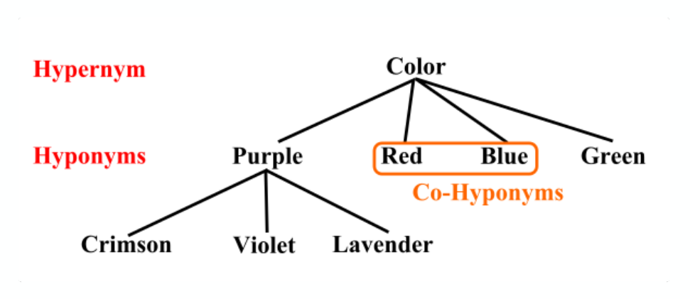

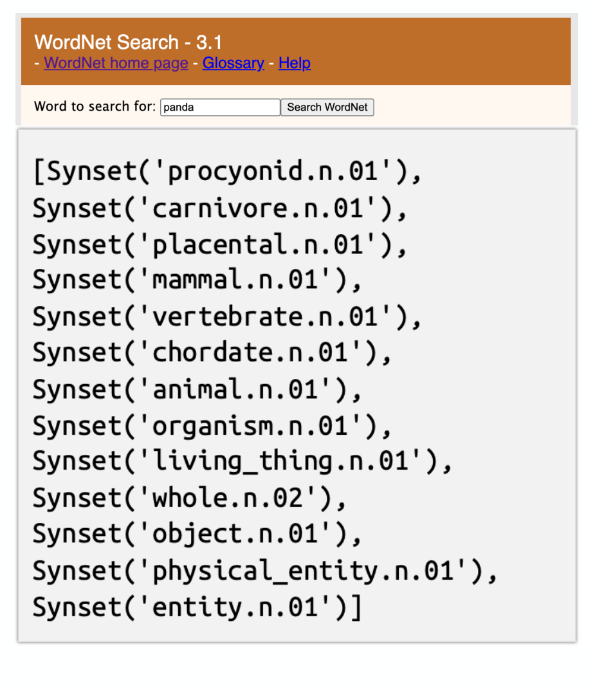

Great resource, but requires human annotations, words are constantly changing, lacks nuance (e.g., abstracts), and has no inherent numerical structure.

---

## Representing words by context

**Distributional semantics:** a word's **meaning** is given by the words that **frequently** appear close-by.

> "You shall know a word by the company it keeps" (J. R. Firth 1957: 11)


One of the most successful ideas in modern statistical NLP.

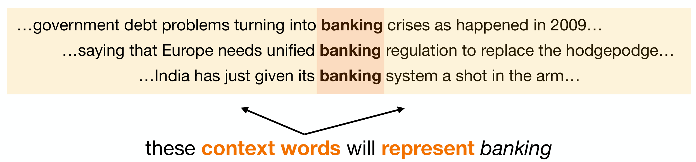

These **context words** will **represent** *banking*.

---

## Distributional hypothesis

**"Ong choy"**
- Ong choy is delicious sautéed with garlic
- Ong choy is superb over rice
- Ong choy leaves with salty sauces

You may have previously seen:
- spinach **sautéed with garlic over rice**
- chard stems and **leaves** are **delicious**
- collard greens and other **salty** leafy greens


*Ipomoea aquatica*, widely known as water spinach.

---

## Word vectors from co-occurrence matrix

How can we employ the distributional hypothesis computationally?

**Idea:** accumulate statistics for what words appear near each other.

Each column (word) contains counts of how often $w_i$ appears next to $w_j$. There's a choice of how many context words to include in the counting (**window size**).

Example corpus: "I like statistics", "I like NLP", "I enjoy coffee"

| count | I | like | statistics | NLP | enjoy | coffee |
|---|:-:|:-:|:-:|:-:|:-:|:-:|
| **I** | 0 | 2 | 0 | 0 | 1 | 0 |
| **like** | 2 | 0 | 1 | 1 | 0 | 0 |
| **statistics** | 0 | 1 | 0 | 0 | 0 | 0 |
| **NLP** | 0 | 1 | 0 | 0 | 0 | 0 |
| **enjoy** | 1 | 0 | 0 | 0 | 0 | 1 |
| **coffee** | 0 | 0 | 0 | 0 | 1 | 0 |

---


## Improving the co-occurrence matrix

**Problem 1** – raw counts lead to bad vector representations.
- Frequency is clearly useful information, but overly frequent words are not informative context words.
- Solution: introduce a **weighted function**.

**Problem 2** – the co-occurrence matrix $A \in \mathbb{R}^{|V| \times |V|}$ is large and sparse.
- Solution: introduce the **Singular Value Decomposition (SVD)**.

---

::: {.callout-warning}
## DCP1
:::


# Pointwise Mutual Information

Problem 1 – raw counts lead to bad vector representations.

Instead we will introduce **Pointwise Mutual Information (PMI)**:

$$\text{PMI}(w_1, w_2) = \log_2 \frac{P(w_1, w_2)}{P(w_1)\,P(w_2)}$$

Do *word 1* and *word 2* co-occur more or less than if they were independent?

- $\text{PMI}(w_1, w_2) > 0 \Rightarrow P(w_1, w_2) > P(w_1)P(w_2)$
- $\text{PMI}(w_1, w_2) < 0 \Rightarrow P(w_1, w_2) < P(w_1)P(w_2)$

Typically we use **Positive** Pointwise Mutual Information:

$$\text{PPMI}(w_1, w_2) = \max\left(\log_2 \frac{P(w_1, w_2)}{P(w_1)\,P(w_2)},\ 0\right)$$

---

## Pointwise Mutual Information (example)

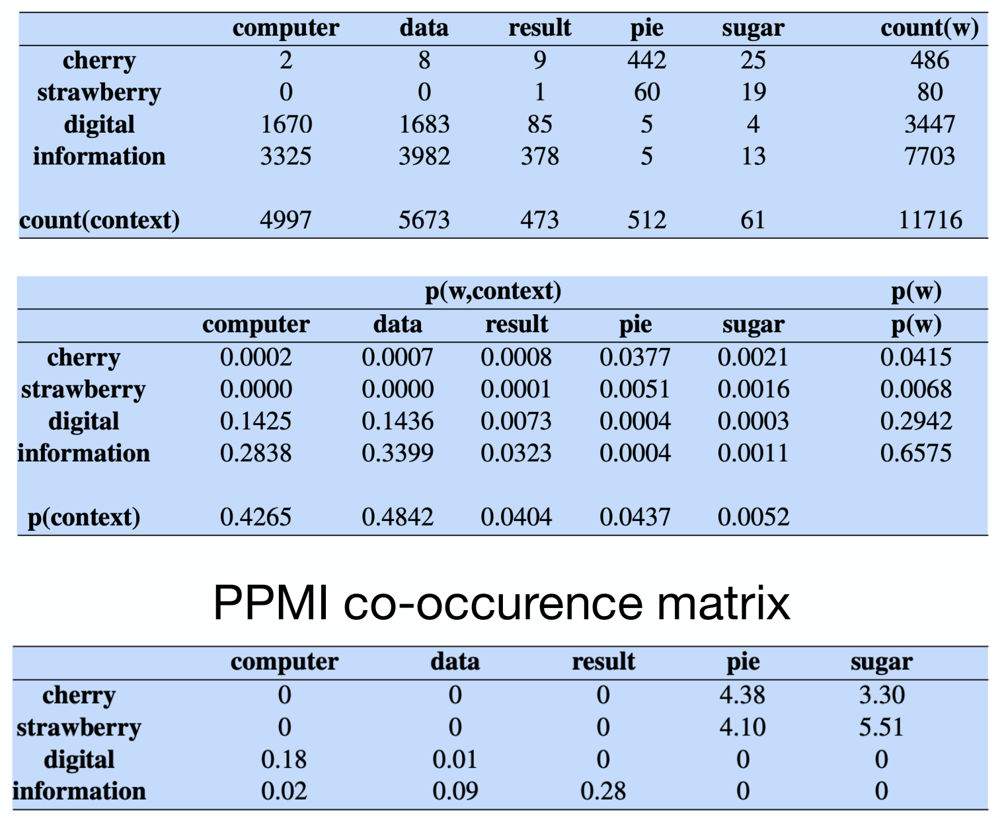

$$\text{PPMI}(w, c) = \max\left(\log_2 \frac{P(w, c)}{P(w)\,P(c)},\ 0\right)$$

PPMI(information, data) = ?

- $P(w = \text{information}, c = \text{data}) = 3982 / 11716 = 0.3399$
- $P(w = \text{information}) = 7703 / 11716 = 0.6575$
- $P(c = \text{data}) = 5677 / 11716 = 0.4842$

$$\log_2\left(\frac{0.3399}{0.6575 \cdot 0.4842}\right) \approx 0.09$$

---

## Augmented co-occurrence matrix

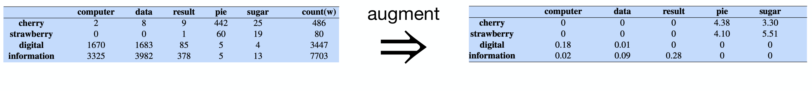

Problem 2 – the co-occurrence matrix is large and sparse:
- Very **high-dimensional**, $A \in \mathbb{R}^{100{,}000 \times 100{,}000}$ (requires a lot of memory even though sparse)
- Can be less robust for some models. How to reduce the dimensionality?

---


# Learning word embeddings

**Word2vec:** a framework for learning word vectors (Mikolov et al. 2013)

- **Input:** a large text corpus, vocabulary $V$, vector dimension size $d$
- **Output:** $f : V \to \mathbb{R}^d$

**Key idea:** **predict** the probability of context words rather than count.

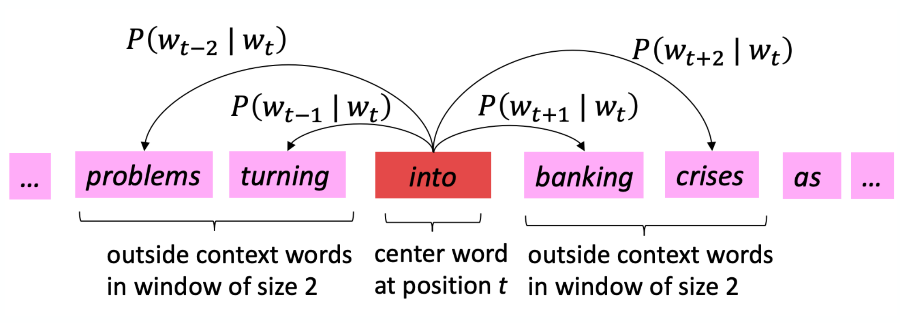

---

## Word2vec: objective function (1)

For each position $t = 1, \dots, T$, **predict** context words within a window of fixed size $m$, given center word $w_t$. This is the data likelihood:

$$\text{Likelihood} = L(\Theta) = \prod_{t=1}^{T} \prod_{\substack{-m \le j \le m \\ j \neq 0}} P(w_{t+j} \mid w_t ; \Theta)$$

We want to **maximize** the likelihood $L(\Theta)$ of predicting the outer context words ($w_o$) given the center word ($w_c$).

---

## Word2vec: objective function (2)

How to calculate $P(w_{t+j} \mid w_t ; \Theta)$?

We define two vectors for each word:
- $w_o$ for when the word is an **outside** (context) word
- $w_c$ for when the word is the **center** word

Then for a center word $c$ and an outside context word $o$:

$$P(w_o \mid w_c) = \frac{\exp(w_o^T w_c)}{\sum_{w \in V} \exp(w_o^T w_c)}$$

---

## Word2vec: model training

To train the model, we gradually **adjust** the parameters $\Theta$ to **maximize** the likelihood (or equivalently, minimize the loss):

$$\Theta = \begin{bmatrix} w_{\text{aardvark}} \\ \vdots \\ w_{\text{zebra}} \\ u_{\text{aardvark}} \\ \vdots \\ u_{\text{zebra}} \end{bmatrix} \in \mathbb{R}^{2|V| \times d}$$

The top half holds the center-word vectors and the bottom half the outside-word vectors.

We **optimize** the parameters by using stochastic gradient descent.

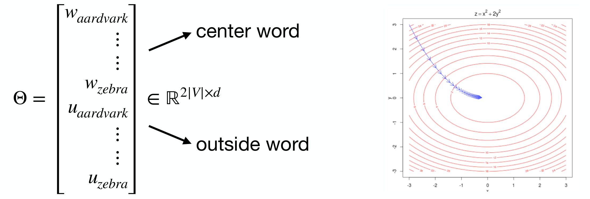

---

## Word vector applications

Trained word embeddings are available:
- word2vec: <https://code.google.com/archive/p/word2vec/>
- GloVe: <https://nlp.stanford.edu/projects/glove/>

Easy-to-use Python libraries:

```python
def load_embedding_model():
    """
    Load GloVe Vectors
    Return:
        wv_from_bin: All 400000 embeddings, each length 200
    """
    import gensim.downloader as api
    wv_from_bin = api.load("glove-wiki-gigaword-200")
    print("Loaded vocab size %i" % len(list(wv_from_bin.index_to_key)))
    return wv_from_bin

wv_from_bin = load_embedding_model()
```

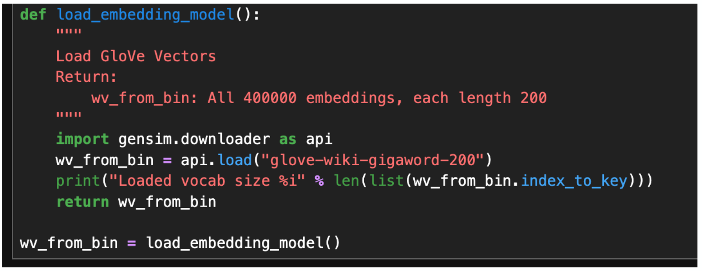

---

## Word vector applications (classification)

Classifying the sentence "I don't like this movie":

**Naive Bayes**

$$\hat{P}(x_i \mid c_j) = \frac{\text{Count}(x_i, c_j)}{\sum_{x \in V} \text{Count}(x, c_j)} \qquad \hat{c} = \arg\max_c \sum_{i}^{n} \log \hat{P}(x_i \mid c_j) + \log \hat{P}(c_j)$$

**Word vectors**

$$\underset{\text{I}}{\begin{bmatrix} 0.17 \\ 0.28 \end{bmatrix}} \underset{\text{don't}}{\begin{bmatrix} -0.31 \\ 0.95 \end{bmatrix}} \underset{\text{like}}{\begin{bmatrix} -0.28 \\ -0.26 \end{bmatrix}} \underset{\text{this}}{\begin{bmatrix} 0.51 \\ -0.43 \end{bmatrix}} \underset{\text{movie}}{\begin{bmatrix} 0.74 \\ 0.63 \end{bmatrix}}$$

$$\text{vec}(s) = w_1 + \dots + w_n$$

Then predict from a classifier using $\text{vec}(s)$.

---

# Language models

**Language modeling** is the task of predicting text:
- Predict the probability of the next word in a sentence, $P(w_i \mid s)$
- Predict the probability of a sentence, $P(s) = P(w_1, w_2, w_3, \dots, w_n)$

Two kinds we'll look at:
1. *n*-gram language models
2. Language models using neural networks

---

## Language models are everywhere

Google search autocomplete, phone keyboard next-word suggestions, ChatGPT, Grammarly.

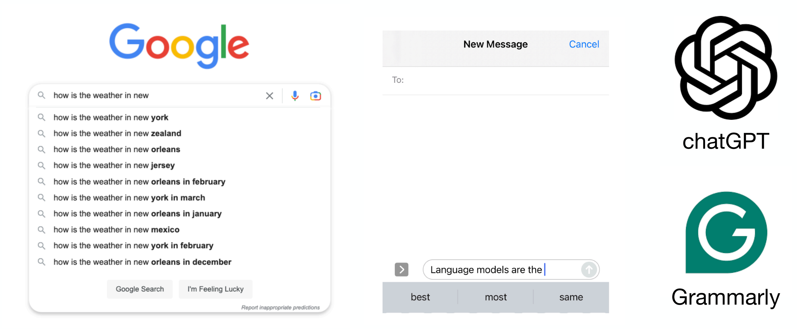

---

::: {.callout-warning}
## DCP2

[Word2Vec demo](https://remykarem.github.io/word2vec-demo/) by Raimi
:::


# Probability: Review

Recall the definition of **conditional probability**:

$$P(w_2 \mid w_1) = \frac{P(w_1, w_2)}{P(w_1)} \quad\text{rewriting}\quad P(w_1, w_2) = P(w_1)\,P(w_2 \mid w_1)$$

With more variables:

$$P(w_1, w_2, w_3) = P(w_1)\,P(w_2 \mid w_1)\,P(w_3 \mid w_1, w_2)$$

The **chain rule** generally:

$$P(w_1, w_2, w_3, \dots, w_n) = P(w_1)\,P(w_2 \mid w_1)\,P(w_3 \mid w_1, w_2) \cdots P(w_n \mid w_1, \dots, w_{n-1})$$

- This assumes an implicit order of words in a sentence.

---

## Word probability example

Consider we have a large corpus of text, and we want to estimate $P(w_i \mid w_{i-1})$.

"The blue ______": what is $P(\text{sky} \mid \text{blue})$?

Compute word/phrase probabilities by **counting** (similar to naive Bayes):

$$P(w_i \mid w_{i-1}) = \frac{P(w_{i-1}, w_i)}{P(w_{i-1})}$$

$$P(\text{sky} \mid \text{blue}) = \frac{P(\text{blue sky})}{P(\text{blue})} = \frac{\text{count(blue sky)}}{\text{count(blue)}} = \frac{50}{200} = 0.25$$

Is this something we can reasonably expect to compute?

---

## Estimating word probabilities

Seems like a daunting task. Let's consider the **space** of text data.

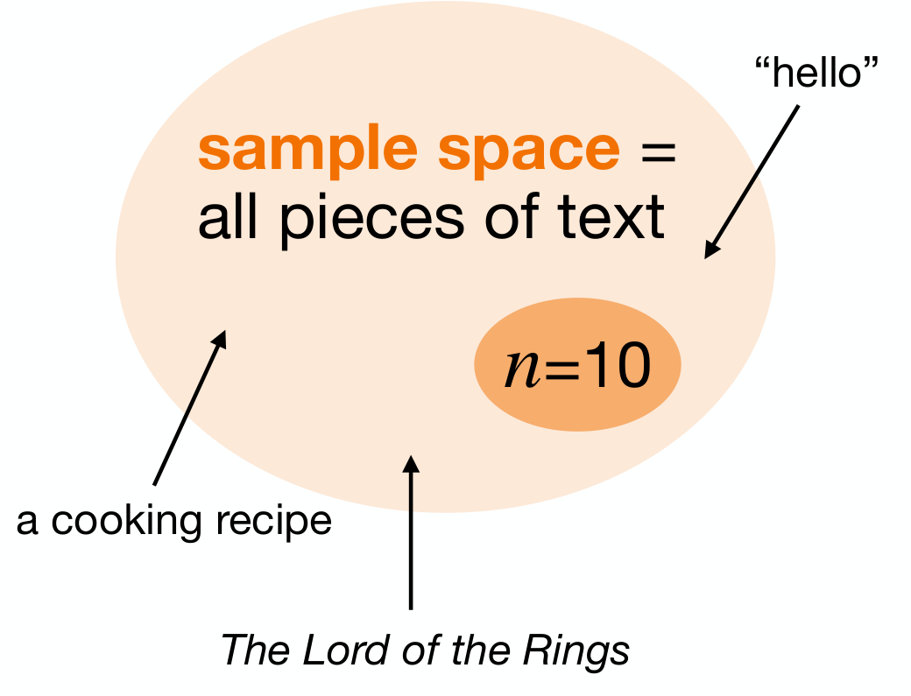

How likely is any word, phrase or document?

- Given a vocabulary of size $V$ and sentence length $n$, the number of sentences of length $n$ is $V^n$
- Consider sentences of length $n = 10$
- A typical English vocabulary is ≈ 40k words
- Then the number of possible sequences is $\approx 4 \times 10^{50}$ ≈ the number of atoms in the Earth

---

## Markov assumption

Use only the **recent past** to predict the next word.

Consider the sentence "the sky is blue":

$$P(\text{the sky is blue}) = P(\text{the})\,P(\text{sky} \mid \text{the})\,P(\text{is} \mid \text{the sky})\,P(\text{blue} \mid \text{the sky is})$$

- 1st order: $P(\text{blue} \mid \text{the sky is}) \approx P(\text{blue} \mid \text{is})$
- 2nd order: $P(\text{blue} \mid \text{the sky is}) \approx P(\text{blue} \mid \text{sky is})$

This reduces the number of estimated parameters in exchange for model capacity.

---

## k<sup>th</sup> order Markov model

Consider only the last *k* words for context (truncated context words):

$$P(w_i \mid w_1, w_2, \dots, w_{i-1}) \approx P(w_i \mid w_{i-k}, \dots, w_{i-1})$$

This implies that the probability of a sequence is:

$$P(w_1, \dots, w_n) \approx \prod_i P(w_i \mid w_{i-k}, \dots, w_{i-1})$$

We only need to estimate the counts for *k*-grams in text.

---

# *n*-gram language model

A representation model that considers contiguous sections of words in a text.

- **Unigram:** $P(w_1, \dots, w_n) = \prod_{i}^{n} P(w_i)$, e.g. P(the) P(sky) P(is)
- **Bigram:** $P(w_1, \dots, w_n) = \prod_{i}^{n} P(w_i \mid w_{i-1})$, e.g. P(the) P(sky | the) P(is | sky)
- Trigram, 4-gram, and so on

Notes:
- Larger *n* gives a more accurate model, but also higher computational costs
- Assumes we have enough data to build a model
- How much context is enough? *n*-grams can't handle **long-distance dependencies**, e.g. "**The soups** that I made from that new cookbook I bought yesterday **were** delicious"

---

## Generating from a language model (sampling)

Given a language model, how do we **generate** a sequence?

E.g., using a bigram model, $P(w_1, \dots, w_n) = \prod_{i}^{n} P(w_i \mid w_{i-1})$:

1. Generate the 1st word: $w_1 \sim P(w)$
2. Generate the 2nd word: $w_2 \sim P(w \mid w_1)$
3. Generate the 3rd word: $w_3 \sim P(w \mid w_2)$
4. Generate the 4th word …

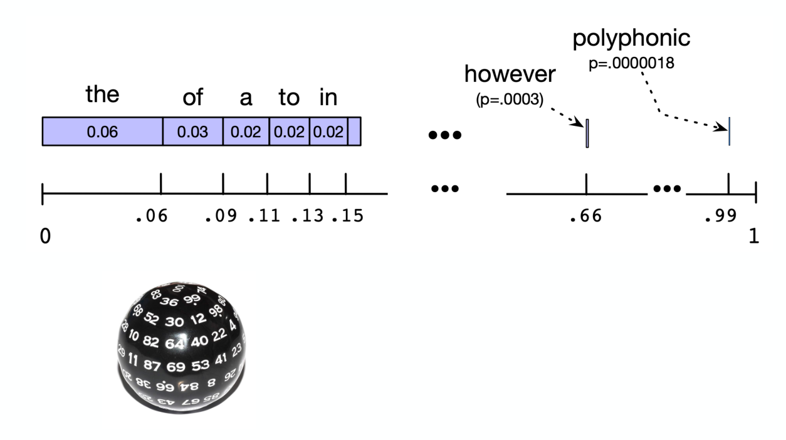

---

## Example of *n*-gram language model

Text generated by models trained on 40 million words from the Wall Street Journal:

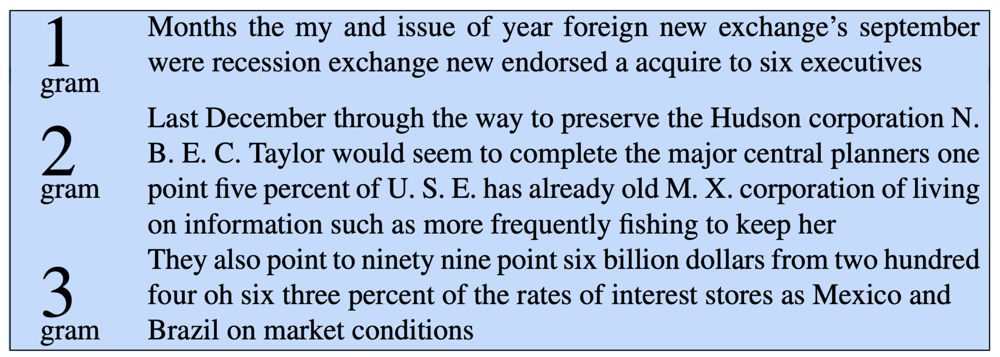

- **1-gram:** "Months the my and issue of year foreign new exchange's september were recession exchange new endorsed a acquire to six executives"
- **2-gram:** "Last December through the way to preserve the Hudson corporation N. B. E. C. Taylor would seem to complete the major central planners one point five percent of U. S. E. has already old M. X. corporation of living on information such as more frequently fishing to keep her"
- **3-gram:** "They also point to ninety nine point six billion dollars from two hundred four oh six three percent of the rates of interest stores as Mexico and Brazil on market conditions"

---

## Generating from a language model (decoding)

"The sky is ______"

**Greedy:** choose the most likely word:

$$w_4 = \arg\max_{w_i \in V} P(w_i \mid w_1, w_2, w_3)$$

**Top-k:** choose among the *k* most likely words.

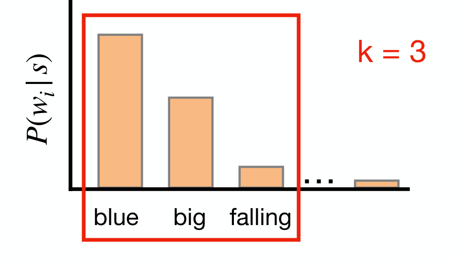

---

## Example of *n*-gram language model

Suppose we are learning a **4-gram** language model.

"as the proctor started the clock, the students opened their ______"

A 4-gram model only conditions on the last three words, "students opened their", and discards the rest.

---

## Sparsity problem with *n*-grams

$$P(w \mid \text{students opened their}) = \frac{\text{Count(students opened their } w)}{\text{Count(students opened their)}}$$

- What if "students opened their *w*" never occurred in the training dataset? Then *w* has probability zero!
- What if "students opened their" never occurred in the training dataset? Then we can't calculate the probability at all.
  - We can try conditioning on less text, known as the "**backoff**" approach.
- Increasing *n* makes the sparsity problem worse. Typically limit to *n* = 5.
- Increasing *n* also makes the storage problem worse.

---

# Neural language model

How to build a neural language model?

- **Input:** sequences of words, $x_1, x_2, x_3, \dots, x_4$
- **Output:** probability distribution of the next word, $P(x_i \mid x_1, \dots, x_{i-1})$

**Approach:** let's use a fixed window of context represented with word embeddings.

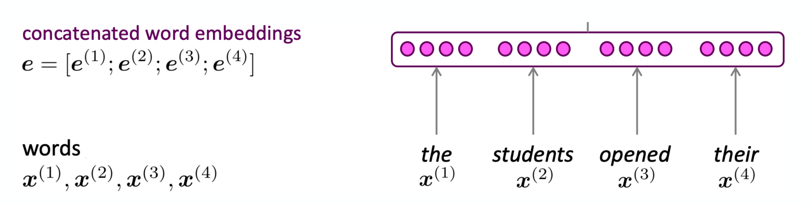

---

## Neural language model – fixed window

Fixed-window based approach (similar idea to *n*-gram):

- **Words:** $x^{(1)}, x^{(2)}, x^{(3)}, x^{(4)}$
- **Concatenated word embeddings:** $e = [e^{(1)}; e^{(2)}; e^{(3)}; e^{(4)}]$
- **Hidden layer:** $h = f(We + b_1)$
- **Output distribution:** $\hat{y} = \text{softmax}(Uh + b_2) \in \mathbb{R}^{|V|}$

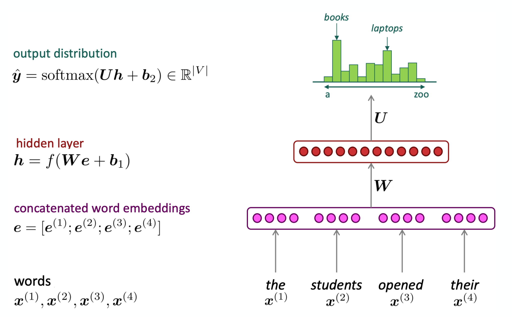

---

## Neural language model – pros and cons

Improvements over *n*-gram LMs:
- No sparsity problem
- Don't need to store all observed *n*-grams

Remaining problems:
- Fixed window is too small
- Increasing the window increases $W$

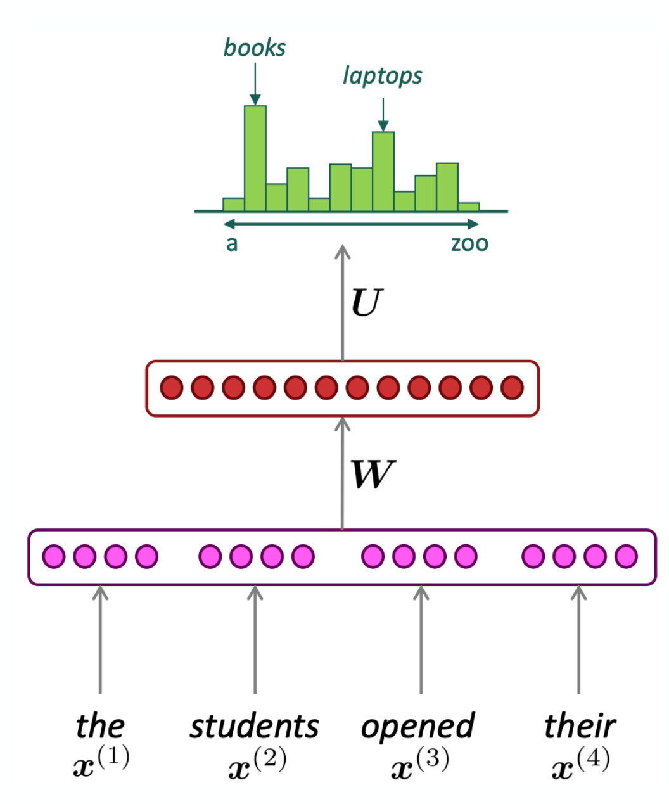

---

## Language model evaluation

How do we define the quality of language models? Similar to word vector models, we define both **extrinsic** and **intrinsic** evaluation.

- **Extrinsic** = validate on a specific task and measure accuracy (e.g., model A vs. B)
- **Intrinsic** = measure model accuracy on an intermediate task
  - Measure accuracy of predicting words in an unseen test set
  - The metric for evaluation is **perplexity**
  - Gives a single metric for evaluating LMs

---

## Intrinsic evaluation – motivation

**Goal:** model $P(w_1, w_2, \dots, w_n)$ or $P(w_k \mid w_1, \dots, w_{k-1})$ accurately.

**Shannon game:** how well can we predict the next word?
- I always order pizza with cheese and ______
- The 33rd president of the US was ______
- Once upon a ______

A better language model assigns higher probability to the word that actually occurs. How do we measure this?

---

::: {.callout-warning}
## DCP3
:::


# Perplexity

A measure of how well a language model predicts the next word.

The intuition is that a good language model prefers "real" sentences over "rare" ones.

$$\text{Perplexity} = P(w_1, w_2, w_3, \dots, w_n)^{-1/n}$$

$$\text{Perplexity} = \exp\left(-\frac{1}{n} \sum_{i}^{n} \log P(w_i \mid w_1, \dots, w_{i-1})\right) \quad \text{(similar to cross-entropy)}$$

- Lower score is better: minimizing perplexity ≈ maximizing the probability of the corpus
- The score can be interpreted as an "average chance" of correctly assigning the next word

---

## LM perplexity results

Training corpus 38 million words, test corpus 1.5 million words, both WSJ:

| N-gram order | Unigram | Bigram | Trigram |
|---|:-:|:-:|:-:|
| Perplexity (test) | 962 | 170 | 109 |

Increasing *n* improves the model, but:
- worsens the sparsity problem
- and increases the model size

---

## Improving neural language models

Many new **architectures** have been introduced to improve language models:
- **Recurrent** neural networks (RNN)
  - Key idea is to use the same weights across layers
  - Long short-term memory (LSTM)
- **Transformers**
  - Key idea is self-attention blocks
  - Generative pre-trained transformers (GPT)

---


# Ethics Enclave: Categorization

::::: {.panel-tabset}

## ImageNet

:::: {.columns}

::: {.column width="45%"}

:::

::: {.column width="10%"}
	
:::

::: {.column width="45%"}
* Dr Fei Fei Li
* Princeton Class of 1999
* Pre-Read Selection for Class of 2028

> Biederman's number: "30,000 unique concepts might provide a complete foundation for understanding the visual world"

* ImageNet competition
* AlexNet: solved by convolutional neural networks in 2012

* **But who makes the categories?**

:::

::::

## Communities

:::: {.columns}

::: {.column width="45%"}
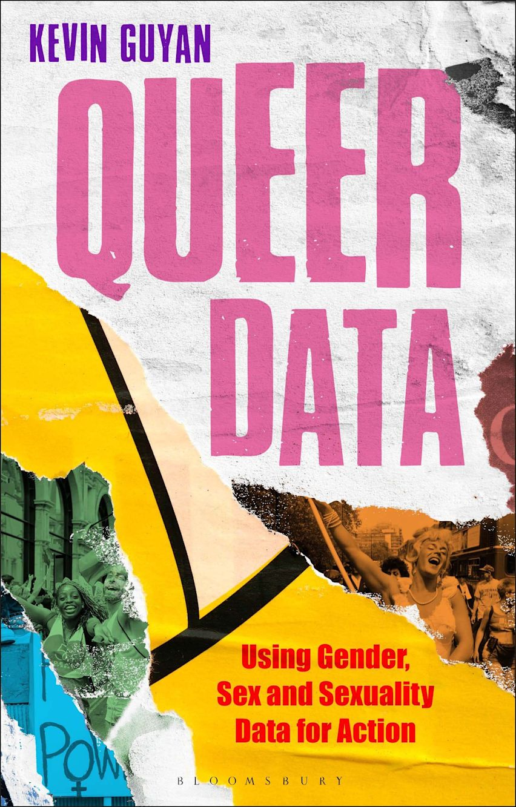
:::

::: {.column width="10%"}
	
:::

::: {.column width="45%"}
> Queer data emerges as the product of tension between categories and anti-categories, assimilation and difference, intrinsic qualities and social constructs, and individuals and populations

--- location 299


> the automated coding of open-text data and use of technologies, such as predictive-text, means that the provision of 'more responsive options' does not exacerbate the problem of small numbers nor risk diluting the uses of LGBTQ data for action

--- location 2654
:::

::::

## Labeling

:::: {.columns}

::: {.column width="45%"}

:::

::: {.column width="10%"}
	
:::

::: {.column width="45%"}
> ImageNet during its development in the late 2000s, was the largest single project hosted on the MTurk platform, according to Li.  It took two and a half years and nearly 50,000 workers across 167 countries to create the dataset.  In the end, the data contained over 14 million images, labeled across 22,000 categories.

--- page 60


:::

::::

## Subclasses

:::: {.columns}

::: {.column width="45%"}
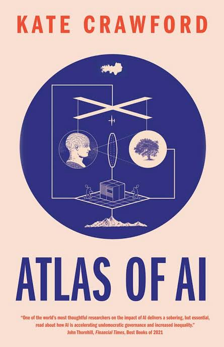
:::

::: {.column width="10%"}
	
:::

::: {.column width="45%"}
> recalls earlier harmful forms of categorization, such as the classification of homosexuality as a mental disorder in the *Diagnosic and Statistical Manual* ... removed it in 1973

--- page 137

> There is an ImageNet category for the term "Hermaphrodite", but it is situated within the branch Person -> Sensualist -> Bisexual alongside the categories "Pseudohermaphrodite" and "Switch Hitter".

--- page 137

> The ImageNet team ultimate removed 1593 of 2832 of the People categories---roughly 56 percent---deeming them 'unsafe', along with the associated 600,040 images.

--- page 140


:::

::::

## Evolution


:::::


# Summary of NLP section

Topics we covered:

- Challenges of working with language data
- How to compute meaningful word vectors
- How to predict words using language models


# Quo Vadimus?

:::: {.columns}

::: {.column width="50%"}
* due this Friday (Nov 13):

    - Precept 8 (1 hour)
    - Multipass: Literature Search (20 minutes)
    - Multipass: Literature Search (20 minutes)
    
        - i.e. each person reads two papers from their literature search
    
* exam: Nov 18

   - Refer to information page on our Canvas site
  
:::

::: {.column width="10%"}
	
:::

::: {.column width="40%"}


* image source: [Jakub Chrzanowski](https://www.linkedin.com/feed/update/urn:li:activity:7524331438758895616/)
:::

::::


# Footnotes

::: {.callout-note collapse="true"}

## (optional) Additional Resources and References

* Today's slides were adapted by lectures by DataX postdocs Eric Verkebe and Giuseppe Ferro

   - which in turn adapted from materials by Dan Jurafsky, Chris Manning and Karthik Narasimhan

:::


::: {.callout-note collapse="true"}
## Session Info

```{r}
sessionInfo()
```
:::


:::: {.columns}

::: {.column width="45%"}
	
:::

::: {.column width="10%"}
	
:::

::: {.column width="45%"}

:::

::::

::::: {.panel-tabset}


:::::